# المرجع الهندسي الشامل لمنظمة الموظفين الرقميين
## Baseline v1.1 — Founder's Single Source of Truth

---

| البند | القيمة |
|-------|--------|
| **عنوان الوثيقة** | المرجع الهندسي الشامل لمنظمة الموظفين الرقميين (AI Employee Organization Architecture) |
| **الإصدار** | Baseline v1.1 (ترقية معيارية شاملة من Baseline v1.0) |
| **الحالة** | APPROVED — معتمد وساري المفعول معمارياً |
| **المرجع الحاكم للترقية** | `docs/archive/MASTER_REFERENCE_v1.1_FINAL_GOVERNING_REWRITE_SPEC.md` |
| **المرجع التاريخي المقارن** | `docs/archive/MASTER_REFERENCE_v1.0.md` |
| **مستودع ونطاق التنفيذ** | `socroot-org/` (مستودع ونطاق تسمية مستقل وسيادي) |
| **حالة الاختبارات والتحقق** | 49/49 ✅ — نسبة نجاح 100% في البيئة المرجعية المعتمدة |
| **نوع الوثيقة** | Founder's Single Source of Truth — الدستور الهندسي والتشغيلي الحاكم |

---

> **الحالة القانونية والمعمارية للوثيقة:** هذه الوثيقة هي المرجع الأعلى والنهائي الأوحد لجميع قرارات التصميم والتنسيق والتشغيل والحوكمة في منظومة `socroot-org`. تستبدل هذه النسخة (v1.1) النسخة السابقة (v1.0) كمرجع حاكم للمستقبل، مع بقاء ملف v1.0 في المستودع كأصل تاريخي للمقارنة والتحقق من عدم فقدان أي محتوى. أي تعديل مستقبلي يستلزم إصدار نسخة جديدة بترقيم `MAJOR.MINOR.PATCH` وفق القواعد المعمارية الصارمة. القاعدة الحاكمة للتوافق المعماري: **أي مكوّن أو موظف لا يتطابق مع المخططات والعقود المعتمدة في النواة يُعدّ مرفوضاً تلقائياً وفق مبدأ الإنكار الافتراضي (Default Deny).**

---

## إطار الحوكمة وسلطة الوثيقة والمعايير المنظمة

### 1. الغرض وحدود الوثيقة وترتيب السلطة
توحد هذه الوثيقة الرؤية المعمارية لمنظمة الموظفين الرقميين، وتجمع بين التأسيس الفلسفي الأصيل، والتشريح التقني الصارم للموظفين، والبروتوكولات التنسيقية، وحوكمة السياسات، والأمن الشبكي، ومصنع الموظفين، والتطبيق المرجعي الميداني، بالإضافة إلى خارطة طريق الانتقال بين الحاضر والمستقبل.

في حال نشوء أي تعارض تأويلي أو تفصيلي، يُعتمد ترتيب السلطة التالي بشكل صارم:
1. **المواصفة الحاكمة النهائية لإعادة الكتابة** (`MASTER_REFERENCE_v1.1_FINAL_GOVERNING_REWRITE_SPEC.md`).
2. **قرارات الحسم المعماري الثمانية الملزمة** (الواردة في القسم 6 من المواصفة والمدمجة في هذا المرجع).
3. **القرارات المعمارية التفصيلية للمقترحات الأربعين** (الواردة في القسم 8 من المواصفة والمدمجة في مواضعها).
4. **المحتوى الهندسي الصحيح غير المتعارض** في المرجع الأصلي (`MASTER_REFERENCE_v1.0.md`).
5. **سجلات المقترحات وتقارير التقييم** كمصادر استرشادية وسياقية مساندة وليست نصوصاً تشريعية.

إذا تعارض نص قديم من v1.0 مع قرار حسم معتمد في v1.1 (مثل الصلاحية الشاملة للمؤسس أو الحجز المالي التفاؤلي الثابت)، يُلغى النص القديم في موضعه ويُستبدل بالصياغة المعتمدة، مع توثيق هذا الاستبدال صراحة في «ملحق هـ: سجل التحويل المعماري» (Migration Ledger).

---

### 2. الكلمات المفتاحية المعيارية (RFC 2119)
تُفسر الكلمات المفتاحية المعيارية الإنجليزية في هذا المرجع طبقاً لمعيار IETF RFC 2119:
- **MUST / SHALL / REQUIRED:** تعني أن الشرط أو القيد إلزامي هندسياً وأمنياً وقانونياً بشكل مطلق؛ ومخالفته تُعد عيباً معمارياً جسيماً يمنع التشغيل أو القبول.
- **MUST NOT / SHALL NOT:** تعني الحظر القاطع والمطلق للممارسة أو التصميم؛ وأي خرق له يُسقط أهلية المكون فوراً.
- **SHOULD / RECOMMENDED:** تعني أن هناك أسباباً معمارية وتشغيلية وجيهة لتطبيق هذا التوجيه في الظروف الطبيعية، ولا يجوز تجاوزه إلا بعد دراسة أثر موثقة وموافقة مسبقة.
- **SHOULD NOT / NOT RECOMMENDED:** تعني أن السلوك غير مستحسن معمارياً ويحمل مخاطر كامنة ينبغي تفاديها.
- **MAY / OPTIONAL:** تعني أن الميزة أو الخيار متاح وفق تقدير القسم أو المصمم دون أن يخل ذلك بالاتساق المعماري العام.

---

### 3. النموذج المعياري للحالة والآفاق المعمارية (Status & Horizons Model)
لضمان التمييز الصارم بين ما هو منفذ ومختبر في الوقت الحاضر، وما هو مخطط للمراحل القادمة، وما يُفعّل بناء على محفزات وشروط ملموسة، تلتزم كافة القدرات والمكونات المعمارية في هذا المرجع بنموذج البيانات التالي:

| الحقل (Metadata Field) | القيم المعتمدة والتفسير المعماري |
|---|---|
| `architectural_status` | **ADOPTED** (معتمد معمارياً بصفة نهائية) أو **ADOPTED_WITH_DESIGN_CONSTRAINTS** (معتمد بقيود تصميمية محددة). |
| `architecture_horizon` | **CURRENT** (عمارة حالية عاملة) \| **TRANSITIONAL** (عمارة انتقالية قيد البناء) \| **TARGET** (عمارة مستهدفة بعيدة المدى). |
| `implementation_status` | **IMPLEMENTED** (مكتمل ومختبر) \| **PARTIAL** (منفذ جزئياً) \| **PLANNED** (مخطط بجدول زمني) \| **TRIGGER_BASED** (مشروط بمحفز تشغيلي أو تعاقدي) \| **DEPRECATED** (مهجور). |
| `normative_strength` | قوة الإلزام: **MUST** \| **SHOULD** \| **MAY** وفق معيار RFC 2119. |
| `activation_trigger` | المحفز الملموس لتفعيل المكون في حال كان مشروطاً (مثل بلوغ حجم تعاقدي، أو متطلب امتثال). |
| `owner` | القسم أو الدور المؤسسي المسؤول عن إدارة المكون وحوكمته. |
| `evidence` | المرجع الأثري الملموس (ADR / Schema / Test Suite / Runbook). |

**قاعدة ذهبية:** أولوية التنفيذ (P0/P1/P2) هي أولوية جدولة عمل وليست إذناً بالظهور في المرجع المعماري. كافة القدرات المعتمدة معمارياً — بما فيها القدرات المشروطة بمحفز مثل النشر المخصص للعملاء الحساسين (`TEN-004`) — تُوثق في هذا المرجع بكامل تفاصيلها المعمارية.

---

### 4. حوكمة الوثائق والتتبع المؤسسي (DOC-001, DOC-002, DOC-003)

#### 4.1 فصل المرجع المعياري عن لقطة التنفيذ (DOC-001)
يفصل هذا المرجع بشكل منهجي بين **المعمارية المعيارية الدائمة (Normative Architecture)** التي تصف القواعد البنيوية، والبروتوكولات، وعقود الواجهات، والسياسات الحاكمة، وبين **لقطة التنفيذ المتغيرة (Implementation Snapshot)** التي تتضمن تفاصيل قابلة للتطور والتغيير مثل عدد أسطر ملفات الكود الحالية، وأسعار استدعاء الرموز المتغيرة، ومسارات الحاويات الميدانية. تبقى النصوص المعيارية ثابتة وصالحة عبر الإصدارات، بينما تُدار تفاصيل اللقطات المتغيرة عبر الملاحق والتهيئة البرمجية الحية.

#### 4.2 نموذج الحالات المعيارية للمقترحات (DOC-002)
تُصاغ جميع نصوص هذا المرجع كنسيج هندسي واحد متماسك يخاطب النظام بصوت معياري موحد. لا تُذكر رموز المقترحات (مثل `ORG-001` أو `FIN-001`) كعناوين رئيسية تعزل الأفكار كأنها مقترحات قيد النقاش، بل تُدمج أحكامها الموضوعية كقدرات أصيلة في النظام، مع الإشارة إلى رمز المقترح في مصفوفة التتبع المعمارية (`RTM`) وسجل التحويل لضمان التتبع التاريخي الكامل.

#### 4.3 معرفات التحف والتتبع المعماري الشامل (DOC-003)
يُسند لكل قرار معماري، أو مخطط بياني، أو عقد، أو استعلام، أو اختبار، معرف تحفة فريد (`Artifact ID`) يربطه بمسار تتبع واضح يبدأ من دافع المقترح وينتهي باختبارات التحقق الميدانية:
`Proposal ID` ➔ `Architectural Decision (ADR)` ➔ `Section ID` ➔ `Schema / Artifact ID` ➔ `Test ID / Verification Runbook`.

---

## جدول المحتويات الشامل

- [الجزء الأول: الأسس الفلسفية والمبادئ المعمارية الحاكمة](#الجزء-الأول)
  - [§ 1.1 — الرؤية الاستراتيجية وفلسفة المنظمة](#-11--الرؤية-الاستراتيجية-وفلسفة-المنظمة)
    - [1.1.1 فلسفة المنظمة — من الأداة إلى الكيان المحاسَب](#111-فلسفة-المنظمة--من-الأداة-إلى-الكيان-المحاسب)
    - [1.1.2 سيادة `socroot-org` — مبدأ النطاق الموحّد](#112-سيادة-socroot-org--مبدأ-النطاق-الموحد)
    - [1.1.3 مبدأ Default Deny — الإنكار كقاعدة أصلية](#113-مبدأ-default-deny--الإنكار-كقاعدة-أصلية)
  - [§ 1.2 — النموذج التنظيمي الهرمي](#-12--النموذج-التنظيمي-الهرمي)
    - [1.2.1 الهرم المؤسسي الكامل](#121-الهرم-المؤسسي-الكامل)
    - [1.2.2 القاعدتان التنظيميتان الأساسيتان](#122-القاعدتان-التنظيميتان-الأساسيتان)
    - [1.2.3 مستويات الاستقلالية الخمسة (Autonomy Levels)](#123-مستويات-الاستقلالية-الخمسة-autonomy-levels)
  - [§ 1.3 — المصطلحات الحاكمة](#-13--المصطلحات-الحاكمة)
    - [1.3.1 الرباعي التشغيلي: Tool / Skill / Workflow / Policy](#131-الرباعي-التشغيلي-tool--skill--workflow--policy)
    - [1.3.2 ثالوث الذكاء / السلطة / المسؤولية](#132-ثالوث-الذكاء--السلطة--المسؤولية)
    - [1.3.3 مصطلحات الإصدار والحالة](#133-مصطلحات-الإصدار-والحالة)
  - [§ 1.4 — التصنيف الثنائي للأقسام وهيكلة مساحة العمل الحاكمة (ORG-001, ORG-002, ORG-003)](#-14--التصنيف-الثنائي-للأقسام-وهيكلة-مساحة-العمل-الحاكمة)
    - [1.4.1 التصنيف الثنائي للأقسام: تشغيلية/إدارية مقابل تنفيذية/خدمية](#141-التصنيف-الثنائي-للأقسام-تشغيليةإدارية-مقابل-تنفيذيةخدمية)
    - [1.4.2 نموذج مواصفة القسم الموحد (Department Specification Template)](#142-نموذج-مواصفة-القسم-الموحد-department-specification-template)
    - [1.4.3 هيكلة مساحة العمل وتسميات الأقسام ومنع المجلدات الوهمية](#143-هيكلة-مساحة-العمل-وتسميات-الأقسام-ومنع-المجلدات-الوهمية)
  - [§ 1.5 — مبدأ الحراسة الحتمية: الذكاء لا يحرس نفسه (ARC-001)](#-15--مبدأ-الحراسة-الحتمية-الذكاء-لا-يحرس-نفسه)
    - [1.5.1 الفصل الصارم بين الذكاء الاحتمالي والحراسة الحتمية](#151-الفصل-الصارم-بين-الذكاء-الاحتمالي-والحراسة-الحتمية)
    - [1.5.2 مصفوفة الحراس الحتميين وسلوك Fail-Closed](#152-مصفوفة-الحراس-الحتميين-وسلوك-fail-closed)
- [الجزء الثاني: تشريح الموظف الرقمي والعقود والمخططات](#الجزء-الثاني)
  - [§ 2.1 — معيار الملفات الستة (The Six-File Atomic Anatomy)](#-21--معيار-الملفات-الستة-the-six-file-atomic-anatomy)
    - [2.1.1 ملف `contract.json` — العقد القانوني](#211-ملف-contractjson--العقد-القانوني)
    - [2.1.2 ملف `manifest.yaml` — المخطط التشغيلي](#212-ملف-manifestyaml--المخطط-التشغيلي)
    - [2.1.3 ملف `employee.py` — نقطة الدخول](#213-ملف-employeepy--نقطة-الدخول)
    - [2.1.4 ملف `tools.py` — الأدوات الحتمية](#214-ملف-toolspy--الأدوات-الحتمية)
    - [2.1.5 ملف `policies.py` — طبقة السياسات المحلية](#215-ملف-policiespy--طبقة-السياسات-المحلية)
    - [2.1.6 مجلد `skills/*.md` — وثائق المعرفة](#216-مجلد-skillsmd--وثائق-المعرفة)
  - [§ 2.2 — المخططات الستة JSON (الأساس الأثري للتحقق)](#-22--المخططات-الستة-json-الأساس-الأثري-للتحقق)
    - [2.2.1 مخطط `contract.schema.json`](#221-مخطط-contractschemajson)
    - [2.2.2 مخطط `manifest.schema.json`](#222-مخطط-manifestschemajson)
    - [2.2.3 مخطط `task_dispatch.schema.json`](#223-مخطط-task_dispatchschemajson)
    - [2.2.4 مخطط `task_result.schema.json`](#224-مخطط-task_resultschemajson)
    - [2.2.5 مخطط `objective_route.schema.json`](#225-مخطط-objective_routeschemajson)
    - [2.2.6 مخطط `escalation_package.schema.json`](#226-مخطط-escalation_packageschemajson)
  - [§ 2.3 — استراتيجية الإصدارات وبروتوكول التراجع](#-23--استراتيجية-الإصدارات-وبروتوكول-التراجع)
    - [2.3.1 نظام ترقيم الإصدارات (MAJOR.MINOR.PATCH)](#231-نظام-ترقيم-الإصدارات-majorminorpatch)
    - [2.3.2 بروتوكول التراجع (Rollback Protocol)](#232-بروتوكول-التراجع-rollback-protocol)
    - [2.3.3 قاعدة التوافق المعماري](#233-قاعدة-التوافق-المعماري)
  - [§ 2.4 — تعزيز استقلالية حزمة الموظف والنواة المشتركة والحواجز المدمجة (SCA-001, SCA-002, SCA-003)](#-24--تعزيز-استقلالية-حزمة-الموظف-والنواة-المشتركة-والحواجز-المدمجة)
    - [2.4.1 حزمة الموظف ذاتية الاكتفاء والنواة المشتركة المثبتة (SCA-001)](#241-حزمة-الموظف-ذاتية-الاكتفاء-والنواة-المشتركة-المثبتة)
    - [2.4.2 الحواجز المدمجة غير القابلة للإسقاط ونقطة إنفاذ السياسات PEP (SCA-002)](#242-الحواجز-المدمجة-غير-القابلة-للإسقاط-ونقطة-إنفاذ-السياسات-pep)
    - [2.4.3 مواصفة التخصيص المحكومة والتحقق من النزاهة (SCA-003)](#243-مواصفة-التخصيص-المحكومة-والتحقق-من-النزاهة)
- [الجزء الثالث: الإدارة والتنسيق وتدفق العمليات والتشغيل](#الجزء-الثالث)
  - [§ 3.1 — منسّق الأقسام ومدير القسم والحلقة التساعية](#-31--منسق-الأقسام-ومدير-القسم-والحلقة-التساعية)
    - [3.1.1 منسّق الأقسام (Departments Orchestrator)](#311-منسق-الأقسام-departments-orchestrator)
    - [3.1.2 مدير القسم (Department Manager)](#312-مدير-القسم-department-manager)
    - [3.1.3 الحلقة التساعية الكاملة (The 9-Step Lifecycle Loop)](#313-الحلقة-التساعية-الكاملة-the-9-step-lifecycle-loop)
    - [3.1.4 تسلسل الموظفين في القسم](#314-تسلسل-الموظفين-في-القسم)
  - [§ 3.2 — بروتوكولات التواصل بين المكوّنات](#-32--بروتوكولات-التواصل-بين-المكونات)
    - [3.2.1 دورة حياة الرسالة الكاملة](#321-دورة-حياة-الرسالة-الكاملة)
    - [3.2.2 هيكل `task_dispatch` — المثال الكامل](#322-هيكل-task_dispatch--المثال-الكامل)
    - [3.2.3 هيكل `task_result` — المثال الكامل](#323-هيكل-task_result--المثال-الكامل)
    - [3.2.4 هيكل `escalation_package` — المثال الكامل](#324-هيكل-escalation_package--المثال-الكامل)
  - [§ 3.3 — دورة القرار وأهلية التنفيذ](#-33--دورة-القرار-وأهلية-التنفيذ)
    - [3.3.1 معايير قرار التقييم الثلاثة](#331-معايير-قرار-التقييم-الثلاثة)
    - [3.3.2 خوارزمية `calculate_fit_score`](#332-خوارزمية-calculate_fit_score)
  - [§ 3.4 — دلالات تسليم الرسائل والاعتمادية التشغيلية (MSG-001)](#-34--دلالات-تسليم-الرسائل-والاعتمادية-التشغيلية)
    - [3.4.1 دلالات التسليم At-Least-Once ونمط صندوق الصادر (Outbox Pattern)](#341-دلالات-التسليم-at-least-once-ونمط-صندوق-الصادر-outbox-pattern)
    - [3.4.2 مفاتيح عدم التكرار (Idempotency Keys) وطابور الرسائل الميتة (DLQ)](#342-مفاتيح-عدم-التكرار-idempotency-keys-وطابور-الرسائل-الميتة-dlq)
  - [§ 3.5 — أدوات التشغيل وإدارة المنظومة socroot-admin (OPS-001, OPS-002, OPS-003)](#-35--أدوات-التشغيل-وإدارة-المنظومة-socroot-admin)
    - [3.5.1 أداة سطر الأوامر socroot-admin وشجرة الأوامر الحتمية (OPS-001)](#351-أداة-سطر-الأوامر-socroot-admin-وشجرة-الأوامر-الحتمية)
    - [3.5.2 المساعد التفاعلي المقيد ومنع الشل المباشر (OPS-002)](#352-المساعد-التفاعلي-المقيد-ومنع-الشل-المباشر)
    - [3.5.3 توليد الموظفين وتخصيص القوالب عبر سطر الأوامر (OPS-003)](#353-توليد-الموظفين-وتخصيص-القوالب-عبر-سطر-الأوامر)
- [الجزء الرابع: الحوكمة والسياسات وسيادة المؤسس ومفاتيح الطوارئ](#الجزء-الرابع)
  - [§ 4.1 — سيادة المؤسس والتفويض التشفيري](#-41--سيادة-المؤسس-والتفويض-التشفيري)
    - [4.1.1 مبدأ السيادة المطلقة](#411-مبدأ-السيادة-المطلقة)
    - [4.1.2 التفويض التشفيري للعمليات الحساسة](#412-التفويض-التشفيري-للعمليات-الحساسة)
    - [4.1.3 متى يُصعَّد للمؤسس](#413-متى-يصعد-للمؤسس)
  - [§ 4.2 — نموذج الصلاحيات RBAC](#-42--نموذج-الصلاحيات-rbac)
    - [4.2.1 جدول `ROLE_PERMISSIONS` الكامل](#421-جدول-role_permissions-الكامل)
    - [4.2.2 خوارزمية التحقق بـ `fnmatch`](#422-خوارزمية-التحقق-بـ-fnmatch)
  - [§ 4.3 — محرك السياسات خماسي الطبقات](#-43--محرك-السياسات-خماسي-الطبقات)
    - [4.3.1 هيكل القرار](#431-هيكل-القرار)
    - [4.3.2 الطبقات الخمس في `evaluate()`](#432-الطبقات-الخمس-في-evaluate)
    - [4.3.3 `enforce()` — الاستثناءات](#433-enforce--الاستثناءات)
  - [§ 4.4 — قواطع الطوارئ الثلاثية](#-44--قواطع-الطوارئ-الثلاثية)
    - [4.4.1 جدول المستويات والتأثيرات](#441-جدول-المستويات-والتأثيرات)
    - [4.4.2 `KillSwitchManager` — الكود الكامل](#442-killswitchmanager--الكود-الكامل)
    - [4.4.3 المحفّزات التلقائية من `manifest.yaml`](#443-المحفزات-التلقائية-من-manifestyaml)
  - [§ 4.5 — تطوير نموذج صلاحيات المؤسس والتفويض التشفيري (IAM-001, IAM-002, IAM-003)](#-45--تطوير-نموذج-صلاحيات-المؤسس-والتفويض-التشفيري)
    - [4.5.1 استبدال الصلاحية الدائمة بالمشغّل المحدود ومسار Break-Glass الخارجي (IAM-001)](#451-استبدال-الصلاحية-الدائمة-بالمشغل-المحدود-ومسار-break-glass-الخارجي)
    - [4.5.2 مواصفة رمز تفويض المؤسس Ed25519 ومكافحة إعادة الاستخدام (IAM-002)](#452-مواصفة-رمز-تفويض-المؤسس-ed25519-ومكافحة-إعادة-الاستخدام)
    - [4.5.3 نموذج الصلاحيات الهجين RBAC + ABAC والقدرات السياقية (IAM-003)](#453-نموذج-الصلاحيات-الهجين-rbac--abac-والقدرات-السياقية)
  - [§ 4.6 — قاطع الطوارئ المستقل والتثبيت الخارجي لسجل التدقيق (REL-001, AUD-001)](#-46--قاطع-الطوارئ-المستقل-والتثبيت-الخارجي-لسجل-التدقيق)
    - [4.6.1 مستوى إيقاف الطوارئ المستقل (Independent Kill Plane) (REL-001)](#461-مستوى-إيقاف-الطوارئ-المستقل-independent-kill-plane)
    - [4.6.2 التثبيت الخارجي الدائم لسجل التدقيق SHA-256 WORM (AUD-001)](#462-التثبيت-الخارجي-الدائم-لسجل-التدقيق-sha-256-worm)
- [الجزء الخامس: النواة التشغيلية والنماذج والذاكرة والأمن الشبكي والمستأجرين](#الجزء-الخامس)
  - [§ 5.1 — موجه النماذج المركزي (Central Model Router)](#-51--موجه-النماذج-المركزي-central-model-router)
    - [5.1.1 نظرة عامة على `ModelRouter`](#511-نظرة-عامة-على-modelrouter)
    - [5.1.2 تدفق `route_and_generate()` — 8 خطوات](#512-تدفق-route_and_generate--8-خطوات)
    - [5.1.3 ملف `config/model_routing.yaml`](#513-ملف-configmodel_routingyaml)
  - [§ 5.2 — إدارة السياق وذاكرة العمل](#-52--إدارة-السياق-وذاكرة-العمل)
    - [5.2.1 `WorkingMemory` — البنية الكاملة](#521-workingmemory--البنية-الكاملة)
    - [5.2.2 `build_llm_context()` — تسلسل الحقن السداسي](#522-build_llm_context--تسلسل-الحقن-السداسي)
    - [5.2.3 نمط الاستخدام الإلزامي في `employee.py`](#523-نمط-الاستخدام-الإلزامي-في-employeepy)
  - [§ 5.3 — محرك الذاكرة رباعية المستويات](#-53--محرك-الذاكرة-رباعية-المستويات)
    - [5.3.1 المستويات الأربعة](#531-المستويات-الأربعة)
    - [5.3.2 هجرة 001 — تهيئة المخططات والامتدادات](#532-هجرة-001--تهيئة-المخططات-والامتدادات)
    - [5.3.3 هجرة 002 — جدول حالة الموظف مع القفل المتفائل](#533-هجرة-002--جدول-حالة-الموظف-مع-القفل-المتفائل)
    - [5.3.4 هجرة 003 — سجل التدقيق الثابت مع المشغّل الأمني](#534-هجرة-003--سجل-التدقيق-الثابت-مع-المشغل-الأمني)
    - [5.3.5 هجرة 004 — الذاكرة الدلالية المتجهية](#535-هجرة-004--الذاكرة-الدلالية-المتجهية)
    - [5.3.6 هجرة 005 — سجل الحوكمة ودورة حياة الموظف](#536-هجرة-005--سجل-الحوكمة-ودورة-حياة-الموظف)
    - [5.3.7 `PostgresStateDriver` — تطبيق القفل المتفائل](#537-postgresstatedriver--تطبيق-القفل-المتفائل)
    - [5.3.8 `AuditLogger` — سلسلة الهاشات SHA-256](#538-auditlogger--سلسلة-الهاشات-sha-256)
    - [5.3.9 `VectorDriver` — البحث الدلالي والتنقية](#539-vectordriver--البحث-الدلالي-والتنقية)
  - [§ 5.4 — الأمن الشبكي وعزل البنية التحتية](#-54--الأمن-الشبكي-وعزل-البنية-التحتية)
    - [5.4.1 طبولوجيا Docker Compose](#541-طبولوجيا-docker-compose)
    - [5.4.2 `SSRFGuard` — حارس الطلبات الشبكية](#542-ssrfguard--حارس-الطلبات-الشبكية)
    - [5.4.3 ملف `config/sources_watchlist.yaml`](#543-ملف-configsources_watchlistyaml)
  - [§ 5.5 — إدارة الأسرار واعتمادات العملاء وتقوية المناعة الأمنية (SEC-001, SEC-002, SEC-003, THR-001)](#-55--إدارة-الأسرار-واعتمادات-العملاء-وتقوية-المناعة-الأمنية)
    - [5.5.1 عزل الأسرار ومرجعية secret_ref الحتمية (SEC-001)](#551-عزل-الأسرار-ومرجعية-secret_ref-الحتمية)
    - [5.5.2 وحدة اعتمادات ووصول العملاء Client Access Vault (SEC-002)](#552-وحدة-اعتمادات-ووصول-العملاء-client-access-vault)
    - [5.5.3 تقوية SSRF وحراسة تدفقات الخروج Egress Proxy (SEC-003)](#553-تقوية-ssrf-وحراسة-تدفقات-الخروج-egress-proxy)
    - [5.5.4 نموذج التهديدات الرسمي STRIDE لموظفي الذكاء الاصطناعي (THR-001)](#554-نموذج-التهديدات-الرسمي-stride-لموظفي-الذكاء-الاصطناعي)
  - [§ 5.6 — شبكة السجلات المركزية واستخبارات الأدوات والنماذج (REG-001..REG-006, DR-001)](#-56--شبكة-السجلات-المركزية-واستخبارات-الأدوات-والنماذج)
    - [5.6.1 قاعدة الموارد والمعرفة الموسعة (REG-001)](#561-قاعدة-الموارد-والمعرفة-الموسعة)
    - [5.6.2 سجل الأدوات وسجل خوادم MCP (REG-002, REG-003)](#562-سجل-الأدوات-وسجل-خوادم-mcp)
    - [5.6.3 سجل تدفقات العمل والساغا وحلقة تقييم الموارد (REG-004, REG-005)](#563-سجل-تدفقات-العمل-والساغا-وحلقة-تقييم-الموارد)
    - [5.6.4 قسم استخبارات الأدوات والمصادر المفتوحة والنماذج (REG-006)](#564-قسم-استخبارات-الأدوات-والمصادر-المفتوحة-والنماذج)
    - [5.6.5 معمارية التعافي من الكوارث وخطة البدء البارد (DR-001)](#565-معمارية-التعافي-من-الكوارث-وخطة-البدء-البارد)
  - [§ 5.7 — معمارية تعدد المستأجرين والعزل الحتمي (TEN-001, TEN-002, TEN-003, TEN-004)](#-57--معمارية-تعدد-المستأجرين-والعزل-الحتمي)
    - [5.7.1 تصنيف الأقسام الخدمية والداخلية في بيئة العملاء (TEN-001)](#571-تصنيف-الأقسام-الخدمية-والداخلية-في-بيئة-العملاء)
    - [5.7.2 خيارات عزل بيانات العملاء: العزل الهجين (TEN-002)](#572-خيارات-عزل-بيانات-العملاء-العزل-الهجين)
    - [5.7.3 ضوابط العزل المنطقي وPostgreSQL RLS وتطهير الذاكرة (TEN-003)](#573-ضوابط-العزل-المنطقي-وpostgresql-rls-وتطهير-الذاكرة)
    - [5.7.4 النشر المخصص للعملاء الحساسين كقدرة مستهدفة (TEN-004)](#574-النشر-المخصص-للعملاء-الحساسين-كقدرة-مستهدفة)
- [الجزء السادس: الاقتصاد التشغيلي وقياس الأداء ومصنع الموظفين والتطبيق المرجعي](#الجزء-السادس)
  - [§ 6.1 — حوكمة الميزانية والاقتصاد التشغيلي](#-61--حوكمة-الميزانية-والاقتصاد-التشغيلي)
    - [6.1.1 طبقتان متكاملتان لحماية الميزانية في `BudgetGuard`](#611-طبقتان-متكاملتان-لحماية-الميزانية-في-budgetguard)
    - [6.1.2 حساب تكلفة الرموز وملف التسعير المرجعي](#612-حساب-تكلفة-الرموز-وملف-التسعير-المرجعي)
  - [§ 6.2 — دورة حياة الموظف وترقيته](#-62--دورة-حياة-الموظف-وترقيته)
    - [6.2.1 آلة الحالات الثمانية (8-State Machine)](#621-آلة-الحالات-الثمانية-8-state-machine)
    - [6.2.2 إطار التقييم رباعي المراحل (4-Phase Evaluation Framework)](#622-إطار-التقييم-رباعي-المراحل-4-phase-evaluation-framework)
  - [§ 6.3 — طبقة هندسة الموظفين ومصنع الموظفين (Employee Factory)](#-63--طبقة-هندسة-الموظفين-ومصنع-الموظفين-employee-factory)
    - [6.3.1 قاعدة الثلاثة الصارمة (The Rule of Three)](#631-قاعدة-الثلاثة-الصارمة-the-rule-of-three)
    - [6.3.2 تصنيف الأدوار الثلاثة عشر في المنظمة المستهدفة](#632-تصنيف-الأدوار-الثلاثة-عشر-في-المنظمة-المستهدفة)
    - [6.3.3 استمارة اعتماد موظف جديد (`config/employee_intake_form.yaml`)](#633-استمارة-اعتماد-موظف-جديد-configemployee_intake_formyaml)
  - [§ 6.4 — التيليمترية والمراقبة واستعلامات SQL التشغيلية](#-64--التيليمترية-والمراقبة-واستعلامات-sql-التشغيلية)
    - [الاستعلام 1: تفصيل الإنفاق اليومي للأقسام](#الاستعلام-1-تفصيل-الإنفاق-اليومي-للأقسام)
    - [الاستعلام 2: معدلات نجاح وفشل الموظفين ومعدل الإنجاز](#الاستعلام-2-معدلات-نجاح-وفشل-الموظفين-ومعدل-الإنجاز)
    - [الاستعلام 3: التحقق الفوري من سلامة سلسلة هاشات سجل التدقيق](#الاستعلام-3-التحقق-الفوري-من-سلامة-سلسلة-هاشات-سجل-التدقيق)
    - [الاستعلام 4: فحص حالة الموظفين ومستويات استقلاليتهم في السجل المركزي](#الاستعلام-4-فحص-حالة-الموظفين-ومستويات-استقلاليتهم-في-السجل-المركزي)
    - [الاستعلام 5: تتبع استهلاك الرموز وتكلفة استدعاء النماذج اللغوية](#الاستعلام-5-تتبع-استهلاك-الرموز-وتكلفة-استدعاء-النماذج-اللغوية)
    - [الاستعلام 6: تحليل أسباب وتكرار التصعيد للمؤسس البشري](#الاستعلام-6-تحليل-أسباب-وتكرار-التصعيد-للمؤسس-البشري)
  - [§ 6.5 — التطبيق المرجعي الكامل: قسم اقتناص الفرص (Opportunity Acquisition)](#-65--التطبيق-المرجعي-الكامل-قسم-اقتناص-الفرص-opportunity-acquisition)
    - [6.5.1 الموظف المرجعي التام: `opp_acq.evaluator.v1`](#651-الموظف-المرجعي-التام-opp_acqevaluatorv1)
  - [§ 6.6 — جناح الاختبارات والتحقق التجريبي (49/49 Tests)](#-66--جناح-الاختبارات-والتحقق-التجريبي-4949-tests)
  - [§ 6.7 — الاقتصاد المالي المتزامن والحجز ثنائي الطور (FIN-001)](#-67--الاقتصاد-المالي-المتزامن-والحجز-ثنائي-الطور)
    - [6.7.1 مقارنة الحجز الذري Two-Phase بالفحص التفاؤلي](#671-مقارنة-الحجز-الذري-two-phase-بالفحص-التفاؤلي)
    - [6.7.2 تدفق آلة حالات الميزانية: Reserve -> Commit -> Release](#672-تدفق-آلة-حالات-الميزانية-reserve---commit---release)
  - [§ 6.8 — مصنع الموظفين كقسم تشغيلي متكامل (FAC-001, FAC-002, FAC-003)](#-68--مصنع-الموظفين-كقسم-تشغيلي-متكامل)
    - [6.8.1 المصنع كقسم تشغيلي عالي الرتبة (Meta-Department) (FAC-001)](#681-المصنع-كقسم-تشغيلي-عالي-الرتبة-meta-department)
    - [6.8.2 خط أنابيب المصنع وأدواره الـ 13 وبوابات الجودة (FAC-002)](#682-خط-أنابيب-المصنع-وأدواره-الـ-13-وبوابات-الجودة)
    - [6.8.3 حوكمة القوالب واستنساخ الموظفين عبر Scaffolding (FAC-003)](#683-حوكمة-القوالب-واستنساخ-الموظفين-عبر-scaffolding)
  - [§ 6.9 — الفصل الحاسم بين آلات الحالات ومعايير الترقية المتخصصة (LIF-001, EVA-001)](#-69--الفصل-الحاسم-بين-آلات-الحالات-ومعايير-الترقية-المتخصصة)
    - [6.9.1 الفصل بين آلات الحالات الثلاث المستقلة: دورة الحياة، النشر، والاستقلالية (LIF-001)](#691-الفصل-بين-آلات-الحالات-الثلاث-المستقلة-دورة-الحياة-النشر-والاستقلالية)
    - [6.9.2 بطاقات تقييم الترقية الخاصة بطبيعة المهمة (EVA-001)](#692-بطاقات-تقييم-الترقية-الخاصة-بطبيعة-المهمة)
- [الجزء السابع: العمارة الحالية والانتقالية والمستهدفة وخارطة التفعيل](#الجزء-السابع)
  - [7.1 العمارة الحالية (Current Architecture Snapshot — Baseline v1.0)](#71-العمارة-الحالية-current-architecture-snapshot--baseline-v10)
  - [7.2 العمارة الانتقالية (Transitional Architecture Horizon)](#72-العمارة-الانتقالية-transitional-architecture-horizon)
  - [7.3 العمارة المستهدفة (Target Architecture Horizon)](#73-العمارة-المستهدفة-target-architecture-horizon)
  - [7.4 خارطة طريق التفعيل ومحفزات الانتقال (Activation Triggers Roadmap)](#74-خارطة-طريق-التفعيل-ومحفزات-الانتقال-activation-triggers-roadmap)
- [الملاحق](#الملاحق)
  - [ملحق أ: مسرد المصطلحات المعمارية الحاكمة (Architectural Glossary)](#ملحق-أ-مسرد-المصطلحات-المعمارية-الحاكمة-architectural-glossary)
  - [ملحق ب: مصفوفة التتبع والقرارات المعمارية (ADR Matrix)](#ملحق-ب-مصفوفة-التتبع-والقرارات-المعمارية-adr-matrix)
  - [ملحق ج: تاريخ المراجعات وسجل الترقية (Baseline v0.2 → Baseline v1.0 → Baseline v1.1)](#ملحق-ج-تاريخ-المراجعات-وسجل-الترقية-baseline-v02--baseline-v10--baseline-v11)
  - [ملحق د: مصفوفة تتبع المتطلبات والمقترحات (Requirements Traceability Matrix - RTM)](#ملحق-د-مصفوفة-تتبع-المتطلبات-والمقترحات-rtm)
  - [ملحق هـ: سجل التحويل المعماري (Migration Ledger v1.0 → v1.1)](#ملحق-هـ-سجل-التحويل-المعماري-migration-ledger-v10--v11)
  - [ملحق و: كتالوج المخططات المعمارية (Architectural Diagrams Catalog)](#ملحق-و-كتالوج-المخططات-المعمارية-architectural-diagrams-catalog)

---

---

# الجزء الأول: الأسس الفلسفية والمبادئ المعمارية الحاكمة {#الجزء-الأول}

## § 1.1 — الرؤية الاستراتيجية وفلسفة المنظمة

### 1.1.1 فلسفة المنظمة — من الأداة إلى الكيان المحاسَب

منظومة `socroot-org` ليست مجموعة من نصوص استدعاء النماذج اللغوية أو السكربتات العشوائية، بل هي **منظمة رقمية مستقلة** مبنية على مبدأ أساسي: كل وحدة ذكاء اصطناعي في هذه المنظومة هي **موظف رقمي** (Digital Employee) يحمل هوية قانونية واضحة، ومهمة محددة، وحدوداً صريحة للسلطة، ومسؤولية كاملة قابلة للتتبع الأثري الحتمي.

الفارق الجوهري بين نموذج «الأداة» ونموذج «الموظف»:

| المعيار | نموذج Agent/Tool التقليدي | نموذج Digital Employee (v1.0 / v1.1) |
|---|---|---|
| **الهوية** | معرّف وظيفي مؤقت أو اسم جلسة | `employee_id` ثابت ومسجل + عقد قانوني `contract.json` موقّع |
| **السلطة** | غير محدودة افتراضياً أو تعتمد على System Prompt | `autonomy_level` من 1 إلى 5 + `ROLE_PERMISSIONS` حصري وقاطع |
| **المسؤولية** | لا توجد أثرية؛ الذاكرة تمحى بلا أثر | كل إجراء يُسجَّل في `core_audit.audit_log` بتسلسل SHA-256 مشفر |
| **الحدود الشبكية** | مفتوحة أو مقيدة ببيئة تشغيل المضيف | عزل Docker داخلي + `SSRFGuard` حتمي + `PolicyEngine` بخمس طبقات |
| **الإيقاف** | يدوي/غير منظّم أو إيقاف السيرفر كاملاً | قاطع طوارئ ثلاثي المستويات عبر Redis + OS signals ومستوى Kill Plane مستقل |
| **الحوكمة** | لا توجد حوكمة حتمية؛ الاعتماد على توجيهات النموذج | 5 طبقات سياسات حتمية + Default Deny + موافقة المؤسس التشفيرية |

*(ملاحظة معمارية: في مسودة v0.2 كانت هذه المقارنة مجرد نية مُعلنة. في v1.0 وv1.1 كل بند من هذا الجدول يقابله كود تشغيلي حيّ ومُختبَر في `socroot-org/` مدعوماً بحراس حتميين لا يمكن للذكاء الاحتمالي إسقاطهم).*

---

### 1.1.2 سيادة `socroot-org` — مبدأ النطاق الموحّد

جميع موارد المنظومة تعمل تحت نطاق تسمية موحّد وسيادي مستقل:

```text
socroot-org/
├── core/          ← النواة المشتركة (kernel, storage, governance, orchestration, protocols, factory)
├── department/    ← الأقسام العملياتية المنفذة فعلياً (opportunity_acquisition, ...)
├── config/        ← ملفات الإعداد المركزية (لا توجد إعدادات مشتتة أو بيئات خارج الرقابة)
└── docs/          ← الكتالوج التشغيلي والمراجع الهندسية والتاريخية
```

قاعدة السيادة: **لا يوجد إعداد خارج `config/`، ولا توجد قاعدة سياسة خارج `core/governance/`، ولا يوجد تواصل خارجي بلا مرور حتمي عبر `SSRFGuard`.** أي انتهاك لهذا المبدأ يُعدّ ثغرة معمارية كبرى يجب حلّها فوراً قبل ترقية أي مكوّن. يُحافظ هذا المبدأ على استقلالية مستودع `socroot-org` ككيان برمجي وتنظيمي قائم بذاته.

---

### 1.1.3 مبدأ Default Deny — الإنكار كقاعدة أصلية

المنظومة مبنية على افتراض **الإنكار الافتراضي الشامل (Default Deny)**: كل طلب — سواء كان وصولاً لشبكة، أو تنفيذ أداة، أو صرف ميزانية، أو استعلام قاعدة بيانات، أو تعديل حالة موظف — يُرفض تلقائياً ومطلقاً ما لم تُوجد صلاحية صريحة وموثقة في السجل المُعتمَد وقواعد السياسات. هذا المبدأ يُجسّده كود `PolicyEngine` في الطبقة الخامسة (`POL_DEFAULT_DENY`) وهو خط الدفاع الحتمي الأخير في كل مسار تقييم.

```python
# core/governance/policy_engine.py — الطبقة الخامسة (الإنكار الافتراضي)
# Tier 5: Default Deny — إذا لم تطابق أي قاعدة سابقة، يُرفض الطلب حتماً
return PolicyDecision(
    policy_id="POL_DEFAULT_DENY",
    outcome=PolicyOutcome.DENY,
    reason="No explicit grant found. Default deny applies.",
    tier=5
)
```

---

## § 1.2 — النموذج التنظيمي الهرمي

### 1.2.1 الهرم المؤسسي الكامل

```text
المؤسس البشري (Human Founder)
    │
    │  [موافقة صريحة + رمز تشفيري Ed25519 Token]
    ▼
منسّق الأقسام (Departments Orchestrator)
    │   core.orchestrator.v1
    │
    ├─► قسم اقتناص الفرص (Opportunity Acquisition Department)
    │       │
    │       │  [مدير القسم]
    │       ▼
    │   opp_acq.manager.v1
    │       │
    │       ├─► opp_acq.scout.v1       (استطلاع المصادر الخارجية)
    │       ├─► opp_acq.context.v1     (استخلاص السياق والأدلة)
    │       ├─► opp_acq.evaluator.v1   (تقييم الأهلية والملاءمة)
    │       ├─► opp_acq.strategist.v1  (صياغة الاستراتيجية)
    │       └─► opp_acq.drafter.v1     (صياغة العروض والمقترحات)
    │
    ├─► مصنع الموظفين (Employee Factory — Meta-Department)
    │       │   core.factory.v1
    │       └─► [مسارات هندسة الموظفين وبوابات الجودة والتوليد]
    │
    └─► [أقسام مستقبلية تضاف بنفس النمط المعماري الحاكم]
```

---

### 1.2.2 القاعدتان التنظيميتان الأساسيتان

**القاعدة الأولى — مبدأ التخصص الذري:** كل موظف رقمي يختص بمهمة وظيفية واحدة محددة لا تتداخل مع مهام غيره. التداخل في المهام علامة معمارية على الحاجة لإنشاء موظف جديد عبر مصنع الموظفين، وليس توسيع موظف قائم بما يخل بتركيزه وسياقه.

**القاعدة الثانية — تدرّج السلطة الصارم:** لا يمكن لموظف أن يتجاوز مستوى سلطة مديره المباشر أو أن يتواصل مباشرة مع المؤسس البشري دون المرور بالقنوات الرسمية. كل تصعيد تنظيمي يجب أن يُعبّأ في وثيقة رسمية خاضعة لمخطط `escalation_package.schema.json`.

---

### 1.2.3 مستويات الاستقلالية الخمسة (Autonomy Levels)

| المستوى | الرمز المعياري | الوصف التشغيلي | القيود المعمارية |
|---|---|---|---|
| 1 | `SHADOW` | يراقب فقط، لا ينفّذ، يتعلم من مخرجات المدير وزملائه | تنفيذ الأدوات محظور تماماً؛ لا وصول خارجي |
| 2 | `ASSISTED` | ينفّذ بإشراف وتأكيد مباشر من مدير القسم لكل خطوة | تنفيذ الأدوات مشروط بموافقة سياقية سابقة |
| 3 | `LIMITED_AUTONOMOUS` | ينفّذ المهام الروتينية باستقلالية ضمن ميزانية وصلاحيات محددة، ويُصعّد غير الروتيني | محكوم بسقوف الميزانية وسياسات التحقق الحتمية |
| 4 | `AUTONOMOUS` | يُنجز المهام المعقدة باستقلالية تامة، ويُصعّد الحالات الاستثنائية والخطرة فقط | مراقبة مستمرة عبر المقاييس واستعلامات التيليمترية |
| 5 | `FOUNDER_DELEGATE` | تفويض رسمي مباشر من المؤسس لقرارات استراتيجية محددة مسبقاً | يتطلب رمز تفويض تشفيري Ed25519 قصير الأجل |

الموظف المرجعي التام `opp_acq.evaluator.v1` مُعيّن عند `autonomy_level: 2` (ASSISTED) في عقده الأساسي المعتمد.

---

## § 1.3 — المصطلحات الحاكمة

### 1.3.1 الرباعي التشغيلي: Tool / Skill / Workflow / Policy

| المصطلح | التعريف الهندسي الدقيق | موقعه في الكود والهيكل |
|---|---|---|
| **Tool** | دالة حتمية ذات مدخلات ومخرجات منضبطة، مُنفَّذة بلغة Python داخل `tools.py` وخاضعة للفحص الأمني الحتمي | `department/.../employees/.../tools.py` |
| **Skill** | وثيقة معرفية منظّمة بصيغة Markdown تُحقن في سياق LLM لتوجيه التفكير المنهجي والتحليلي | `department/.../employees/.../skills/*.md` |
| **Workflow** | تسلسل مُرتّب ومنسق من الاستدعاءات والعمليات يديره مدير القسم عبر حلقة دورة الحياة | `department/.../manager/lifecycle.py` |
| **Policy** | قاعدة حوكمة حتمية تُقيّم الطلبات وتُنتج قراراً باتاً (`ALLOW`, `DENY`, `ESCALATE`) | `core/governance/policy_engine.py` |

---

### 1.3.2 ثالوث الذكاء / السلطة / المسؤولية

المبدأ الفلسفي المحوري في المنظومة هو أن **الذكاء بلا سلطة مقيدة خطر داهم، والسلطة بلا مسؤولية محاسبية كارثة تشغيلية**. لذا فإن كل موظف رقمي في `socroot-org` يرتكز على أركان ثلاثة متكاملة لا تنفصل:

1. **الذكاء (Intelligence):** النموذج اللغوي المُوجَّه بمهمة حصرية وسياق عمل مضبوط بدقة عبر تسلسل الحقن في `build_llm_context()`.
2. **السلطة (Authority):** مجموعة محددة وحصرية من الصلاحيات والأدوات مُعرَّفة في `ROLE_PERMISSIONS` والعقد القانوني `contract.json`.
3. **المسؤولية (Accountability):** كل إجراء وقرار واستدعاء يُسجَّل في `core_audit.audit_log` بتسلسل هاشات SHA-256 غير قابل للتعديل أو الإسقاط.

---

### 1.3.3 مصطلحات الإصدار والحالة

| المصطلح | التعريف المعماري المعتمد |
|---|---|
| `Baseline` | نسخة معمارية مُعتمدة بالكامل وقابلة للتشغيل في بيئة الإنتاج |
| `CONFIGURED` | الموظف مُعرَّف ومُصادق على ملفاته الستة لكنه لم يُفعَّل في حلقة العمل بعد |
| `AUTONOMOUS` | الموظف أكمل جميع بوابات التقييم الميدانية ويعمل باستقلالية وفق مستواه |
| `DEPRECATED` | الموظف في طور الإيقاف المُخطَّط له ولا تُسند إليه مهام جديدة |
| `ADR` | سجل القرار المعماري (Architectural Decision Record) — قرار ملزم لا يُعدل إلا بنسخة معمارية جديدة |

---

## § 1.4 — التصنيف الثنائي للأقسام وهيكلة مساحة العمل الحاكمة

### 1.4.1 التصنيف الثنائي للأقسام: تشغيلية/إدارية مقابل تنفيذية/خدمية (ORG-001)

| الخاصية | القيمة |
|---|---|
| `proposal_ref` | `ORG-001` (التصنيف الثنائي للأقسام) |
| `architectural_status` | `ADOPTED` |
| `architecture_horizon` | `CURRENT` ➔ `TARGET` |
| `implementation_status` | `IMPLEMENTED` (مطبق في النواة الحالية وقسم اقتناص الفرص) |
| `normative_strength` | `MUST` |
| `owner` | إدارة المنظومة وهندسة المؤسسة (`core/orchestration`) |

تُفصل الوحدات التنظيمية داخل `socroot-org` إلى فئتين صريحتين لمنع تداخل المسؤوليات وتضارب المصالح:

1. **الأقسام التشغيلية والإدارية (Operational / Meta-Departments):**
   - **الهدف:** بناء المنصة الداخلية، إدارة النواة، توفير الموارد المشتركة، حراسة الأمن، وضمان الحوكمة.
   - **المهام:** هندسة الموظفين ومصنع الموظفين (`Employee Factory`)، أمن وسجلات المنظومة (`Security & Registries`)، واستخبارات الأدوات والنماذج (`Tooling & Model Intelligence`).
   - **القيد المعماري:** لا تُقدم خدمات مباشرة لعملاء خارجيين في السوق؛ ومخرجاتها موجهة داخلياً للأقسام التنفيذية.

2. **الأقسام التنفيذية والخدمية (Functional / Line Departments):**
   - **الهدف:** تنفيذ الأعمال الموجهة للسوق والعملاء، اقتناص الفرص التجارية، تقديم الخدمات، وتحقيق الإيرادات.
   - **الأمثلة:** قسم اقتناص الفرص (`dept_opportunity_acquisition`)، قسم العمليات السيبرانية (`dept_cyber_soc`)، وقسم عمليات العملاء (`dept_client_operations`).
   - **القيد المعماري:** تستهلك خدمات المنصة المشتركة وتخضع لسياسات الحوكمة وحراس الميزانية دون أن تمتلك صلاحية تعديل النواة.

يُمنع منعاً باتاً وجود وحدات هجينة تجمع بين وضع سياسات الحوكمة واستهلاك الموارد الرقابية دون فحص خارجي. يتم توثيق حدود كل قسم عبر واجهات برمجية وأحداث ورسائل واضحة ومحددة في مصفوفة RACI.

---

### 1.4.2 نموذج مواصفة القسم الموحد (Department Specification Template) (ORG-002)

| الخاصية | القيمة |
|---|---|
| `proposal_ref` | `ORG-002` (نموذج موحد لتوثيق الأقسام) |
| `architectural_status` | `ADOPTED` |
| `architecture_horizon` | `CURRENT` |
| `implementation_status` | `IMPLEMENTED` |
| `normative_strength` | `MUST` |

يجب على كل قسم جديد يُضاف إلى المنظومة أن يصاغ وفق **قالب مواصفة القسم الموحد (Department Specification Template)**، بحيث يتضمن الإلزاميات التالية:
1. **الهوية والنوع:** الاسم البرمجي الفريد (`department_id`)، الاسم المعرب، والنوع التنظيمي (`OPERATIONAL_META` أو `FUNCTIONAL_LINE`).
2. **الرسالة والنطاق:** بيان الغرض التنظيمي، وما يقع ضمن نطاق عمل القسم، وما يُحظر عليه صراحة (Out of Scope).
3. **الهيكل الداخلي:** مدير القسم، قائمة الموظفين التابعين، وتوصيف أدوارهم.
4. **العقود وقنوات الدخول والخروج:** مخططات الرسائل المعتمدة (`task_dispatch` و`task_result`) ومسارات التصعيد.
5. **الموارد والأسرار المسموحة:** قائمة الأدوات المصرح بها ومراجع الأسرار (`secret_ref`) وحصص الميزانية.
6. **مؤشرات الأداء وSLOs:** معايير جودة الإنجاز، وسقوف زمن الاستجابة، ونسب النجاح المستهدفة.
7. **الارتباطات الميدانية:** مجلد القسم الفعلي، جداول قاعدة البيانات المرتبطة، والسياسات الخاصة به.

---

### 1.4.3 هيكلة مساحة العمل وتسميات الأقسام ومنع المجلدات الوهمية (ORG-003)

| الخاصية | القيمة |
|---|---|
| `proposal_ref` | `ORG-003` (هيكلة مساحة العمل وتسميات الأقسام) |
| `architectural_status` | `ADOPTED_WITH_DESIGN_CONSTRAINTS` (القرار المعماري 6.4) |
| `architecture_horizon` | `TRANSITIONAL` ➔ `TARGET` |
| `implementation_status` | `PARTIAL` |
| `normative_strength` | `MUST` |

تعتمد المنظمة معياراً موحداً لتسمية وهيكلة مساحات العمل في العمارة المستهدفة:

```text
socroot-org/
├── core/
│   ├── governance/
│   ├── kernel/
│   ├── orchestration/
│   ├── factory/
│   └── protocols/
├── operational_departments/
│   ├── dept_workforce_engineering/
│   ├── dept_security_governance/
│   └── dept_tooling_model_intelligence/
└── executive_departments/
    ├── dept_opportunity_acquisition/
    ├── dept_cyber_soc/
    └── dept_client_operations/
```

> [!IMPORTANT]
> **قاعدة الحسم المعماري (القرار 6.4 — منع المجلدات الوهمية):**
> توثق الأقسام المستقبلية كاملة في العمارة المستهدفة ومخططاتها المعمارية، ولكن **يُحظر قطعياً إنشاء مجلدات فارغة أو هياكل هيكلية وهمية (Ghost / Skeleton Folders) في المستودع قبل بدء التنفيذ الفعلي للقسم**. الوجود المعماري لا يعني وجوداً مادياً مضللاً في المستودع يوحي بجاهزية برمجية غير حقيقية. يُدار انتقال القسم من التخطيط إلى التنفيذ عبر حقل `implementation_status` في سجل الأقسام المركزي.

---

## § 1.5 — مبدأ الحراسة الحتمية: الذكاء لا يحرس نفسه (ARC-001)

| الخاصية | القيمة |
|---|---|
| `proposal_ref` | `ARC-001` (قاعدة الذكاء لا يحرس نفسه) |
| `architectural_status` | `ADOPTED` |
| `architecture_horizon` | `CURRENT` |
| `implementation_status` | `IMPLEMENTED` |
| `normative_strength` | `MUST` |
| `owner` | أمن وحوكمة النواة (`core/governance`) |

### 1.5.1 الفصل الصارم بين الذكاء الاحتمالي والحراسة الحتمية
النماذج اللغوية الكبيرة (LLMs) كيانات استدلالية احتمالية بطبيعتها؛ لذا تقضي القاعدة المعمارية الحاكمة بأن: **«الذكاء لا يحرس نفسه، والاحتمال لا يُؤتمن على إنفاذ الحدود الصارمة»**. لا يجوز بأي حال من الأحوال تفويض القرارات الأمنية أو المالية أو الشبكية لحكم النموذج اللغوي أو لمحتوى الـ Prompts.

تُنَفَّذ كافة بوابات الرقابة عبر **حراس برمجيين حتميين (Deterministic Fail-Closed Guards)** مكتوبين بلغة برمجية تقليدية (Python/SQL/OS) خارج سياق النموذج اللغوي، بحيث يعترض الحارس الطلب ويفحصه وفق قواعد جبرية قطعية قبل السماح به أو رفضه.

### 1.5.2 مصفوفة الحراس الحتميين وسلوك Fail-Closed
في حال حدوث أي خطأ، أو انقطاع في الاتصال، أو استثناء غير متوقع داخل أي حارس أمني، يكون السلوك الإلزامي هو **الإغلاق التلقائي والحظر الكامل (Fail-Closed)**:

| مجال الحراسة | الحارس البرمجي الحتمي | السلوك عند الخطأ / الاستثناء | الحماية المحققة |
|---|---|---|---|
| **الأمن الشبكي** | `SSRFGuard` (`core/kernel/ssrf_guard.py`) | Fail-Closed (حظر الاتصال فوراً) | منع الوصول للشبكات الداخلية وعناوين Loopback |
| **حوكمة السياسات** | `PolicyEngine` (`core/governance/policy_engine.py`) | Fail-Closed (`POL_DEFAULT_DENY`) | رفض أي عملية تفتقر إلى إذن صريح |
| **الميزانية والمالية** | `BudgetGuard` (`core/kernel/budget_guard.py`) | Fail-Closed (تجميد الاستدعاء وإلغاء الحجز) | منع استنزاف الرصيد وتجاوز سقوف التكلفة |
| **الصلاحيات والأدوار** | `PermissionStore` (`core/governance/permission_store.py`) | Fail-Closed (إنكار الصلاحية) | منع تصعيد الامتيازات أو القفز فوق الأدوار |
| **التحكم وحالات الطوارئ** | `KillSwitchManager` (`core/governance/kill_switch.py`) | Fail-Closed (إيقاف فوري للعمليات) | عزل فوري للموظف أو القسم أو المنظومة |

---

## المخططات المعمارية الإلزامية للجزء الأول

### المخطط 1: سياق النظام وحدود الثقة والجهات الخارجية (System Context & Trust Boundaries)

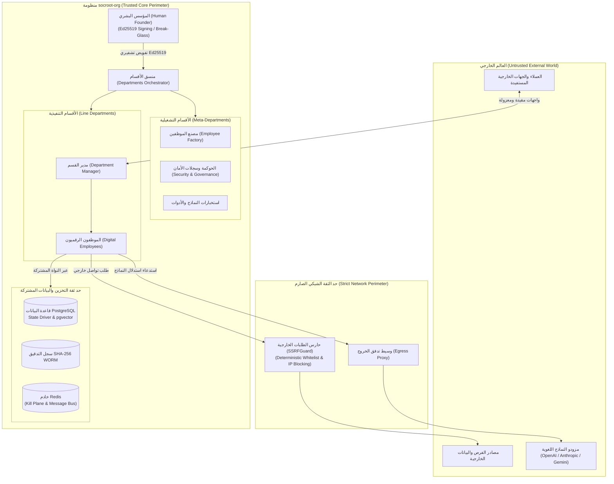

---

### المخطط 2: مستويات ومسارات النظام (System Planes Architecture)

```mermaid
graph LR
    subgraph Control_Plane["1. مستوى التحكم والتنسيق (Control Plane)"]
        CP_Orch["Orchestrator"]
        CP_Mgr["Department Manager"]
        CP_Life["9-Step Lifecycle"]
    end

    subgraph Data_Plane["2. مستوى البيانات والتنفيذ (Data Plane)"]
        DP_Emp["Employee Runtime"]
        DP_Tools["Deterministic Tools"]
        DP_Memory["Working Memory & Vectors"]
    end

    subgraph Governance_Plane["3. مستوى الحوكمة والرقابة (Governance Plane)"]
        GP_Policy["5-Tier PolicyEngine"]
        GP_Budget["Two-Phase BudgetGuard"]
        GP_Audit["SHA-256 Audit Logger"]
    end

    subgraph Kill_Plane["4. مستوى قاطع الطوارئ المستقل (Kill Plane)"]
        KP_Redis["Redis Pub/Sub Channel"]
        KP_Signals["OS Signals (SIGTERM/SIGKILL)"]
        KP_Switch["KillSwitchManager"]
    end

    Control_Plane -->|أوامر التكليف task_dispatch| Data_Plane
    Data_Plane -->|فحص إلزامي قبل التنفيذ PEP| Governance_Plane
    Governance_Plane -->|قرار بات ALLOW / DENY| Data_Plane
    Kill_Plane -.->|إيقاف قسري حتمي يتجاوز التطبيق| Data_Plane
    Kill_Plane -.->|تعليق فوري للمنسق والمدير| Control_Plane
```

---

### المخطط 3: الهيكل التنظيمي والفصل بين الأقسام التشغيلية والتنفيذية (ORG-001)

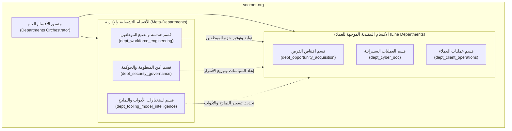

---

---

# الجزء الثاني: تشريح الموظف الرقمي والعقود والمخططات {#الجزء-الثاني}

## § 2.1 — معيار الملفات الستة (The Six-File Atomic Anatomy)

كل موظف رقمي في `socroot-org` يتكوّن حصراً من ستة ملفات ذرية متكاملة لا أقل ولا أكثر، تشكل معاً وحدة تشغيلية ذاتية الاكتفاء:

```text
department/{dept_name}/employees/{employee_name}/
├── contract.json          ← العقد القانوني (مصادق عليه بـ contract.schema.json)
├── manifest.yaml          ← المخطط التشغيلي البنيوي (مصادق عليه بـ manifest.schema.json)
├── employee.py            ← نقطة الدخول البرمجية وحلقة التنفيذ الرئيسية
├── tools.py               ← الأدوات الحتمية المتاحة حصراً لهذا الموظف
├── policies.py            ← طبقة السياسات المحلية ونقطة إنفاذ الضوابط الخاصة
└── skills/
    └── {skill_name}.md    ← وثائق المعرفة المتخصصة المحقونة في السياق اللغوي
```

---

### 2.1.1 ملف `contract.json` — العقد القانوني

العقد هو الوثيقة الأعلى سلطة في تعريف وتحديد الموظف الرقمي وحقوقه وواجباته. يحتوي العقد على:

- **هوية الموظف:** `employee_id`, `name`, `role`, `version`, `department`, `manager_id`.
- **المهمة والنطاق:** `mission`, `scope` (ما يفعله الموظف بدقة), `exclusions` (ما يُحظر عليه صراحةً).
- **السلطة والأدوات:** `authority.autonomy_level` (مستوى الاستقلالية من 1 إلى 5), `tools[]`, `skills[]`.
- **السياسات:** `policies[]` — قائمة معرّفات السياسات الحتمية المطبّقة.
- **إعدادات الذاكرة:** `memory_config` — نوع الذاكرة وسعتها وسياسة تطهيرها.
- **إعدادات التشغيل:** `runtime_config` — شبكة Docker، مهل الانتهاء (Timeouts)، والتزامن الأقصى.
- **مسار التصعيد:** `escalation_path` — من يُصعَّد إليه هرمياً ومتى يُطلق التصعيد.
- **موجه الهوية (Identity Prompt):** التعليمات الأساسية الثابتة التي تحدد شخصية وطبيعة دور الموظف.

---

### 2.1.2 ملف `manifest.yaml` — المخطط التشغيلي

المخطط هو وثيقة التشغيل البنيوية الموجهة لمحرك النشر والبنية التحتية، مُصمَّمة على غرار مواصفات Kubernetes Deployment:

- **`apiVersion/kind`:** نوع المورد المعياري (`EmployeeManifest`).
- **`metadata`:** البيانات التعريفية + `lifecycle_state` + `contract_ref` (الربط بالعقد).
- **`spec.runtime`:** صورة Docker، متغيرات البيئة المحقونة، والموارد المخصصة (CPU/Memory limits).
- **`spec.network`:** وضع العزل الشبكي (`mode: internal | isolated | none`) وقائمة المضيفين الداخليين المسموح بهم.
- **`spec.kill_switch`:** المحفّزات التلقائية للإيقاف (`BUDGET_EXCEEDED`, `POLICY_VIOLATION`, `UNEXPECTED_ERROR`).
- **`spec.health_check`:** مسار فحص الجاهزية والصحة، والمهلة، وتكرار الفحص الدوري.

---

### 2.1.3 ملف `employee.py` — نقطة الدخول

يحتوي على الصنف الرئيسي للموظف المشتق من النواة المشتركة، مع التطبيق الحتمي للخطوات التالية:
- تهيئة ذاكرة العمل المؤقتة `WorkingMemory` في بداية كل مهمة.
- استدعاء `build_llm_context()` لبناء السياق المحقون بتسلسل الطبقات الست الصارم.
- التحقق الإلزامي من قاطع الطوارئ عبر `KillSwitchManager.assert_*_active()` في مستهل كل دورة عمل.
- استدعاء نقطة إنفاذ السياسات `PolicyEngine.enforce()` قبل استدعاء أي أداة حتمية.
- استدعاء تطهير الذاكرة `WorkingMemory.wipe()` فور اكتمال المهمة لمنع تسريب السياقات.

---

### 2.1.4 ملف `tools.py` — الأدوات الحتمية

كل دالة معرفة في `tools.py` يجب أن تخضع للشروط الهندسية التالية:
- **حتمية مطلقة (Deterministic):** نفس المدخلات تُنتج نفس المخرجات دون أي تخمين.
- **انعدام الآثار الجانبية الشبكية المباشرة:** أي وصول للشبكة الخارجية يجب أن يمر حصراً عبر `SSRFGuard`.
- **توثيق صارم عبر docstring:** يحدد نوع المدخلات، والمخرجات، وحالات الخطأ المتوقعة.
- **خضوع قبلي للتحقق:** استدعاء فحص السياسات المحلية `policies.py` قبل الشروع في التنفيذ الفعلي.

---

### 2.1.5 ملف `policies.py` — طبقة السياسات المحلية

يحتوي على محرك السياسات المحلي المخصص للموظف الذي يفرض ضوابط حتمية خاصة بطبيعة دوره. مثال من ملف السياسات الحقيقي لموظف الصياغة `drafter/policies.py`:

```python
# department/opportunity_acquisition/employees/drafter/policies.py
from core.governance.policy_engine import EgressViolationError

class DrafterPolicyEngine:
    """محرك السياسات المحلي لموظف الصياغة — يطبّق سياسة العزل الشبكي المطلق POL_DRF_HARD_01."""

    ALLOWED_TOOLS = {"assemble_proposal_sections", "verify_section_completeness"}

    def validate_tool_execution(self, tool_name: str) -> None:
        """يرفض أي أداة ليست في القائمة البيضاء المعتمدة."""
        if tool_name not in self.ALLOWED_TOOLS:
            raise EgressViolationError(
                f"Tool '{tool_name}' is not permitted for the Drafter employee. "
                f"Allowed tools: {self.ALLOWED_TOOLS}"
            )

    def block_outbound_network(self) -> None:
        """يرفض أي محاولة وصول شبكي خارجي — حظر مطلق غير قابل للتجاوز."""
        raise EgressViolationError(
            "POL_DRF_HARD_01: Drafter employee has ZERO network egress permissions. "
            "All external access is permanently blocked."
        )
```

---

### 2.1.6 مجلد `skills/*.md` — وثائق المعرفة

كل ملف بصيغة Markdown داخل مجلد `skills/` يمثل **وثيقة معرفة متخصصة ومنهجية** تُحقن في السياق اللغوي للموظف لتوجيه مسار التفكير والاستدلال. يجب أن يتضمن كل ملف:
- ترويسة تعريفية (YAML Frontmatter) توضح اسم المهارة ونطاقها.
- المعايير الموضوعية للتحليل والتنفيذ.
- أمثلة توضيحية لمدخلات ومخرجات قياسية.
- قواعد القرار القطعية (شرط / نتيجة: IF/THEN) لإرشاد الموظف عند مواجهة حالات معقدة أو ملتبسة.

---

## § 2.2 — المخططات الستة JSON (الأساس الأثري للتحقق)

جميع المخططات محفوظة مركزياً في `socroot-org/core/protocols/` وتُستخدَم للتحقق الآلي الصارم عبر `validator.py` المعتمد على مواصفة `JSON Schema Draft 2020-12`.

---

### 2.2.1 مخطط `contract.schema.json`

```json
{
  "$schema": "https://json-schema.org/draft/2020-12/schema",
  "$id": "ai-org/employee-contract/v1.0",
  "title": "AI Employee Contract",
  "type": "object",
  "required": [
    "schema_version", "employee_id", "name", "role", "version",
    "department", "manager_id", "mission", "scope", "exclusions",
    "authority", "tools", "skills", "policies",
    "memory_config", "runtime_config", "escalation_path", "identity_prompt"
  ],
  "properties": {
    "schema_version": { "type": "string", "const": "1.0" },
    "employee_id":    { "type": "string", "pattern": "^[a-z0-9_]+\\.[a-z0-9_]+\\.v[0-9]+$" },
    "name":           { "type": "string" },
    "role":           { "type": "string" },
    "version":        { "type": "string" },
    "department":     { "type": "string" },
    "manager_id":     { "type": "string" },
    "mission":        { "type": "string" },
    "scope":          { "type": "array", "items": { "type": "string" } },
    "exclusions":     { "type": "array", "items": { "type": "string" } },
    "authority": {
      "type": "object",
      "required": ["autonomy_level"],
      "properties": {
        "autonomy_level": { "type": "integer", "minimum": 1, "maximum": 5 }
      }
    },
    "tools": {
      "type": "array",
      "items": {
        "type": "object",
        "required": ["tool_id", "description", "is_idempotent"],
        "properties": {
          "tool_id":       { "type": "string" },
          "description":   { "type": "string" },
          "is_idempotent": { "type": "boolean" }
        }
      }
    },
    "skills": {
      "type": "array",
      "items": { "type": "string" }
    },
    "policies": {
      "type": "array",
      "items": { "type": "string" }
    },
    "memory_config": {
      "type": "object",
      "required": ["type", "working_memory_max_tokens"],
      "properties": {
        "type": { "type": "string", "enum": ["ephemeral", "persistent"] },
        "working_memory_max_tokens": { "type": "integer" }
      }
    },
    "runtime_config": {
      "type": "object",
      "required": ["docker_network", "max_concurrent_tasks", "task_timeout_seconds"],
      "properties": {
        "docker_network": { "type": "string", "enum": ["internal", "isolated", "none"] },
        "max_concurrent_tasks": { "type": "integer", "minimum": 1 },
        "task_timeout_seconds": { "type": "integer", "minimum": 1 }
      }
    },
    "escalation_path": {
      "type": "array",
      "items": {
        "type": "object",
        "required": ["level", "target_id"],
        "properties": {
          "level": { "type": "integer" },
          "target_id": { "type": "string" }
        }
      }
    },
    "identity_prompt": { "type": "string" }
  }
}
```

*(ملاحظة معمارية: في مسودة v0.2 لم يكن هناك أي مخطط JSON رسمي معتمد، بل كانت البنية مجرد وصف نظري. الإصدار v1.0 وv1.1 يُلزمان كل عقد بالخضوع الآلي لـ `Draft202012Validator` قبل السماح بتحميل الموظف في الذاكرة).*

---

### 2.2.2 مخطط `manifest.schema.json`

```json
{
  "$schema": "https://json-schema.org/draft/2020-12/schema",
  "$id": "ai-org/employee-manifest/v1.0",
  "title": "AI Employee Manifest",
  "type": "object",
  "required": ["apiVersion", "kind", "metadata", "spec"],
  "properties": {
    "apiVersion": { "type": "string", "const": "apps/v1" },
    "kind":       { "type": "string", "const": "EmployeeManifest" },
    "metadata": {
      "type": "object",
      "required": [
        "employee_id", "version", "department", "manager_id",
        "contract_ref", "created_at", "lifecycle_state"
      ],
      "properties": {
        "employee_id":     { "type": "string" },
        "version":         { "type": "string" },
        "department":      { "type": "string" },
        "manager_id":      { "type": "string" },
        "contract_ref":    { "type": "string" },
        "created_at":      { "type": "string", "format": "date-time" },
        "lifecycle_state": {
          "type": "string",
          "enum": [
            "CREATED", "CONFIGURED", "EVALUATED", "SHADOW",
            "ASSISTED", "LIMITED_AUTONOMOUS", "AUTONOMOUS", "DEPRECATED"
          ]
        }
      }
    },
    "spec": {
      "type": "object",
      "required": [
        "runtime", "network", "environment", "resources",
        "health_check", "kill_switch"
      ],
      "properties": {
        "runtime": {
          "type": "object",
          "required": ["image", "entrypoint"],
          "properties": {
            "image":      { "type": "string" },
            "entrypoint": { "type": "string" }
          }
        },
        "network": {
          "type": "object",
          "required": ["mode"],
          "properties": {
            "mode": { "type": "string", "enum": ["internal", "isolated", "none"] },
            "allowed_internal_hosts": {
              "type": "array",
              "items": { "type": "string" }
            }
          }
        },
        "environment": {
          "type": "object"
        },
        "resources": {
          "type": "object",
          "required": ["cpu_limit", "memory_limit"],
          "properties": {
            "cpu_limit":    { "type": "string" },
            "memory_limit": { "type": "string" }
          }
        },
        "health_check": {
          "type": "object",
          "required": ["endpoint", "interval_seconds", "timeout_seconds"],
          "properties": {
            "endpoint":         { "type": "string" },
            "interval_seconds": { "type": "integer" },
            "timeout_seconds":  { "type": "integer" }
          }
        },
        "kill_switch": {
          "type": "object",
          "required": ["auto_triggers"],
          "properties": {
            "auto_triggers": {
              "type": "array",
              "items": {
                "type": "object",
                "required": ["condition", "level", "action"],
                "properties": {
                  "condition": { "type": "string" },
                  "level":     { "type": "string", "enum": ["TASK", "EMPLOYEE", "DEPARTMENT"] },
                  "action":    { "type": "string" }
                }
              }
            }
          }
        }
      }
    }
  }
}
```

---

### 2.2.3 مخطط `task_dispatch.schema.json`

```json
{
  "$schema": "https://json-schema.org/draft/2020-12/schema",
  "$id": "ai-org/task-dispatch/v1.0",
  "title": "Task Dispatch Message",
  "type": "object",
  "required": [
    "schema_version", "message_type", "message_id", "task_id",
    "sender", "receiver", "timestamp_utc", "objective",
    "constraints", "inputs", "expected_outputs", "escalation_path"
  ],
  "properties": {
    "schema_version": { "type": "string", "const": "1.0" },
    "message_type":   { "type": "string", "const": "task.dispatch" },
    "message_id":     { "type": "string", "format": "uuid" },
    "task_id":        { "type": "string", "format": "uuid" },
    "sender":         { "type": "string" },
    "receiver":       { "type": "string" },
    "timestamp_utc":  { "type": "string", "format": "date-time" },
    "objective":      { "type": "string" },
    "constraints": {
      "type": "object",
      "required": ["deadline_utc", "cost_budget_usd", "autonomy_level"],
      "properties": {
        "deadline_utc":    { "type": "string", "format": "date-time" },
        "cost_budget_usd": { "type": "number", "minimum": 0 },
        "autonomy_level":  { "type": "integer", "minimum": 1, "maximum": 5 }
      }
    },
    "inputs": {
      "type": "object"
    },
    "expected_outputs": {
      "type": "array",
      "items": { "type": "string" }
    },
    "escalation_path": {
      "type": "array",
      "items": {
        "type": "object",
        "required": ["level", "target_id"],
        "properties": {
          "level":     { "type": "integer" },
          "target_id": { "type": "string" }
        }
      }
    }
  }
}
```

---

### 2.2.4 مخطط `task_result.schema.json`

```json
{
  "$schema": "https://json-schema.org/draft/2020-12/schema",
  "$id": "ai-org/task-result/v1.0",
  "title": "Task Result Message",
  "type": "object",
  "required": [
    "schema_version", "message_type", "message_id",
    "task_id", "sender", "receiver", "timestamp_utc",
    "status", "outputs", "evidence", "audit_ref"
  ],
  "properties": {
    "schema_version": { "type": "string", "const": "1.0" },
    "message_type":   { "type": "string", "const": "task.result" },
    "message_id":     { "type": "string", "format": "uuid" },
    "task_id":        { "type": "string", "format": "uuid" },
    "sender":         { "type": "string" },
    "receiver":       { "type": "string" },
    "timestamp_utc":  { "type": "string", "format": "date-time" },
    "status":         { "type": "string", "enum": ["completed", "failed", "escalated"] },
    "outputs":        { "type": "object" },
    "evidence": {
      "type": "array",
      "description": "قائمة الأدلة الموضوعية المستخلصة التي بنى عليها الموظف قراره",
      "items": {
        "type": "object",
        "required": ["source_url", "extracted_text", "relevance_score"],
        "properties": {
          "source_url":      { "type": "string" },
          "extracted_text":  { "type": "string" },
          "relevance_score": { "type": "number", "minimum": 0, "maximum": 1 }
        }
      }
    },
    "audit_ref": {
      "type": "string",
      "pattern": "^audit://[a-f0-9-]+$",
      "description": "معرف مرجعي دائم يربط النتيجة بسلسلة سجل التدقيق SHA-256"
    }
  }
}
```

---

### 2.2.5 مخطط `objective_route.schema.json`

```json
{
  "$schema": "https://json-schema.org/draft/2020-12/schema",
  "$id": "ai-org/objective-route/v1.0",
  "title": "Objective Routing Message",
  "type": "object",
  "required": [
    "schema_version", "message_type", "message_id",
    "objective_id", "sender", "receiver", "timestamp_utc",
    "objective", "dependencies", "parallel_objectives"
  ],
  "properties": {
    "schema_version": { "type": "string", "const": "1.0" },
    "message_type":   { "type": "string", "const": "objective.route" },
    "message_id":     { "type": "string", "format": "uuid" },
    "objective_id":   { "type": "string", "format": "uuid" },
    "sender":         { "type": "string" },
    "receiver":       { "type": "string" },
    "timestamp_utc":  { "type": "string", "format": "date-time" },
    "objective": {
      "type": "object",
      "required": ["description", "priority", "deadline_utc", "success_criteria"],
      "properties": {
        "description":      { "type": "string" },
        "priority":         { "type": "string", "enum": ["low", "medium", "high", "critical"] },
        "deadline_utc":     { "type": "string", "format": "date-time" },
        "success_criteria": {
          "type": "array",
          "items": { "type": "string" },
          "description": "معايير النجاح الكمية والموضوعية القابلة للقياس والتحقق"
        }
      }
    },
    "dependencies": {
      "type": "array",
      "items": { "type": "string" }
    },
    "parallel_objectives": {
      "type": "array",
      "items": { "type": "string" },
      "description": "الأهداف التنفيذية التي يمكن تشغيلها بالتوازي لتقليل زمن الاستجابة"
    }
  }
}
```

---

### 2.2.6 مخطط `escalation_package.schema.json`

```json
{
  "$schema": "https://json-schema.org/draft/2020-12/schema",
  "$id": "ai-org/escalation-package/v1.0",
  "title": "Escalation Package Message",
  "type": "object",
  "required": [
    "schema_version", "message_type", "escalation_id",
    "task_id", "sender", "receiver", "timestamp_utc",
    "reason_code", "context", "evidence", "actions_taken",
    "recommended_human_action", "estimated_fix_cost_usd",
    "potential_grant_value_usd", "urgency"
  ],
  "properties": {
    "schema_version":           { "type": "string", "const": "1.0" },
    "message_type":              { "type": "string", "const": "escalation.package" },
    "escalation_id":            { "type": "string", "pattern": "^esc-[a-z0-9-]+$" },
    "task_id":                  { "type": "string", "format": "uuid" },
    "sender":                   { "type": "string" },
    "receiver":                 { "type": "string" },
    "timestamp_utc":            { "type": "string", "format": "date-time" },
    "reason_code": {
      "type": "string",
      "description": "رمز السبب المعياري المغلق للتصعيد",
      "enum": [
        "SCORE_AMBIGUOUS", "BUDGET_EXCEEDED",
        "POLICY_VIOLATION", "SLA_BREACH", "SCHEMA_INVALID"
      ]
    },
    "context":                  { "type": "object" },
    "evidence":                 { "type": "array", "items": { "type": "object" } },
    "actions_taken":            { "type": "array", "items": { "type": "string" } },
    "recommended_human_action": { "type": "string" },
    "estimated_fix_cost_usd":   { "type": "number", "minimum": 0 },
    "potential_grant_value_usd":{ "type": "number", "minimum": 0 },
    "urgency":                  { "type": "string", "enum": ["LOW", "MEDIUM", "HIGH", "CRITICAL"] }
  }
}
```

---

## § 2.3 — استراتيجية الإصدارات وبروتوكول التراجع

### 2.3.1 نظام ترقيم الإصدارات (MAJOR.MINOR.PATCH)

يخضع الموظفون والنواة المشتركة لنظام ترقيم الإصدارات الدلالي الصارم (Semantic Versioning):

| نوع التغيير | المتغير المرفوع | الوصف والضوابط | مثال واقعي في المنظومة |
|---|---|---|---|
| **تغيير يكسر التوافق** | `MAJOR` | أي تعديل في الحقول الإلزامية (`required`) أو إلغاء وظائف سابقة | تعديل مخطط `contract.schema.json` أو تغيير بنية `employee.py` |
| **إضافة ميزة متوافقة** | `MINOR` | إضافة أدوات جديدة مصرح بها أو انضمام موظف إضافي للقسم | إضافة موظف `opp_acq.strategist.v1` إلى قسم اقتناص الفرص |
| **إصلاح خطأ دون تغيير واجهة** | `PATCH` | تصحيح داخلي في منطق دالة حتمية دون المساس بالعقود | تحسين دقة حساب تكلفة الرموز في `pricing.py` |

---

### 2.3.2 بروتوكول التراجع (Rollback Protocol)

عند حدوث فشل تشغيلي أو انتهاك حرج يستدعي التراجع الفوري عن إصدار موظف، يُنفَّذ المسار الإلزامي التالي:

1. **إيقاف الموظف فوراً:** استدعاء `KillSwitchManager.kill_employee(employee_id)` لقطع التنفيذ وحظر استقبال أي مهام جديدة.
2. **استعادة النسخة السابقة المعتمدة:** استرجاع حزمة الملفات الستة للإصدار السابق من مستودع التحكم `git` وإعادة بناء الحاوية.
3. **التحقق الآلي من المخططات:** تشغيل فحص النزاهة: `python -m core.protocols.validator contract employee_contract.json`.
4. **تشغيل الاختبارات المعزولة:** تنفيذ جناح الاختبارات المحلي `pytest department/{dept}/employees/{name}/` واشتراط نجاح 100%.
5. **توثيق حدث التراجع في التدقيق:** إدراج سجل رسمي بنوع `EMPLOYEE_ROLLBACK` داخل `core_audit.audit_log` مشتملاً على سبب التراجع.
6. **إلغاء قفل الطوارئ وإعادة التشغيل:** استدعاء `KillSwitchManager` لإزالة الموظف من قائمة الإيقاف وإعادته للخدمة.

---

### 2.3.3 قاعدة التوافق المعماري

> [!CAUTION]
> **قاعدة صارمة وملزمة:** أي تعديل يُجرى على أي مخطط JSON داخل `core/protocols/` يُعدّ حكماً تغييراً من النوع `MAJOR`؛ ويستلزم إلزامياً إعادة فحص ومصادقة كافة العقود والرسائل الموجودة في المنظومة قبل التصريح بنشر الإصدار. يُحظر حظراً باتاً نشر أي تعديل لمخطط دون تحقيق نسبة نجاح 100% في كامل اختبارات المنظومة.

---

## § 2.4 — تعزيز استقلالية حزمة الموظف والنواة المشتركة والحواجز المدمجة

### 2.4.1 حزمة الموظف ذاتية الاكتفاء والنواة المشتركة المثبتة (SCA-001)

| الخاصية | القيمة |
|---|---|
| `proposal_ref` | `SCA-001` (حزمة موظف ذاتية الاكتفاء) |
| `architectural_status` | `ADOPTED_WITH_DESIGN_CONSTRAINTS` (القرار المعماري 6.3) |
| `architecture_horizon` | `CURRENT` ➔ `TARGET` |
| `implementation_status` | `IMPLEMENTED` |
| `normative_strength` | `MUST` |
| `owner` | مصنع الموظفين وهندسة النواة (`core/factory` & `core/kernel`) |

لتحقيق أقصى درجات قابلية النقل والاختبار المعزول للموظف الرقمي، يجب أن تكون حزمة الموظف السداسية **ذاتية الاكتفاء (Self-Contained Bundle)** بحيث تحوي كافة عقودها وسياساتها وأدواتها محلياً دون تبعيات خفية على أقسام أخرى.

> [!IMPORTANT]
> **قاعدة الحسم المعماري (القرار 6.3 — النواة المشتركة المثبتة):**
> تعتمد الحزمة على نواة مشتركة مثبتة الإصدار (`core.kernel.base_employee:BaseEmployee`) عبر الوراثة أو التضمين المنضبط، بدلاً من النسخ الكلي لكود النواة داخل كل موظف. يمنع هذا التصميم ظاهرة **انحراف الترقيعات الأمنية (Security Patch Drift)**؛ فعند ترقية نواة النظام الأمنية أو محرك التدقيق، تسري الترقية فوراً على جميع الموظفين دون الحاجة لإعادة كتابة كود كل موظف على حدة.

---

### 2.4.2 الحواجز المدمجة غير القابلة للإسقاط ونقطة إنفاذ السياسات PEP (SCA-002)

| الخاصية | القيمة |
|---|---|
| `proposal_ref` | `SCA-002` (Guardrails مدمجة وغير قابلة للإسقاط) |
| `architectural_status` | `ADOPTED` |
| `architecture_horizon` | `CURRENT` |
| `implementation_status` | `IMPLEMENTED` |
| `normative_strength` | `MUST` |

تتضمن نقطة دخول الموظف `employee.py` حواجز حتمية صلبة تمثل **نقطة إنفاذ السياسات (Policy Enforcement Point - PEP)**. هذه الحواجز مُدمجة داخل صلب حلقة التنفيذ ولا يمكن لأي مطور أو وكيل ذكاء اصطناعي إسقاطها أو تجاوزها أثناء التخصيص:

1. **حاجز قاطع الطوارئ (Kill-Switch Interceptor):** اعتراض التنفيذ والتأكد من عدم وجود أمر إيقاف نشط على مستوى الموظف أو القسم قبل استهلاك أي مورد.
2. **حاجز حجز الميزانية (Budget Pre-Reserve Interceptor):** التأكد من حجز الرصيد المالي المخصص للمهمة ذرياً قبل مخاطبة مزود النموذج.
3. **حاجز فحص السياسات والأدوات (Policy Validation Interceptor):** إخضاع كل أداة في `tools.py` للفحص الحتمي عبر `PolicyEngine.enforce()` قبل تمرير المدخلات.
4. **حاجز التطهير النهائي (Ephemerality & Memory Wipe Interceptor):** محو بيانات الجلسة من الذاكرة اللحظية `WorkingMemory` فور انتهاء الدورة.

---

### 2.4.3 مواصفة التخصيص المحكومة والتحقق من النزاهة (SCA-003)

| الخاصية | القيمة |
|---|---|
| `proposal_ref` | `SCA-003` (Customization Spec محكوم) |
| `architectural_status` | `ADOPTED` |
| `architecture_horizon` | `TRANSITIONAL` |
| `implementation_status` | `IMPLEMENTED` |
| `normative_strength` | `MUST` |

يُحظر التعديل الحر أو غير المنضبط على ملفات الموظف. يخضع أي تخصيص لموظف جديد أو قائم لـ **مواصفة التخصيص المحكومة (Controlled Customization Spec)** التي تفحص عبر خط أنابيب CI/CD الآلي:
- تطابق الحزمة مع معيار الملفات الستة الذرية (عدم وجود ملفات زائدة أو ناقصة).
- نجاح التحقق الصارم من صحة العقد `contract.json` والمخطط `manifest.yaml` بنسبة 100%.
- خلو ملف الأدوات `tools.py` من أي استدعاءات شبكية مباشرة تلتف على `SSRFGuard`.
- توافق مصفوفة الصلاحيات مع الدور المحدد في `ROLE_PERMISSIONS`.

---

## المخطط المعماري الإلزامي للجزء الثاني

### المخطط 4: حزمة الموظف السداسية والنواة المشتركة ونقطة إنفاذ السياسات (SCA-001, SCA-002)

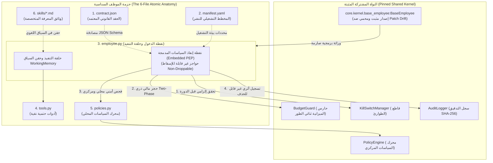

---

---

# الجزء الثالث: الإدارة والتنسيق وتدفق العمليات والتشغيل {#الجزء-الثالث}

## § 3.1 — منسّق الأقسام ومدير القسم والحلقة التساعية

### 3.1.1 منسّق الأقسام (Departments Orchestrator)

المنسّق العام هو الجسر المعماري الرابط بين قرارات المؤسس البشري والتنفيذ العملياتي داخل الأقسام. يعمل المنسق بمعرّف ثابت ونظامي `ORCHESTRATOR_ID = "core.orchestrator.v1"`، ومهمته استلام حزم توجيه الأهداف (`objective_route`)، والتحقق من صحتها البنيوية، وفحص قواطع الطوارئ، وتوجيهها للمدير المناسب.

```python
# core/orchestration/departments_orchestrator.py (73 سطراً)
from core.governance.kill_switch import KillSwitchManager
from core.governance.policy_engine import PolicyEngine
from core.protocols.validator import validate_objective_route

class DepartmentsOrchestrator:
    """
    المنسّق المركزي: يستقبل الأهداف من المؤسس ويوجّهها للأقسام المناسبة.
    معرّف المنسّق: core.orchestrator.v1
    """
    ORCHESTRATOR_ID = "core.orchestrator.v1"

    def __init__(self, department_managers: dict, kill_switch: KillSwitchManager,
                 policy_engine: PolicyEngine):
        self.department_managers = department_managers
        self.kill_switch = kill_switch
        self.policy_engine = policy_engine

    async def dispatch_objective(self, objective_route: dict) -> dict:
        """
        يستقبل حزمة objective_route ويُوجّها للمدير المناسب.
        الخطوة 1: التحقق من صحة المخطط
        الخطوة 2: التحقق من قاطع الطوارئ
        الخطوة 3: توجيه الهدف للقسم المناسب
        """
        validate_objective_route(objective_route)
        receiver_id = objective_route["receiver"]
        await self.kill_switch.assert_department_active(receiver_id)

        if "opp_acq" in receiver_id:
            target_mgr = self.department_managers["opp_acq"]
            return await target_mgr.run_objective_cycle(objective_route)

        raise ValueError(f"No department manager found for receiver: {receiver_id}")
```

---

### 3.1.2 مدير القسم (Department Manager)

مدير القسم (مثل `opp_acq.manager.v1`) هو الكيان المسؤول عن تنسيق العمليات اليومية لموظفي قسمه، وضبط تسلسل المهام، وإدارة الميزانية، وتطبيق الحلقة التساعية الصارمة المعرفة في `lifecycle.py`.

---

### 3.1.3 الحلقة التساعية الكاملة (The 9-Step Lifecycle Loop)

تلتزم جميع الأقسام التنفيذية بالحلقة التساعية الموحدة لتنفيذ الأهداف دون أي تجاوز للخطوات:

```python
# department/opportunity_acquisition/manager/lifecycle.py (235 سطراً)
class DepartmentManager:
    """مدير قسم اقتناص الفرص. المعرّف: opp_acq.manager.v1"""
    MANAGER_ID = "opp_acq.manager.v1"

    async def run_objective_cycle(self, objective_route: dict) -> dict:
        """الحلقة التساعية لتنفيذ الأهداف — 9 خطوات صريحة وملزمة."""

        # الخطوة 1: استقبال الهدف والتحقق من صحته البنيوية والتسجيل الأثري
        validate_objective_route(objective_route)
        objective_id = objective_route["objective_id"]
        await self.audit.record(
            task_id=objective_id, employee_id=self.MANAGER_ID,
            event_type="OBJECTIVE_RECEIVED", event_data=objective_route
        )

        # الخطوة 2: تحليل الهدف وتفكيكه إلى مهام جزئية متسلسلة وموزية
        task_plan = await self.planner.decompose_objective(objective_route)

        # الخطوة 3: التحقق المسبق من الميزانية وحجز المخصصات
        for task in task_plan:
            estimated_cost = task["constraints"]["cost_budget_usd"]
            await self.budget_guard.check_pre_call(
                task_id=task["task_id"],
                department_id=self.department_id,
                estimated_cost_usd=estimated_cost
            )

        # الخطوتان 4+5: الإرسال والمراقبة الحثيثة للموظفين
        results = {}
        for task_dispatch in task_plan:
            employee_id = task_dispatch["receiver"]
            await self.kill_switch.assert_employee_active(employee_id)
            result = await self._dispatch_and_monitor(task_dispatch)
            results[employee_id] = result

            # بوابة الإجهاض المبكر عند التقييم لمنع هدر الموارد
            if employee_id == "opp_acq.evaluator.v1":
                score = result["outputs"].get("fit_score", 0)
                if score < 40.0:
                    return self._build_abort_result(objective_id, score, results)

        # الخطوة 6: التحقق من صحة المخرجات النهائية والامتثال للـ SLA
        final_result = results.get("opp_acq.drafter.v1")
        validate_task_result(final_result)
        self._check_sla_compliance(objective_route, final_result)

        # الخطوة 7: التصعيد للمؤسس البشري عند الفشل أو التعثر (يُنفَّذ عند الضرورة)

        # الخطوة 8: تحديث الحالة الدائمة في PostgreSQL مع القفل المتفائل
        await self.state_driver.set_state(
            employee_id=self.MANAGER_ID,
            state_key=f"objective:{objective_id}",
            value={"status": "completed", "results": results},
            expected_version=None
        )

        # الخطوة 9: تسجيل التدقيق النهائي بسلسلة SHA-256
        await self.audit.record(
            task_id=objective_id, employee_id=self.MANAGER_ID,
            event_type="OBJECTIVE_COMPLETED", event_data=final_result
        )
        return final_result
```

---

### 3.1.4 تسلسل الموظفين في القسم

```python
# department/opportunity_acquisition/manager/planner.py
class DepartmentPlanner:
    """مخطط تسلسل الموظفين المعياري داخل قسم اقتناص الفرص."""
    EMPLOYEE_SEQUENCE = [
        "opp_acq.scout.v1",      # 1. استطلاع ومسح المصادر الخارجية المعتمدة
        "opp_acq.context.v1",    # 2. استخلاص السياق والأدلة وتجهيز الذاكرة
        "opp_acq.evaluator.v1",  # 3. تقييم الأهلية والملاءمة (بوابة القرار الحاكمة)
        "opp_acq.strategist.v1", # 4. صياغة استراتيجية الفوز وزوايا التقديم
        "opp_acq.drafter.v1",    # 5. كتابة مسودة العرض والمستندات النهائية
    ]
```

---

## § 3.2 — بروتوكولات التواصل بين المكوّنات

### 3.2.1 دورة حياة الرسالة الكاملة

تنتقل الرسائل بين الكيانات التنظيمية عبر مسار هرمي معتمد وخاضع للمطابقة الصارمة:

```text
المؤسس البشري ➔ [objective_route.schema.json] ➔ منسق الأقسام (DepartmentsOrchestrator)
   ➔ [task_dispatch.schema.json × 5] ➔ مدير القسم (DepartmentManager)
   ➔ scout ➔ context ➔ evaluator (بوابة حسم) ➔ strategist ➔ drafter
   ➔ [task_result.schema.json] ➔ مدير القسم ➔ [النتيجة المكتملة] ➔ المؤسس البشري
```

---

### 3.2.2 هيكل `task_dispatch` — المثال الكامل

```json
{
  "schema_version": "1.0",
  "message_type": "task.dispatch",
  "message_id": "550e8400-e29b-41d4-a716-446655440000",
  "task_id": "a1b2c3d4-e5f6-7890-abcd-ef1234567890",
  "sender": "opp_acq.manager.v1",
  "receiver": "opp_acq.evaluator.v1",
  "timestamp_utc": "2025-01-15T09:00:00Z",
  "objective": "تقييم أهلية فرصة منحة Y Combinator RFS دورة W26",
  "constraints": {
    "deadline_utc": "2025-01-15T09:40:00Z",
    "cost_budget_usd": 0.15,
    "autonomy_level": 2
  },
  "inputs": {
    "grant_source": "ycombinator_rfs",
    "context_data": { "extracted_text": "...", "source_url": "https://..." },
    "evaluation_criteria": ["technical_fit", "market_timing", "team_strength"]
  },
  "expected_outputs": {
    "fit_score":          { "type": "number", "minimum": 0, "maximum": 100 },
    "eligibility_verdict": { "type": "string", "enum": ["ELIGIBLE","INELIGIBLE","AMBIGUOUS"] },
    "rationale":          { "type": "string" }
  },
  "escalation_path": [
    { "level": 1, "target_id": "opp_acq.manager.v1" },
    { "level": 2, "target_id": "human.founder" }
  ]
}
```

---

### 3.2.3 هيكل `task_result` — المثال الكامل

```json
{
  "schema_version": "1.0",
  "message_type": "task.result",
  "message_id": "660e8400-e29b-41d4-a716-446655440001",
  "task_id": "a1b2c3d4-e5f6-7890-abcd-ef1234567890",
  "sender": "opp_acq.evaluator.v1",
  "receiver": "opp_acq.manager.v1",
  "timestamp_utc": "2025-01-15T09:35:00Z",
  "status": "completed",
  "outputs": {
    "fit_score": 78.5,
    "eligibility_verdict": "ELIGIBLE",
    "rationale": "الفرصة تستوفي 4/5 من معايير الأهلية الأساسية وتتطابق مع أهداف المنظومة."
  },
  "evidence": [
    {
      "source_url": "https://www.ycombinator.com/rfs",
      "extracted_text": "We are looking for AI-first startups building autonomous enterprise systems...",
      "relevance_score": 0.92
    }
  ],
  "audit_ref": "audit://a1b2c3d4-e5f6-7890-abcd-ef1234567890"
}
```

---

### 3.2.4 هيكل `escalation_package` — المثال الكامل

```json
{
  "schema_version": "1.0",
  "message_type": "escalation.package",
  "escalation_id": "esc-7f3a2b1c9d4e",
  "task_id": "a1b2c3d4-e5f6-7890-abcd-ef1234567890",
  "sender": "opp_acq.manager.v1",
  "receiver": "human.founder",
  "timestamp_utc": "2025-01-15T09:38:00Z",
  "reason_code": "SCORE_AMBIGUOUS",
  "urgency": "MEDIUM",
  "context": {
    "fit_score": 62.3,
    "range": "50.0-69.9",
    "policy_triggered": "POL_EVA_AMBIGUOUS_SCORE"
  },
  "evidence": [{"source_url": "https://...", "extracted_text": "..."}],
  "actions_taken": ["تم إيقاف التنفيذ عند بوابة التقييم وحفظ سياق المهمة مؤقتاً"],
  "recommended_human_action": "مراجعة تقرير التقييم واتخاذ قرار الاستمرار أو الإلغاء النهائي",
  "estimated_fix_cost_usd": 0.05,
  "potential_grant_value_usd": 125000.00
}
```

---

## § 3.3 — دورة القرار وأهلية التنفيذ

### 3.3.1 معايير قرار التقييم الثلاثة

مستخلصة من العقد المعتمد للموظف المرجعي `opp_acq.evaluator.v1/contract.json`:

| نطاق النتيجة (`fit_score`) | قرار التقييم | الإجراء العملياتي التلقائي |
|---|---|---|
| `score >= 85.0` | `FAST_TRACK` | المسار السريع: تجاوز مرحلة الاستراتيجية والتمرير المباشر للصياغة |
| `70.0 <= score < 85.0` | `PROCEED` | المسار الاعتيادي: استكمال الحلقة التساعية وتسليم المهمة للمخطط الاستراتيجي |
| `50.0 <= score < 70.0` | `ESCALATE` | منطقة الغموض: تفعيل سياسة `POL_EVA_AMBIGUOUS_SCORE` والتصعيد الفوري للمؤسس |
| `score < 40.0` | `ABORT` | الإجهاض التلقائي: إيقاف فوري للهدف لمنع هدر الميزانية وتوليد تقرير أسباب الإجهاض |

```json
"decision_rule": {
  "minimum_viable_score":      70.0,
  "fast_track_threshold":      85.0,
  "automatic_abort_threshold": 40.0
}
```

---

### 3.3.2 خوارزمية `calculate_fit_score`

تُحسب نتيجة الملاءمة رياضياً وفق الصيغة الحتمية:
$$\text{Fit Score} = \frac{\sum (\text{وزن المعيار} \times \text{درجة الاستيفاء})}{\sum \text{الأوزان}} \times 100$$

```python
# الصيغة: Σ(وزن_المعيار × درجة_الاستيفاء) / Σ(الأوزان) × 100
def calculate_fit_score(eligibility_criteria: dict, grant_requirements: dict,
                         weights: dict | None = None) -> float:
    """دالة حتمية لحساب درجة الملاءمة والأهلية بنسبة مئوية من 0 إلى 100."""
    if weights is None:
        weights = {k: 1.0 for k in eligibility_criteria}
    total_weight = sum(weights.values())
    weighted_score = sum(
        weights.get(c, 1.0) * eligibility_criteria.get(c, 0.0)
        for c in grant_requirements
    )
    return round((weighted_score / total_weight) * 100, 2)
```

---

## § 3.4 — دلالات تسليم الرسائل والاعتمادية التشغيلية (MSG-001)

| الخاصية | القيمة |
|---|---|
| `proposal_ref` | `MSG-001` (دلالات تسليم Redis) |
| `architectural_status` | `ADOPTED` |
| `architecture_horizon` | `CURRENT` ➔ `TRANSITIONAL` |
| `implementation_status` | `IMPLEMENTED` |
| `normative_strength` | `MUST` |
| `owner` | هندسة النواة والتنسيق (`core/orchestration`) |

### 3.4.1 دلالات التسليم At-Least-Once ونمط صندوق الصادر (Outbox Pattern)
لضمان عدم ضياع أي رسالة تكليف أو نتيجة مهمة في حال تعطل الحاوية أو إعادة تشغيل خادم Redis، تعتمد المنظومة دلالات تسليم **على الأقل مرة واحدة (At-Least-Once Delivery)**.

يُطبق **نمط صندوق الصادر الموثوق (Transactional Outbox Pattern)** بحيث لا تُرسل الرسالة إلى وسيط الرسائل (Redis Streams) إلا بعد حفظها في جدول قاعدة بيانات محلي `core_orchestration.outbox` ضمن نفس المعاملة المصرفية (Database Transaction) لتحديث حالة المهمة. يقوم عامل مخصص بقراءة السجلات غير المرسلة ودفعها إلى Redis، مما يضمن الاتساق التام حتى لو انقطعت الشبكة لحظة الإرسال.

### 3.4.2 مفاتيح عدم التكرار (Idempotency Keys) وطابور الرسائل الميتة (DLQ)
1. **مفاتيح عدم التكرار (Idempotency Keys):** تحمل كل رسالة `task.dispatch` و`task.result` معرفاً فريداً (`message_id` من نوع UUID). يقوم المستقبل بفحص جدول `core_orchestration.processed_messages` قبل معالجة الرسالة؛ وإذا تكررت الرسالة، تُهمل المعالجة ويُعاد الرد السابق المخزن فوراً دون إعادة تشغيل أدوات الموظف أو استدعاء النماذج.
2. **طابور الرسائل الميتة (Dead Letter Queue - DLQ):** الرسائل التي تفشل في المعالجة بعد 3 محاولات استرجاع (Retries) مع تأخير أسي (Exponential Backoff)، أو التي تنتهك مخططات JSON بشكل غير قابل للإصلاح، تُنقل تلقائياً إلى طابور `dlq:tasks` مع إشعار تحذيري لمدير القسم والمشغل البشري لمنع انسداد خط العمل.

---

## § 3.5 — أدوات التشغيل وإدارة المنظومة socroot-admin (OPS-001, OPS-002, OPS-003)

| الخاصية | القيمة |
|---|---|
| `proposal_refs` | `OPS-001`, `OPS-002`, `OPS-003` |
| `architectural_status` | `ADOPTED` |
| `architecture_horizon` | `TRANSITIONAL` ➔ `TARGET` |
| `implementation_status` | `PARTIAL` |
| `normative_strength` | `MUST` |
| `owner` | التشغيل وإدارة النواة (`core/operations`) |

### 3.5.1 أداة سطر الأوامر socroot-admin وشجرة الأوامر الحتمية (OPS-001)
أداة `socroot-admin` هي الواجهة التشغيلية القياسية للمشغل البشري لإدارة المنظومة والتحكم في دورة حياتها. تُبنى الأداة على شجرة أوامر حتمية تعتمد شجرة الإعراب المجردة (Command AST) بدلاً من معالجة النصوص الحرة:

```text
socroot-admin
├── employee
│   ├── generate   --dept <name> --role <role> --template <id>
│   ├── validate   --path <employee_dir>
│   ├── deploy     --id <employee_id>
│   └── status     --id <employee_id>
├── kill-switch
│   ├── activate   --level <TASK|EMPLOYEE|DEPARTMENT|GLOBAL> --target <id>
│   └── deactivate --level <level> --target <id>
├── budget
│   ├── inspect    --dept <name>
│   └── set-limit  --dept <name> --amount <usd>
└── audit
    └── verify-chain --dept <name> --from <timestamp>
```

### 3.5.2 المساعد التفاعلي المقيد ومنع الشل المباشر (OPS-002)
تتضمن أداة `socroot-admin` مساعداً استشارياً تفاعلياً مدعوماً بنموذج لغوي لمساعدة المشغل في استعلام الحالة وتحليل الأخطاء واقتراح الأوامر.
> [!CAUTION]
> **قيد أمني حاسم:** يُحظر قطعياً منح المساعد التفاعلي صلاحية تنفيذ أوامر الشل (Shell) مباشرة على النظام، أو امتلاك صلاحيات المؤسس الجذرية. تنحصر وظيفة المساعد في **اقتراح نص الأمر للمشغل مع عرض خطة الأثر**، ويتطلب تشغيل أي أمر تعديلي موافقة صريحة وتأكيداً بشرياً ضاغطاً على لوحة المفاتيح من قِبل المشغل.

### 3.5.3 توليد الموظفين وتخصيص القوالب عبر سطر الأوامر (OPS-003)
تتيح الأداة عبر الأمر `socroot-admin employee generate` توليد حزمة الموظف السداسية المتكاملة استناداً إلى قوالب معتمدة من مصنع الموظفين (`Employee Factory`). يقوم الأمر بإنشاء العقود والمخططات والسياسات والأدوات الأولية مع حقن النواة المشتركة وتوليد معرّفات فريدة وفحص مطابقة العقد للمخططات آلياً قبل كتابة الملفات على القرص.

---

## المخطط المعماري الإلزامي للجزء الثالث

### المخطط 10: تسليم الرسائل ونمط صندوق الصادر وDLQ ومفاتيح Idempotency (MSG-001)

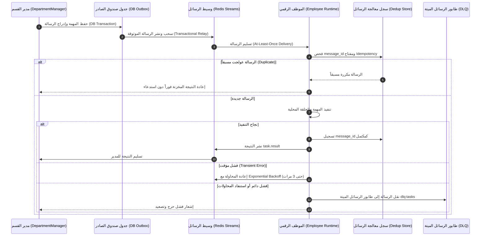

---

---

# الجزء الرابع: الحوكمة والسياسات وسيادة المؤسس ومفاتيح الطوارئ {#الجزء-الرابع}

## § 4.1 — سيادة المؤسس والتفويض التشفيري

### 4.1.1 مبدأ السيادة المطلقة وتحديثات الحسم المعماري

المؤسس البشري (Human Founder) هو المالك الاستراتيجي والمرجعية السيادية العليا للمنظومة. في مسودة v1.0 الأساسية، رُمزت هذه السيادة بصلاحية جذرية شاملة `["*"]` في جدول الصلاحيات. 

> [!IMPORTANT]
> **قاعدة الحسم المعماري (القرار 6.1 والمقترح IAM-001):**
> لدرء مخاطر الاختراق العرضي والتسريب العابر للصلاحيات، يُمنع منعاً باتاً وجود صلاحية شاملة دائمة (`Permanent Wildcard "*"`) داخل مسار التشغيل والذاكرة اليومية للمنظومة. بدلاً من ذلك، تعتمد المنظومة **دور المشغّل المحدود (Limited Operator Role)** للعمليات الإدارية الروتينية، مع حصر الصلاحيات الجذرية في **مسار الطوارئ المعزول (Isolated Break-Glass Root)** خارج بيئة تشغيل التطبيق، والذي يتطلب تفعيلاً صريحاً ومؤقتاً عبر رمز تفويض تشفيري قصير الأجل وموقع بمفتاح المؤسس `Ed25519`.

---

### 4.1.2 التفويض التشفيري للعمليات الحساسة

تخضع كافة الالتزامات المالية والقرارات عالية الخطورة للتحقق الحتمي في الطبقة الثانية من محرك السياسات عبر التوقيع التشفيري:

```python
# core/governance/policy_engine.py — Tier 2 (Require Cryptographic Authorization)
if action in ("funds:commit", "funds:allocate", "system:break_glass"):
    token = context.get("founder_signed_token")
    if not token or not self._verify_founder_ed25519_token(token):
        return PolicyDecision(
            policy_id="POL_FIN_APPROVAL",
            outcome=PolicyOutcome.REQUIRE_APPROVAL,
            reason="High-risk action requires a valid, short-lived Founder Ed25519 authorization token.",
            tier=2
        )
```

---

### 4.1.3 متى يُصعَّد للمؤسس

يقتصر التصعيد التنظيمي للمؤسس البشري حصراً على الحالات الحرجة التالية:
1. **طوارئ فورية (`urgency: CRITICAL`):** تعطل بنيوي أو تهديد أمني حرج.
2. **الالتزامات المالية الاستثنائية (`POL_FIN_APPROVAL`):** اعتماد ميزانيات تتجاوز السقوف التلقائية للقسم.
3. **التقديم الخارجي الرسمي (`POL_EXT_SUBMISSION`):** إرسال عروض تجارية أو مقترحات تعاقدية لجهات خارجية.
4. **الدرجات الملتبسة للفرص (`POL_EVA_AMBIGUOUS_SCORE`):** نتيجة تقييم في المنطقة الرمادية (50.0–69.9).
5. **استنفاد محاولات الاسترجاع:** فشل موظف 3 مرات متتالية في إنجاز نفس التكليف.

---

## § 4.2 — نموذج الصلاحيات RBAC

### 4.2.1 جدول `ROLE_PERMISSIONS` الكامل

يُحدد جدول الصلاحيات المعتمد في `core/governance/permission_store.py` قائمة الصلاحيات الممنوحة حصراً لكل دور والمحظورات القاطعة التي تتقدم على أي إذن:

```python
# core/governance/permission_store.py
ROLE_PERMISSIONS = {
    "scout":        ["web:read", "model:invoke", "storage:state_read", "storage:state_write", "task:read", "task:complete"],
    "context":      ["web:read", "model:invoke", "storage:state_read", "storage:state_write", "storage:vector_read", "storage:vector_write", "task:read", "task:complete"],
    "evaluator":    ["model:invoke", "storage:state_read", "storage:state_write", "storage:vector_read", "task:read", "task:complete"],
    "strategist":   ["model:invoke", "storage:state_read", "storage:state_write", "storage:vector_read", "task:read", "task:complete"],
    "drafter":      ["model:invoke", "storage:state_read", "storage:state_write", "storage:vector_read", "task:read", "task:complete"],
    "manager":      ["model:invoke", "task:dispatch", "task:abort", "escalation:create", "audit:read", "audit:write", "storage:state_read", "storage:state_write"],
    "orchestrator": ["objective:route", "department:control", "model:invoke", "audit:read"],
    "operator":     ["department:read", "employee:status", "metrics:read", "task:inspect", "audit:read"],
    # دور المؤسس التكتيكي يُفعل فقط مع رمز Ed25519 صالح ومحدد النطاق
    "break_glass_root": ["system:emergency_override", "department:kill", "employee:kill", "budget:override"]
}

ROLE_PROHIBITIONS = {
    "drafter":   ["web:*", "external:*", "funds:*", "storage:audit_modify"],
    "evaluator": ["web:*", "external:*", "funds:*", "storage:audit_modify"],
    "context":   ["external:submit", "funds:*", "storage:audit_modify"],
    "scout":     ["web:write", "web:post", "external:submit", "funds:*"],
    "manager":   ["funds:commit_unauthorized"],
    "operator":  ["funds:commit", "storage:audit_modify", "system:break_glass"]
}
```

---

### 4.2.2 خوارزمية التحقق بـ `fnmatch`

```python
import fnmatch

def is_permitted(self, role: str, action: str) -> bool:
    """
    التحقق الحتمي ثلاثي المراحل:
    1. فحص المحظورات الصريحة أولاً (تتقدم دائماً).
    2. فحص الصلاحيات الممنوحة عبر المطابقة بالأنماط.
    3. الإنكار الافتراضي (Default Deny).
    """
    # 1. المحظورات تتقدم دائماً
    for prohibition in self.ROLE_PROHIBITIONS.get(role, []):
        if fnmatch.fnmatch(action, prohibition):
            return False

    # 2. فحص الصلاحيات الممنوحة
    for permission in self.ROLE_PERMISSIONS.get(role, []):
        if fnmatch.fnmatch(action, permission):
            return True

    # 3. الإنكار الافتراضي الحتمي
    return False
```

---

## § 4.3 — محرك السياسات خماسي الطبقات

### 4.3.1 هيكل القرار

```python
from enum import Enum
from dataclasses import dataclass

class PolicyOutcome(Enum):
    ALLOW              = "ALLOW"
    DENY               = "DENY"
    REQUIRE_APPROVAL   = "REQUIRE_APPROVAL"
    REQUIRE_ESCALATION = "REQUIRE_ESCALATION"

@dataclass
class PolicyDecision:
    policy_id: str
    outcome:   PolicyOutcome
    reason:    str
    tier:      int  # من 1 (الأعلى حسماً) إلى 5 (الإنكار الافتراضي)
```

---

### 4.3.2 الطبقات الخمس في `evaluate()`

تُقيّم الطلبات عبر خمس طبقات متتابعة لا يمكن تجاوز أي منها:

```python
def evaluate(self, employee_id: str, role: str,
             action: str, context: dict) -> PolicyDecision:

    # ── الطبقة 1: الحظر الصلب غير القابل للتفاوض (Hard Deny) ───────────────
    if role == "drafter" and ("web" in action or "external" in action):
        return PolicyDecision("POL_DRF_HARD_01", PolicyOutcome.DENY,
                              "Drafter: ZERO network egress allowed.", tier=1)

    if action in ("audit_modify", "audit_delete", "storage:audit_modify"):
        return PolicyDecision("POL_AUDIT_IMMUTABILITY", PolicyOutcome.DENY,
                              "Audit log is strictly immutable.", tier=1)

    if action in ("network:private_ip", "network:aws_imds"):
        return PolicyDecision("POL_SSRF_HARD_BLOCK", PolicyOutcome.DENY,
                              "SSRF Guard: Internal and Cloud metadata IPs are blocked.", tier=1)

    # ── الطبقة 2: اشتراط التفويض التشفيري (Require Approval) ────────────────
    if action in ("funds:commit", "funds:allocate"):
        if not context.get("founder_signed_token"):
            return PolicyDecision("POL_FIN_APPROVAL",
                                  PolicyOutcome.REQUIRE_APPROVAL,
                                  "Financial commitment requires valid founder token.", tier=2)

    if action == "external:submit_proposal":
        if not context.get("founder_approved"):
            return PolicyDecision("POL_EXT_SUBMISSION",
                                  PolicyOutcome.REQUIRE_APPROVAL,
                                  "External proposal submission requires founder approval.", tier=2)

    # ── الطبقة 3: اشتراط التصعيد المؤسسي (Require Escalation) ───────────────
    if action == "evaluator:score_submit":
        score = context.get("fit_score", 0)
        if 50.0 <= score <= 69.9:
            return PolicyDecision("POL_EVA_AMBIGUOUS_SCORE",
                                  PolicyOutcome.REQUIRE_ESCALATION,
                                  f"Fit score {score} falls within ambiguous evaluation range.", tier=3)

    if action == "model:invoke" and context.get("budget_breach"):
        return PolicyDecision("POL_BUDGET_CAP_BREACH",
                              PolicyOutcome.REQUIRE_ESCALATION,
                              "Department daily budget cap exceeded.", tier=3)

    # ── الطبقة 4: السماح المشروط بالسياسات والصلاحيات (Conditional Allow) ──
    if role == "scout" and action == "web:read":
        if self.ssrf_guard.is_domain_approved(context.get("url", "")) and \
           context.get("method") in ("GET", "HEAD"):
            return PolicyDecision("POL_SCO_ALLOWLIST", PolicyOutcome.ALLOW,
                                  "Scout accessing pre-approved domain with read-only method.", tier=4)

    if self.permission_store.is_permitted(role, action):
        return PolicyDecision("POL_RBAC_GRANT", PolicyOutcome.ALLOW,
                              f"RBAC: role '{role}' granted action '{action}'.", tier=4)

    # ── الطبقة 5: الإنكار الافتراضي الشامل (Default Deny) ───────────────────
    return PolicyDecision("POL_DEFAULT_DENY", PolicyOutcome.DENY,
                          f"No explicit policy grant found for role '{role}' and action '{action}'.", tier=5)
```

---

### 4.3.3 `enforce()` — الاستثناءات

تترجم قرارات المحرك إلى استثناءات برمجية حتمية توقف التنفيذ فوراً في حال عدم تحقق السماح:

```python
def enforce(self, employee_id: str, role: str, action: str, context: dict) -> None:
    decision = self.evaluate(employee_id, role, action, context)
    if decision.outcome == PolicyOutcome.DENY:
        raise HardDenyViolationError(f"[{decision.policy_id}] {decision.reason}")
    elif decision.outcome == PolicyOutcome.REQUIRE_APPROVAL:
        raise ApprovalRequiredError(f"[{decision.policy_id}] {decision.reason}")
    elif decision.outcome == PolicyOutcome.REQUIRE_ESCALATION:
        raise EscalationRequiredError(f"[{decision.policy_id}] {decision.reason}")
    # في حالة ALLOW يستمر التنفيذ بصمت وبأمان
```

---

## § 4.4 — قواطع الطوارئ الثلاثية

### 4.4.1 جدول المستويات والتأثيرات

| المستوى | الأمر البرمجي | التأثير التشغيلي | المدة والامتداد |
|---|---|---|---|
| **TASK** | `kill_task(task_id)` | وقف فوري للمهمة وتفريغ مواردها وحظر معالجة نتائجها | 24 ساعة (Redis TTL: 86400s) |
| **EMPLOYEE** | `kill_employee(employee_id)` | تجميد فوري لعمليات الموظف ومنعه من استقبال تكليفات | دائم حتى إلغاء القفل صراحة |
| **DEPARTMENT** | `kill_department(dept_id, pid)` | إرسال إشارة `SIGTERM` لعملية القسم وتجميد كافة موظفيه | دائم ويتطلب تدخلاً بشرياً للإنعاش |
| **GLOBAL** | `kill_organization()` | عزل شبكي شامل وإيقاف فوري لجميع الحاويات والمهام | إيقاف شامل للمنظومة |

---

### 4.4.2 `KillSwitchManager` — الكود الكامل

```python
# core/governance/kill_switch.py (258 سطراً)
import os
import signal
from core.storage.audit import AuditLogger

class TaskKilledException(Exception): pass
class EmployeeKilledException(Exception): pass
class DepartmentKilledException(Exception): pass

class KillSwitchManager:
    """
    إدارة قواطع الطوارئ عبر ثلاث آليات متوازية:
    1. ذاكرة عاملة محلية سريعة جداً (In-Memory Sets).
    2. مفاتيح وقنوات Redis موزعة عبر الحاويات (Cross-Process Pub/Sub).
    3. إشارات نظام التشغيل الحتمية SIGTERM على مستوى الحاوية والقسم.
    """
    def __init__(self, redis_client, audit: AuditLogger):
        self.redis = redis_client
        self.audit = audit
        self._killed_tasks:       set[str] = set()
        self._killed_employees:   set[str] = set()
        self._killed_departments: set[str] = set()

    async def kill_task(self, task_id: str, reason: str = "") -> None:
        self._killed_tasks.add(task_id)
        await self.redis.set(f"kill:task:{task_id}", "1", ex=86400)
        await self.redis.publish("socroot:kill:task",
                                 f'{{"task_id":"{task_id}","reason":"{reason}"}}')
        await self.audit.record(task_id=task_id, employee_id="kill_switch_manager",
                                event_type="TASK_KILL_SWITCH_TRIGGERED",
                                event_data={"task_id": task_id, "reason": reason})

    async def kill_employee(self, employee_id: str, reason: str = "") -> None:
        self._killed_employees.add(employee_id)
        await self.redis.set(f"kill:employee:{employee_id}", "1")
        await self.redis.publish("socroot:kill:employee",
                                 f'{{"employee_id":"{employee_id}","reason":"{reason}"}}')
        await self.audit.record(task_id="SYSTEM", employee_id=employee_id,
                                event_type="EMPLOYEE_KILL_SWITCH_TRIGGERED",
                                event_data={"employee_id": employee_id, "reason": reason})

    async def kill_department(self, department_id: str,
                               process_pid: int | None = None,
                               reason: str = "") -> None:
        self._killed_departments.add(department_id)
        await self.redis.set(f"kill:department:{department_id}", "1")
        await self.redis.publish("socroot:kill:department",
                                 f'{{"department_id":"{department_id}","reason":"{reason}"}}')
        if process_pid:
            try:
                os.kill(process_pid, signal.SIGTERM)
            except ProcessLookupError:
                pass
        await self.audit.record(task_id="SYSTEM", employee_id="kill_switch_manager",
                                event_type="DEPARTMENT_KILL_SWITCH_TRIGGERED",
                                event_data={"department_id": department_id,
                                            "process_pid": process_pid, "reason": reason})

    async def assert_task_active(self, task_id: str) -> None:
        if task_id in self._killed_tasks:
            raise TaskKilledException(f"Task {task_id} has been killed.")
        if await self.redis.exists(f"kill:task:{task_id}"):
            self._killed_tasks.add(task_id)
            raise TaskKilledException(f"Task {task_id} has been killed (verified via Redis).")

    async def assert_employee_active(self, employee_id: str) -> None:
        if employee_id in self._killed_employees:
            raise EmployeeKilledException(f"Employee {employee_id} is frozen.")
        if await self.redis.exists(f"kill:employee:{employee_id}"):
            self._killed_employees.add(employee_id)
            raise EmployeeKilledException(f"Employee {employee_id} is frozen (verified via Redis).")

    async def assert_department_active(self, department_id: str) -> None:
        if department_id in self._killed_departments:
            raise DepartmentKilledException(f"Department {department_id} is killed.")
        if await self.redis.exists(f"kill:department:{department_id}"):
            self._killed_departments.add(department_id)
            raise DepartmentKilledException(f"Department {department_id} is killed (verified via Redis).")
```

---

### 4.4.3 المحفّزات التلقائية من `manifest.yaml`

```yaml
kill_switch:
  auto_triggers:
    - condition: "BUDGET_EXCEEDED"
      level: "TASK"
      action: "halt_task"
    - condition: "POLICY_VIOLATION"
      level: "EMPLOYEE"
      action: "freeze_process"
    - condition: "HEALTH_CHECK_FAILED_3X"
      level: "EMPLOYEE"
      action: "freeze_process"
```

---

## § 4.5 — تطوير نموذج صلاحيات المؤسس والتفويض التشفيري (IAM-001, IAM-002, IAM-003)

### 4.5.1 استبدال الصلاحية الدائمة بالمشغّل المحدود ومسار Break-Glass الخارجي (IAM-001)

| الخاصية | القيمة |
|---|---|
| `proposal_ref` | `IAM-001` (بدائل صلاحية المؤسس) |
| `architectural_status` | `ADOPTED` (القرار المعماري 6.1) |
| `architecture_horizon` | `CURRENT` ➔ `TRANSITIONAL` |
| `implementation_status` | `IMPLEMENTED` |
| `normative_strength` | `MUST` |
| `owner` | إدارة الأمن والحوكمة السيادية (`core/governance`) |

انطلاقاً من القرار المعماري الحاسم 6.1:
1. **حظر الصلاحيات الشاملة الدائمة:** تم إلغاء `founder: ["*"]` من بيئة التنفيذ الميدانية لمنع استغلالها عبر هجمات حقن التعليمات البرمجية أو أخطاء التنسيق.
2. **دور المشغّل المحدود (Limited Operator):** يُمارس المؤسس والمشغلون البشريون العمليات اليومية (مراقبة، تفتيش، استعلام تقارير، استرجاع مهام) عبر دور محدود الصلاحيات لا يستطيع اعتماد نفقات كبرى أو تعديل كود النواة.
3. **مسار كسر الزجاج المعزول (Break-Glass Root):** في الحالات الطارئة القصوى، يُفعل مسار Break-Glass من خارج بيئة تشغيل التطبيق (عبر أداة CLI معزولة تستند إلى مفاتيح مشفرة ومصادقة متعددة العوامل MFA) لتوليد رمز تفويض مؤقت محدد الهدف.

---

### 4.5.2 مواصفة رمز تفويض المؤسس Ed25519 ومكافحة إعادة الاستخدام (IAM-002)

| الخاصية | القيمة |
|---|---|
| `proposal_ref` | `IAM-002` (مواصفة Founder Ed25519 Signature Token) |
| `architectural_status` | `ADOPTED` |
| `architecture_horizon` | `TRANSITIONAL` ➔ `TARGET` |
| `implementation_status` | `IMPLEMENTED` |
| `normative_strength` | `MUST` |

يُصاغ رمز التفويض التشفيري للمؤسس كوثيقة JSON منضبطة وموقعة بخوارزمية `Ed25519`:

```json
{
  "token_id": "tok-9f8e7d6c-5b4a-3210-fedc-ba9876543210",
  "founder_public_key": "ed25519:MCowBQYDK2VwAyEA...[Base64]...",
  "scope": "AUTHORIZE_FINANCIAL_COMMITMENT",
  "target_resource": "dept_opportunity_acquisition:task:a1b2c3d4",
  "max_amount_usd": 500.00,
  "valid_from": "2025-01-15T10:00:00Z",
  "valid_until": "2025-01-15T10:15:00Z",
  "nonce": "a7b9c3d1e5f8420b9876543210abcdef",
  "signature": "ed25519:MEQCID...[Base64_Signature]..."
}
```

> [!IMPORTANT]
> **قواعد الحماية التشفيرية الصارمة:**
> - **قصر الأجل (Short TTL):** صلاحية الرمز لا تتجاوز 15 دقيقة كحد أقصى (`valid_until - valid_from <= 900s`).
> - **مكافحة إعادة الاستخدام (Replay Defense):** يحمل كل رمز رقم استخدام لمرة واحدة (`nonce`). عند التحقق من الرمز، يُخزن الـ Nonce في Redis وفي جدول التدقيق الذري؛ وأي محاولة لاحقة لتقديم نفس الرمز تُرفض فوراً باعتبارها هجوم إعادة تشغيل.

---

### 4.5.3 نموذج الصلاحيات الهجين RBAC + ABAC والقدرات السياقية (IAM-003)

| الخاصية | القيمة |
|---|---|
| `proposal_ref` | `IAM-003` (RBAC + ABAC/Capabilities) |
| `architectural_status` | `ADOPTED` |
| `architecture_horizon` | `TRANSITIONAL` |
| `implementation_status` | `PARTIAL` |
| `normative_strength` | `MUST` |

تتطور منظومة التحكم بالوصول من نموذج الأدوار البسيط (RBAC) إلى **نموذج هجين يجمع بين الأدوار والخصائص السياقية (RBAC + ABAC)**:
- لا يكفي تطابق الدور الوظيفي لمنح الإذن، بل تُفحص **سمات السياق (Contextual Attributes)**:
  - هوية المستأجر (`tenant_id`).
  - التكلفة التقديرية الحالية وتاريخ استهلاك الحصة.
  - الوقت الجغرافي وحالة قاطع الطوارئ الحالية.
  - مستوى حساسية البيانات المصنفة (`DATA_CONFIDENTIALITY_LEVEL`).

---

## § 4.6 — قاطع الطوارئ المستقل والتثبيت الخارجي لسجل التدقيق (REL-001, AUD-001)

### 4.6.1 مستوى إيقاف الطوارئ المستقل (Independent Kill Plane) (REL-001)

| الخاصية | القيمة |
|---|---|
| `proposal_ref` | `REL-001` (Kill Plane مستقل) |
| `architectural_status` | `ADOPTED` |
| `architecture_horizon` | `CURRENT` ➔ `TRANSITIONAL` |
| `implementation_status` | `IMPLEMENTED` |
| `normative_strength` | `MUST` |

يُفصل **مستوى قاطع الطوارئ (Kill Plane)** معمارياً وفيزيائياً عن مستوى التطبيق والاستدلال (App & LLM Plane). 
- يمتلك الـ Kill Plane قناة اتصال حصرية مخصصة في Redis وقنوات إشارات نظام تشغيل مباشرة (`SIGTERM` / `SIGKILL`).
- لا يمر أمر الإيقاف عبر محركات استدلال النماذج اللغوية، ولا يتطلب موافقة المنسق أو المدير؛ بل يتجاوز كود التطبيق ليوقف الحاوية أو العملية البرمجية من مستوى البنية التحتية فورياً.

---

### 4.6.2 التثبيت الخارجي الدائم لسجل التدقيق SHA-256 WORM (AUD-001)

| الخاصية | القيمة |
|---|---|
| `proposal_ref` | `AUD-001` (تثبيت خارجي لسجل التدقيق) |
| `architectural_status` | `ADOPTED` |
| `architecture_horizon` | `TRANSITIONAL` ➔ `TARGET` |
| `implementation_status` | `PARTIAL` |
| `normative_strength` | `MUST` |

لضمان عدم قدرة أي مهاجم يخترق قاعدة بيانات PostgreSQL على إعادة كتابة سلسلة هاشات سجل التدقيق، يُطبق بروتوكول **التثبيت الخارجي (External Cryptographic Anchoring)**:
- تُحسب خلاصة شجرة ميركل (Merkle Tree Root) لكافة السجلات كل ساعة.
- تُدفع الخلاصة إلى وسيط تخزين خارجي غير قابل للتعديل (Write-Once-Read-Many - WORM Storage) أو خدمة تخزين سحابية مقفلة بمفاتيح لا تمتلك حاويات التطبيق صلاحية تعديلها أو حذفها.

---

## المخططات المعمارية الإلزامية للجزء الرابع

### المخطط 6: تدفق تفويض المؤسس والمشغل ومسار Break-Glass مع رمز Ed25519 (IAM-001, IAM-002)

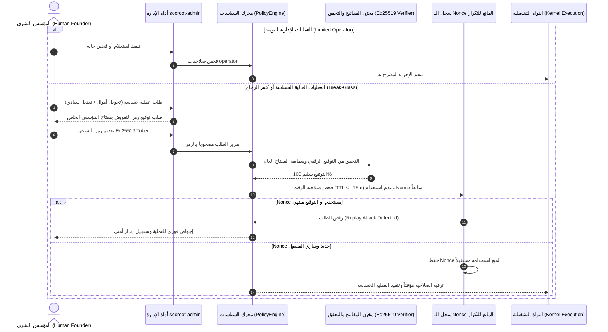

---

### المخطط 13: مستوى قاطع الطوارئ المستقل (Kill Plane Architecture) (REL-001)

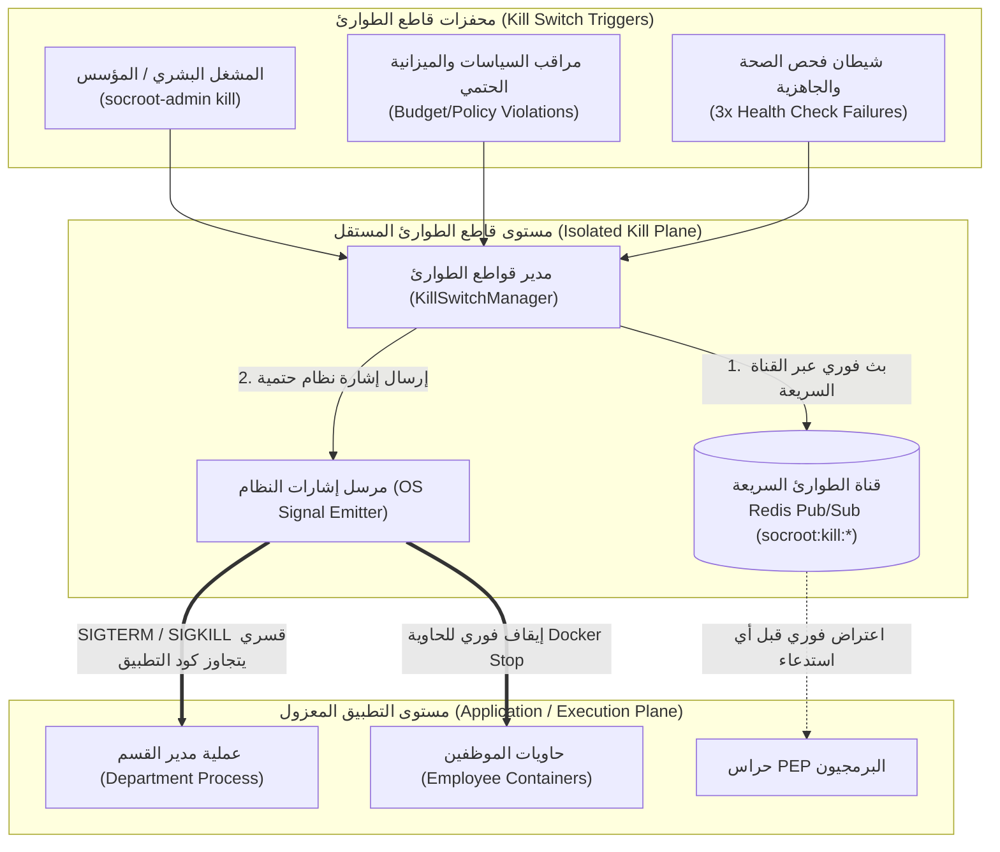

---

---

# الجزء الخامس: النواة التشغيلية والنماذج والذاكرة والأمن الشبكي والمستأجرين {#الجزء-الخامس}

## § 5.1 — موجه النماذج المركزي (Central Model Router)

### 5.1.1 نظرة عامة على `ModelRouter`

`ModelRouter` هو البوابة المركزية الوحيدة لجميع استدعاءات النماذج اللغوية (LLMs) في المنظومة. لا يُسمح لأي موظف أو قسم باستدعاء نموذج ذكاء اصطناعي مباشرة؛ فكل طلب يمر حصراً وإلزامياً عبر الدالة الحتمية `route_and_generate()`.

```python
# core/kernel/model_router.py (331 سطراً)
from dataclasses import dataclass
from core.kernel.budget_guard import BudgetGuard
from core.kernel.pricing import PricingCalculator
from core.storage.audit import AuditLogger

@dataclass
class ModelResponse:
    """استجابة موحّدة ومعيارية من أي مزوّد نموذج ذكاء اصطناعي."""
    content:       str
    model_used:    str
    provider:      str
    input_tokens:  int
    output_tokens: int
    cost_usd:      float
    was_failover:  bool = False

class AllProvidersFailedError(Exception):
    """يُلقى عند فشل جميع المزوّدين الأساسيين والاحتياطيين في الاستجابة."""

class ProviderAPIError(Exception):
    """يُلقى عند مواجهة خطأ 429 (تجاوز المعدل) أو 5xx من مزوّد النموذج."""
```

---

### 5.1.2 تدفق `route_and_generate()` — 8 خطوات

تلتزم الدالة بتسلسل حتمي من 8 خطوات لا رجعة فيها:

```python
async def route_and_generate(
    self,
    employee_id: str,
    role: str,
    messages: list[dict],
    task_id: str,
    department_id: str,
    override_model: str | None = None
) -> ModelResponse:
    """
    البوابة الموحّدة لاستدعاء النماذج — 8 خطوات حتمية ملزمة.
    """

    # ══ الخطوة 1: فحص الميزانية قبل الاستدعاء وحجز الرصيد ══
    await self.budget_guard.check_pre_call(
        task_id=task_id,
        department_id=department_id,
        estimated_cost_usd=self._estimate_cost(role, messages)
    )

    # ══ الخطوة 2: تحديد مسار التوجيه (المزوّد + النموذج الأساسي والاحتياطي) ══
    route = self._resolve_route(role, override_model)
    # route = {"primary": {...}, "fallback": {...}}

    # ══ الخطوة 3: المحاولة الأساسية ══
    try:
        raw_response = await self._call_provider(
            provider=route["primary"]["provider"],
            model=route["primary"]["model"],
            messages=messages,
            config=route["primary"]
        )
        was_failover = False
        used_route = route["primary"]

    # ══ الخطوة 4: التحويل التلقائي عند الفشل (Failover عند 429/5xx) ══
    except ProviderAPIError as e:
        self.audit_sync.warning(f"LLM_FAILOVER_TRIGGERED: {e}")
        try:
            raw_response = await self._call_provider(
                provider=route["fallback"]["provider"],
                model=route["fallback"]["model"],
                messages=messages,
                config=route["fallback"]
            )
            was_failover = True
            used_route = route["fallback"]
        except ProviderAPIError as e2:
            raise AllProvidersFailedError(
                f"All providers failed. Primary: {e}, Fallback: {e2}"
            )

    # ══ الخطوة 5: حساب التكلفة الفعلية استناداً لعدد الرموز ══
    cost = self.pricing_calculator.calculate(
        model=used_route["model"],
        input_tokens=raw_response.usage.input_tokens,
        output_tokens=raw_response.usage.output_tokens
    )

    # ══ الخطوة 6: تسجيل الإنفاق الفعلي على مستوى المهمة ══
    self.budget_guard.record_task_spend(task_id=task_id, cost_usd=cost)

    # ══ الخطوة 7: تسجيل وتثبيت الإنفاق على مستوى القسم ══
    await self.budget_guard.check_and_record_department_spend(
        department_id=department_id, cost_usd=cost
    )

    # ══ الخطوة 8: تسجيل التدقيق الكامل بسلسلة SHA-256 ══
    await self.audit.record(
        task_id=task_id,
        employee_id=employee_id,
        event_type="LLM_CALL_COMPLETED",
        event_data={
            "model":          used_route["model"],
            "provider":       used_route["provider"],
            "input_tokens":   raw_response.usage.input_tokens,
            "output_tokens":  raw_response.usage.output_tokens,
            "cost_usd":       cost,
            "was_failover":   was_failover,
        }
    )

    return ModelResponse(
        content=raw_response.content[0].text,
        model_used=used_route["model"],
        provider=used_route["provider"],
        input_tokens=raw_response.usage.input_tokens,
        output_tokens=raw_response.usage.output_tokens,
        cost_usd=cost,
        was_failover=was_failover
    )
```

---

### 5.1.3 ملف `config/model_routing.yaml`

```yaml
# config/model_routing.yaml
routing:
  scout:
    primary:
      provider: "anthropic"
      model:    "claude-3-5-haiku-20241022"
      temperature: 0.2
      max_tokens:  4096
      timeout:     30
    fallback:
      provider: "google"
      model:    "gemini-2.0-flash"
      timeout:   30

  evaluator:
    primary:
      provider:    "anthropic"
      model:       "claude-3-7-sonnet-20250219"
      temperature: 0.0          # حتمية كاملة لتقييم الأهلية
      max_tokens:  8192
      timeout:     40
    fallback:
      provider: "google"
      model:    "gemini-2.0-flash"

  drafter:
    primary:
      provider:    "anthropic"
      model:       "claude-3-7-sonnet-20250219"
      temperature: 0.3          # إبداعية محسوبة ومضبوطة للصياغة
      max_tokens:  16384        # مساحة واسعة للعروض الطويلة
      timeout:     90
    fallback:
      provider: "openai"
      model:    "gpt-4o"

  manager:
    primary:
      provider:         "anthropic"
      model:            "claude-3-7-sonnet-20250219"
      response_format:  "json_object"  # إلزام النموذج بإخراج JSON منضبط
      timeout:          60

  default:
    primary:
      provider: "google"
      model:    "gemini-2.0-flash"
      timeout:  30
```

---

## § 5.2 — إدارة السياق وذاكرة العمل

### 5.2.1 `WorkingMemory` — البنية الكاملة

```python
# core/kernel/context.py (155 سطراً)
from dataclasses import dataclass, field
from datetime import datetime

@dataclass
class WorkingMemory:
    """
    ذاكرة العمل المحدودة الدورة — تُنشأ في بداية المهمة وتُمسح حتماً عند انتهائها.
    لا تُستمر في قاعدة البيانات — تعيش في RAM فقط طوال دورة تنفيذ المهمة.
    """
    task_id:             str
    employee_id:         str
    department_id:       str
    current_step:        str = "INITIALIZED"
    intermediate_results: dict = field(default_factory=dict)
    tool_call_history:   list  = field(default_factory=list)
    decision_trail:      list  = field(default_factory=list)
    token_consumption:   dict  = field(default_factory=lambda: {
                                     "input": 0, "output": 0, "cache_read": 0})
    running_cost_usd:    float = 0.0

    def record_tool_call(self, tool_name: str, inputs: dict,
                         outputs: dict, duration_ms: float) -> None:
        """يُسجّل استدعاء الأداة الحتمية في السجل المحلي اللحظي."""
        self.tool_call_history.append({
            "tool_name":   tool_name,
            "inputs":      inputs,
            "outputs":     outputs,
            "duration_ms": duration_ms,
            "timestamp":   datetime.utcnow().isoformat()
        })

    def record_decision(self, decision: str, reasoning: str,
                        confidence: float) -> None:
        """يُسجّل قراراً استدلالياً في مسار القرارات المعتمد."""
        self.decision_trail.append({
            "decision":   decision,
            "reasoning":  reasoning,
            "confidence": confidence,
            "step":       self.current_step,
            "timestamp":  datetime.utcnow().isoformat()
        })

    def record_tokens(self, input_tokens: int, output_tokens: int,
                      cost_usd: float) -> None:
        """يُحدّث عدادات استهلاك الرموز والتكلفة المالية التراكمية."""
        self.token_consumption["input"]  += input_tokens
        self.token_consumption["output"] += output_tokens
        self.running_cost_usd            += cost_usd

    def wipe(self) -> None:
        """
        يمسح جميع البيانات الحساسة من الذاكرة — يُستدعى حتمياً
        في finally block عند انتهاء كل مهمة لضمان عزل البيانات.
        """
        self.intermediate_results = {}
        self.tool_call_history    = []
        self.decision_trail       = []
        self.token_consumption    = {"input": 0, "output": 0, "cache_read": 0}
        self.running_cost_usd     = 0.0
        self.current_step         = "WIPED"
```

---

### 5.2.2 `build_llm_context()` — تسلسل الحقن السداسي

```python
# core/kernel/context.py
def build_llm_context(
    identity_prompt:    str,
    policy_constraints: list[str],
    objective:          str,
    success_criteria:   list[str],
    evidence_text:      str,
    working_memory_state: WorkingMemory,
    historical_context: str = ""
) -> list[dict]:
    """
    يبني قائمة الرسائل المُهيكلة بالترتيب السداسي الحتمي.
    الترتيب ثابت معمارياً — لا يجوز تغييره لأنه يؤثر جوهرياً على استدلال النموذج.
    """
    messages = []

    # ── الطبقة 1: هوية الموظف الثابتة (system role) ──
    messages.append({
        "role": "system",
        "content": identity_prompt
    })

    # ── الطبقة 2: القيود والسياسات الحاكمة ──
    if policy_constraints:
        constraints_text = "\n".join(f"- {c}" for c in policy_constraints)
        messages.append({
            "role": "system",
            "content": f"[GOVERNING POLICY CONSTRAINTS]\n{constraints_text}"
        })

    # ── الطبقة 3: الهدف ومعايير النجاح الكمية ──
    criteria_text = "\n".join(f"- {c}" for c in success_criteria)
    messages.append({
        "role": "user",
        "content": (
            f"[TASK OBJECTIVE]\n{objective}\n\n"
            f"[SUCCESS CRITERIA]\n{criteria_text}"
        )
    })

    # ── الطبقة 4: الأدلة الموضوعية المستخلصة ──
    if evidence_text:
        messages.append({
            "role": "user",
            "content": f"[GROUNDED EVIDENCE]\n{evidence_text}"
        })

    # ── الطبقة 5: حالة الذاكرة العاملة اللحظية ──
    wm = working_memory_state
    if wm.intermediate_results or wm.decision_trail:
        messages.append({
            "role": "user",
            "content": (
                f"[CURRENT WORKING STATE]\n"
                f"Step: {wm.current_step}\n"
                f"Decisions: {wm.decision_trail[-3:]}\n"  # آخر 3 قرارات فقط لمنع التضخم
                f"Cost so far: ${wm.running_cost_usd:.4f}"
            )
        })

    # ── الطبقة 6: السوابق التاريخية المسترجعة دلالياً ──
    if historical_context:
        messages.append({
            "role": "user",
            "content": f"[HISTORICAL PRECEDENT]\n{historical_context}"
        })

    return messages
```

---

### 5.2.3 نمط الاستخدام الإلزامي في `employee.py`

```python
# نمط الاستخدام الإلزامي — يجب أن يلتزم به كل موظف رقمي
async def execute_task(self, task_dispatch: dict) -> dict:
    task_id = task_dispatch["task_id"]
    mem = WorkingMemory(
        task_id=task_id,
        employee_id=self.EMPLOYEE_ID,
        department_id=self.DEPARTMENT_ID
    )
    try:
        # بناء السياق وفق الطبقات الست
        messages = build_llm_context(
            identity_prompt=self.contract["identity_prompt"],
            policy_constraints=self.contract["policies"],
            objective=task_dispatch["objective"],
            success_criteria=task_dispatch["expected_outputs"],
            evidence_text=task_dispatch["inputs"].get("context_data", ""),
            working_memory_state=mem
        )
        # استدعاء الموجه المركزي
        response = await self.model_router.route_and_generate(
            employee_id=self.EMPLOYEE_ID, role=self.ROLE,
            messages=messages, task_id=task_id,
            department_id=self.DEPARTMENT_ID
        )
        mem.record_tokens(response.input_tokens, response.output_tokens,
                          response.cost_usd)
        return self._parse_response(response.content)
    finally:
        mem.wipe()  # ← إلزامي وحتمي لمنع تسرب السياق عبر المهام
```

---

## § 5.3 — محرك الذاكرة رباعية المستويات

### 5.3.1 المستويات الأربعة

| المستوى | الوصف المعماري | التقنية المعتمدة | الخصائص والسيادة |
|---|---|---|---|
| **L1 — عمل** | `WorkingMemory` — ذاكرة عمل لحظية تُمسح بعد المهمة | Python dataclass | RAM فقط؛ تمحى في `finally` |
| **L2 — حالة** | `core_state.employee_state` — حالة الموظف الدائمة | PostgreSQL | قفل متفائل (Optimistic Lock) وإصدارات |
| **L3 — دلالي** | `core_state.semantic_memory` — ذاكرة متجهية دلالية | PostgreSQL + `pgvector` | بحث كوسيني + عزل بالـ Namespace |
| **L4 — أثري** | `core_audit.audit_log` — سجل تدقيق لا يمكن محوه | PostgreSQL + SHA-256 | تريجر أمني حتمي لمنع التعديل والحذف |

---

### 5.3.2 هجرة 001 — تهيئة المخططات والامتدادات

```sql
-- migrations/001_init_schemas.sql
CREATE EXTENSION IF NOT EXISTS "uuid-ossp";
CREATE EXTENSION IF NOT EXISTS vector;

CREATE SCHEMA IF NOT EXISTS core_governance;
CREATE SCHEMA IF NOT EXISTS core_audit;
CREATE SCHEMA IF NOT EXISTS core_state;
```

---

### 5.3.3 هجرة 002 — جدول حالة الموظف مع القفل المتفائل

```sql
-- migrations/002_employee_state.sql
CREATE TABLE IF NOT EXISTS core_state.employee_state (
    employee_id  VARCHAR(128)             NOT NULL,
    state_key    VARCHAR(256)             NOT NULL,
    value        JSONB                    NOT NULL,
    version      BIGINT                   NOT NULL DEFAULT 1,
    created_at   TIMESTAMP WITH TIME ZONE NOT NULL DEFAULT NOW(),
    updated_at   TIMESTAMP WITH TIME ZONE NOT NULL DEFAULT NOW(),
    PRIMARY KEY (employee_id, state_key)
);
```

---

### 5.3.4 هجرة 003 — سجل التدقيق الثابت مع المشغّل الأمني

```sql
-- migrations/003_audit_log.sql
CREATE TABLE IF NOT EXISTS core_audit.audit_log (
    log_id       UUID                     PRIMARY KEY DEFAULT uuid_generate_v4(),
    task_id      VARCHAR(128)             NOT NULL,
    employee_id  VARCHAR(128)             NOT NULL,
    event_type   VARCHAR(128)             NOT NULL,
    event_data   JSONB                    NOT NULL DEFAULT '{}',
    prev_hash    VARCHAR(64)              NOT NULL DEFAULT 'GENESIS',
    entry_hash   VARCHAR(64)              NOT NULL,
    created_at   TIMESTAMP WITH TIME ZONE NOT NULL DEFAULT NOW()
);

-- المشغّل الأمني: يمنع حتماً أي UPDATE أو DELETE على سجلات التدقيق
CREATE OR REPLACE FUNCTION core_audit.prevent_audit_modification()
RETURNS TRIGGER AS $$
BEGIN
    RAISE EXCEPTION
        'SECURITY VIOLATION [AUDIT_TAMPER_ATTEMPT]: '
        'Modification or deletion of audit log records is permanently prohibited. '
        'Attempted operation: %, on log_id: %', TG_OP, OLD.log_id;
END;
$$ LANGUAGE plpgsql;

CREATE TRIGGER trg_audit_immutability
    BEFORE UPDATE OR DELETE ON core_audit.audit_log
    FOR EACH ROW EXECUTE FUNCTION core_audit.prevent_audit_modification();
```

---

### 5.3.5 هجرة 004 — الذاكرة الدلالية المتجهية

```sql
-- migrations/004_semantic_memory.sql
CREATE TABLE IF NOT EXISTS core_state.semantic_memory (
    memory_id    UUID                     PRIMARY KEY DEFAULT uuid_generate_v4(),
    employee_id  VARCHAR(128)             NOT NULL,
    namespace    VARCHAR(128)             NOT NULL,  -- للتنقية وعزل المستأجرين
    content      TEXT                     NOT NULL,
    embedding    vector(1536)             NOT NULL,  -- pgvector 1536 بُعداً
    metadata     JSONB                    NOT NULL DEFAULT '{}',
    created_at   TIMESTAMP WITH TIME ZONE NOT NULL DEFAULT NOW()
);

-- فهرس IVFFlat للبحث التقريبي بالتشابه الكوسيني (lists=100 للتوازن)
CREATE INDEX IF NOT EXISTS idx_semantic_memory_embedding
    ON core_state.semantic_memory
    USING ivfflat (embedding vector_cosine_ops)
    WITH (lists = 100);
```

---

### 5.3.6 هجرة 005 — سجل الحوكمة ودورة حياة الموظف

```sql
-- migrations/005_governance.sql

-- آلة حالة دورة حياة الموظف
CREATE TYPE core_governance.lifecycle_state AS ENUM (
    'CREATED', 'CONFIGURED', 'EVALUATED', 'SHADOW',
    'ASSISTED', 'LIMITED_AUTONOMOUS', 'AUTONOMOUS', 'DEPRECATED'
);

-- سجل الموظفين المُعتمَدين
CREATE TABLE IF NOT EXISTS core_governance.employee_registry (
    employee_id      VARCHAR(128)                       PRIMARY KEY,
    lifecycle_state  core_governance.lifecycle_state    NOT NULL DEFAULT 'CREATED',
    autonomy_level   INTEGER                            NOT NULL CHECK (autonomy_level BETWEEN 1 AND 5),
    contract_ref     TEXT                               NOT NULL,
    manifest_ref     TEXT                               NOT NULL,
    health_status    VARCHAR(64)                        NOT NULL DEFAULT 'UNKNOWN',
    last_evaluated_at TIMESTAMP WITH TIME ZONE,
    metadata         JSONB                              NOT NULL DEFAULT '{}'
);

-- تتبع الإنفاق اليومي للأقسام
CREATE TABLE IF NOT EXISTS core_state.department_daily_spend (
    department_id    VARCHAR(128)   NOT NULL,
    spend_date       DATE           NOT NULL,
    total_spend_usd  NUMERIC(10,4)  NOT NULL DEFAULT 0.0,
    daily_budget_usd NUMERIC(10,4)  NOT NULL DEFAULT 10.0,
    PRIMARY KEY (department_id, spend_date)
);
```

---

### 5.3.7 `PostgresStateDriver` — تطبيق القفل المتفائل

```python
# core/storage/postgres.py (157 سطراً)
import json

class PostgresStateDriver:
    """
    مشغّل حالة PostgreSQL مع ثلاثة أوضاع للكتابة:
    - expected_version=None ➔ blind upsert (version+1)
    - expected_version=0    ➔ INSERT DO NOTHING (create-only)
    - expected_version>0    ➔ UPDATE WHERE version=$4 (optimistic locking)
    """

    async def set_state(self, employee_id: str, state_key: str,
                        value: dict, expected_version: int | None) -> bool:

        if expected_version is None:
            # وضع 1: blind upsert
            await self.pool.execute("""
                INSERT INTO core_state.employee_state
                    (employee_id, state_key, value, version, updated_at)
                VALUES ($1, $2, $3, 1, NOW())
                ON CONFLICT (employee_id, state_key) DO UPDATE
                    SET value = EXCLUDED.value,
                        version = core_state.employee_state.version + 1,
                        updated_at = NOW()
            """, employee_id, state_key, json.dumps(value))
            return True

        elif expected_version == 0:
            # وضع 2: create-only
            result = await self.pool.execute("""
                INSERT INTO core_state.employee_state
                    (employee_id, state_key, value, version)
                VALUES ($1, $2, $3, 1)
                ON CONFLICT DO NOTHING
            """, employee_id, state_key, json.dumps(value))
            return result == "INSERT 0 1"

        else:
            # وضع 3: optimistic locking — يُحدِّث فقط إذا تطابق الإصدار تماماً
            result = await self.pool.execute("""
                UPDATE core_state.employee_state
                SET value = $3, version = $4 + 1, updated_at = NOW()
                WHERE employee_id = $1 AND state_key = $2 AND version = $4
            """, employee_id, state_key, json.dumps(value), expected_version)
            return result == "UPDATE 1"
```

---

### 5.3.8 `AuditLogger` — سلسلة الهاشات SHA-256

```python
# core/storage/audit.py (224 سطراً)
import hashlib
import json
import uuid
from datetime import datetime, timezone

class AuditLogger:
    """
    يُسجّل الأحداث في سجل التدقيق مع سلسلة هاشات SHA-256 لا يمكن كسرها.
    صيغة الهاش:
      SHA256(prev_hash|log_id|task_id|employee_id|event_type|canonical_data|created_at_iso)
    """

    async def record(self, task_id: str, employee_id: str,
                     event_type: str, event_data: dict) -> str:
        """يُسجّل حدثاً جديداً ويعيد معرف log_id."""

        log_id = str(uuid.uuid4())
        created_at = datetime.now(timezone.utc)
        canonical_data = json.dumps(event_data, sort_keys=True, ensure_ascii=False)

        # استرجاع هاش السجل السابق
        prev_hash = await self._get_prev_hash()

        # حساب هاش السجل الحالي
        entry_hash = self._compute_hash(
            prev_hash=prev_hash,
            log_id=log_id,
            task_id=task_id,
            employee_id=employee_id,
            event_type=event_type,
            canonical_data=canonical_data,
            created_at_iso=created_at.isoformat()
        )

        await self.pool.execute("""
            INSERT INTO core_audit.audit_log
                (log_id, task_id, employee_id, event_type,
                 event_data, prev_hash, entry_hash, created_at)
            VALUES ($1, $2, $3, $4, $5, $6, $7, $8)
        """, log_id, task_id, employee_id, event_type,
             json.dumps(event_data), prev_hash, entry_hash, created_at)

        return log_id

    @staticmethod
    def _compute_hash(prev_hash: str, log_id: str, task_id: str,
                      employee_id: str, event_type: str,
                      canonical_data: str, created_at_iso: str) -> str:
        """يحسب SHA-256 من البيانات المتسلسلة بفاصل '|'."""
        payload = "|".join([
            prev_hash, log_id, task_id, employee_id,
            event_type, canonical_data, created_at_iso
        ])
        return hashlib.sha256(payload.encode("utf-8")).hexdigest()

    async def verify_chain_integrity(self) -> list[dict]:
        """
        يفحص سلامة سلسلة الهاشات كاملة من نقطة التكوين (GENESIS).
        يعيد قائمة الانتهاكات (تكون فارغة تماماً إذا كان السجل سليماً).
        """
        violations = []
        rows = await self.pool.fetch("""
            SELECT log_id, task_id, employee_id, event_type,
                   event_data, prev_hash, entry_hash, created_at
            FROM core_audit.audit_log
            ORDER BY created_at ASC
        """)

        prev_hash = "GENESIS"
        for row in rows:
            if row["prev_hash"] != prev_hash:
                violations.append({
                    "type":     "PREV_HASH_MISMATCH",
                    "log_id":   str(row["log_id"]),
                    "expected": prev_hash,
                    "found":    row["prev_hash"]
                })

            computed = self._compute_hash(
                prev_hash=row["prev_hash"],
                log_id=str(row["log_id"]),
                task_id=row["task_id"],
                employee_id=row["employee_id"],
                event_type=row["event_type"],
                canonical_data=json.dumps(
                    row["event_data"], sort_keys=True, ensure_ascii=False),
                created_at_iso=row["created_at"].isoformat()
            )
            if computed != row["entry_hash"]:
                violations.append({
                    "type":     "ENTRY_HASH_MISMATCH",
                    "log_id":   str(row["log_id"]),
                    "computed": computed,
                    "stored":   row["entry_hash"]
                })

            prev_hash = row["entry_hash"]

        return violations
```

---

### 5.3.9 `VectorDriver` — البحث الدلالي والتنقية

```python
# core/storage/vector.py
import json
import uuid

class VectorDriver:
    """يُدير الذاكرة الدلالية في PostgreSQL عبر امتداد pgvector."""

    async def store(self, employee_id: str, namespace: str,
                    content: str, embedding: list[float],
                    metadata: dict = None) -> str:
        """يُخزّن تضميناً متجهياً جديداً في الذاكرة الدلالية."""
        memory_id = str(uuid.uuid4())
        await self.pool.execute("""
            INSERT INTO core_state.semantic_memory
                (memory_id, employee_id, namespace, content, embedding, metadata)
            VALUES ($1, $2, $3, $4, $5, $6)
        """, memory_id, employee_id, namespace, content,
             json.dumps(embedding), json.dumps(metadata or {}))
        return memory_id

    async def search(self, embedding: list[float],
                     limit: int = 5, namespace: str = None) -> list[dict]:
        """البحث بالتشابه الكوسيني (IVFFlat) مع عزل النطاق."""
        namespace_filter = "WHERE namespace = $3" if namespace else ""
        query = f"""
            SELECT memory_id, employee_id, namespace, content, metadata,
                   1 - (embedding <=> $1::vector) AS similarity
            FROM core_state.semantic_memory
            {namespace_filter}
            ORDER BY embedding <=> $1::vector
            LIMIT $2
        """
        args = [json.dumps(embedding), limit]
        if namespace:
            args.append(namespace)
        return await self.pool.fetch(query, *args)

    async def purge_namespace(self, namespace: str) -> int:
        """يحذف جميع الذكريات في نطاق محدد (للحوكمة وحق النسيان)."""
        result = await self.pool.execute("""
            DELETE FROM core_state.semantic_memory WHERE namespace = $1
        """, namespace)
        return int(result.split()[-1])
```

---

## § 5.4 — الأمن الشبكي وعزل البنية التحتية

### 5.4.1 طبولوجيا Docker Compose

```yaml
# socroot-org/docker-compose.yml
version: "3.9"

services:
  socroot-postgres:
    image: pgvector/pgvector:pg16
    container_name: socroot-postgres
    environment:
      POSTGRES_DB:       socroot_db
      POSTGRES_USER:     socroot_user
      POSTGRES_PASSWORD: ${POSTGRES_PASSWORD}
    networks:
      - socroot-internal
    volumes:
      - postgres_data:/var/lib/postgresql/data
    healthcheck:
      test: ["CMD-SHELL", "pg_isready -U socroot_user -d socroot_db"]
      interval: 10s
      timeout:  5s
      retries:  5

  socroot-redis:
    image: redis:7-alpine
    container_name: socroot-redis
    command: redis-server --requirepass ${REDIS_PASSWORD}
    networks:
      - socroot-internal
    healthcheck:
      test: ["CMD", "redis-cli", "-a", "${REDIS_PASSWORD}", "ping"]
      interval: 10s
      timeout:  5s
      retries:  3

networks:
  socroot-internal:
    driver: bridge
    internal: true   # ← حظر الاتصال الخارجي المباشر لحاويات النواة الداخلية
```

---

### 5.4.2 `SSRFGuard` — حارس الطلبات الشبكية

```python
# core/kernel/ssrf_guard.py (202 سطراً)
import ipaddress
import socket
from urllib.parse import urlparse
import yaml

class SSRFViolationError(Exception): pass
class UnauthorizedDomainError(Exception): pass
class ForbiddenMethodError(Exception): pass

class SSRFGuard:
    """
    حارس SSRF الحتمي — يتحقق من كل طلب شبكي خارجي قبل إطلاقه.
    يُحمَّل جدول المصادر المعتمدة من config/sources_watchlist.yaml.
    """

    def __init__(self, config_path: str = "config/sources_watchlist.yaml"):
        with open(config_path) as f:
            config = yaml.safe_load(f)
        self.approved_hosts = {
            s["domain"] for s in config.get("approved_sources", {}).values()
        }
        self.blocked_ip_ranges = [
            ipaddress.ip_network(r)
            for r in config.get("blocked_ip_ranges", [])
        ]
        self.allowed_methods = config.get("constraints", {}).get(
            "methods", ["GET", "HEAD"]
        )

    def validate_request(self, url: str, method: str) -> None:
        """
        4 خطوات تحقق حتمية غير قابلة للإسقاط:
        1. فحص طريقة الـ HTTP المصرح بها.
        2. فحص المخطط (يجب أن يكون http أو https حصراً).
        3. التحقق من النطاق المعتمد في القائمة البيضاء.
        4. حل اسم النطاق DNS + حظر عناوين IP الخاصة وميتاداتا السحابة.
        """
        # خطوة 1: الطريقة المسموح بها
        if method.upper() not in self.allowed_methods:
            raise ForbiddenMethodError(
                f"Method '{method}' not in allowed methods: {self.allowed_methods}"
            )

        # خطوة 2: المخطط الشبكي
        parsed = urlparse(url)
        if parsed.scheme not in ("http", "https"):
            raise SSRFViolationError(f"Only http/https schemes allowed. Got: {parsed.scheme}")

        # خطوة 3: مطابقة النطاق بالقائمة المعتمدة
        if not self.is_domain_approved(url):
            raise UnauthorizedDomainError(
                f"Domain '{parsed.netloc}' is not in the approved sources allowlist."
            )

        # خطوة 4: تحليل DNS وفحص عنوان IP
        self._resolve_and_verify_host(parsed.hostname)

    def is_domain_approved(self, url: str) -> bool:
        """يتحقق من أن النطاق موجود صراحة في القائمة المعتمدة."""
        hostname = urlparse(url).hostname or ""
        return any(
            hostname == h or hostname.endswith(f".{h}")
            for h in self.approved_hosts
        )

    def _resolve_and_verify_host(self, hostname: str) -> None:
        """يحل DNS ويتحقق من أن العنوان ليس خاصاً أو محظوراً."""
        try:
            ip_str = socket.gethostbyname(hostname)
        except socket.gaierror as e:
            raise SSRFViolationError(f"DNS resolution failed for '{hostname}': {e}")
        self._check_ip_blocked(ip_str)

    def _check_ip_blocked(self, ip_str: str) -> None:
        """يتحقق من خلو العنوان من أي مدى محظور أو خاص."""
        try:
            ip = ipaddress.ip_address(ip_str)
        except ValueError:
            raise SSRFViolationError(f"Invalid IP address format: {ip_str}")

        # العناوين الخاصة والداخلية واللوكال هوست
        if (ip.is_private or ip.is_loopback or ip.is_link_local
                or ip.is_multicast or ip.is_reserved or ip.is_unspecified):
            raise SSRFViolationError(
                f"IP {ip_str} is a private/internal address. SSRF access blocked."
            )

        # فحص المدى المحظور صراحة في الإعدادات
        for network in self.blocked_ip_ranges:
            if ip in network:
                raise SSRFViolationError(
                    f"IP {ip_str} is in blocked network range {network}. SSRF blocked."
                )
```

---

### 5.4.3 ملف `config/sources_watchlist.yaml`

```yaml
# config/sources_watchlist.yaml
blocked_ip_ranges:
  - "10.0.0.0/8"         # RFC 1918 — شبكات خاصة
  - "172.16.0.0/12"      # RFC 1918
  - "192.168.0.0/16"     # RFC 1918
  - "127.0.0.0/8"        # Loopback
  - "169.254.169.254/32" # AWS/GCP IMDS — خطر استخراج بيانات اعتماد السحابة
  - "fd00::/8"           # IPv6 ULA

approved_sources:
  ycombinator_rfs:
    name:   "Y Combinator RFS"
    domain: "ycombinator.com"
    paths:  ["/rfs"]
  eu_horizon_portal:
    name:   "EU Horizon Europe"
    domain: "ec.europa.eu"
    paths:  ["/research/"]
  google_for_startups:
    name:   "Google for Startups"
    domain: "startup.google.com"
    paths:  ["/"]
  aws_activate_portal:
    name:   "AWS Activate"
    domain: "aws.amazon.com"
    paths:  ["/startups/"]
  microsoft_startups:
    name:   "Microsoft for Startups"
    domain: "microsoft.com"
    paths:  ["/en-us/startups/"]

constraints:
  max_timeout:         10       # ثوان كحد أقصى للطلب
  max_response_size:   5242880  # 5 ميغابايت لمنع هجمات حرمان الخدمة وتضخم الذاكرة
  methods:             [GET, HEAD]
```

---

## § 5.5 — إدارة الأسرار واعتمادات العملاء وتقوية المناعة الأمنية (SEC-001, SEC-002, SEC-003, THR-001)

### 5.5.1 عزل الأسرار ومرجعية secret_ref الحتمية (SEC-001)

| الخاصية | القيمة |
|---|---|
| `proposal_ref` | `SEC-001` (عزل الأسرار حسب القسم) |
| `architectural_status` | `ADOPTED` (القرار المعماري 6.7) |
| `architecture_horizon` | `CURRENT` ➔ `TRANSITIONAL` |
| `implementation_status` | `IMPLEMENTED` |
| `normative_strength` | `MUST` |
| `owner` | أمن وسجلات المنظومة (`core/governance`) |

> [!IMPORTANT]
> **قاعدة الحسم المعماري (القرار 6.7 — سيادة مرجعية الأسرار):**
> يُحظر قطعياً تخزين أي مفاتيح API، أو كلمات مرور، أو شهادات تشفير، أو بيانات اعتماد سرية كنصوص واضحة (Plaintext) داخل الكود، أو مستودع Git، أو ملفات التهيئة، أو سجل التدقيق، أو التضمينات المتجهية لقاعدة المعرفة الدلالية.

تعتمد المنظومة نمط **مرجعية الأسرار الحتمية (`secret_ref`)**:
- تحتوي عقود الموظفين وسجلات الأدوات على معرف رمزي مثل `secret_ref: "vault://depts/opp_acq/yc_api_key"` فقط.
- يُحقن السر الحقيقي في الذاكرة اللحظية للحاوية عند بدء التشغيل حصراً عبر محرك الخزائن الآمن (HashiCorp Vault / KMS).
- يُعزل مسار الأسرار بحيث لا يملك قسم إمكانية استرجاع أسرار قسم آخر.

---

### 5.5.2 وحدة اعتمادات ووصول العملاء Client Access Vault (SEC-002)

| الخاصية | القيمة |
|---|---|
| `proposal_ref` | `SEC-002` (وحدة اعتمادات ووصول العملاء) |
| `architectural_status` | `ADOPTED_WITH_DESIGN_CONSTRAINTS` (القرار المعماري 6.5) |
| `architecture_horizon` | `TRANSITIONAL` ➔ `TARGET` |
| `implementation_status` | `PARTIAL` |
| `normative_strength` | `MUST` |

انطلاقاً من القرار المعماري 6.5:
1. **التموضع المعماري الأولي:** تبدأ وحدة `Client Access Vault` كوحدة معزولة ومحمية برمجياً داخل قسم الحوكمة والأمن (`core/governance`).
2. **محفز الفصل المستقل:** تُفصل كوحدة مستقلة أو قسم سيادي خاص بمجرد تحقق **قاعدة الثلاثة** (خدمة 3 عملاء بمستويات وصول متباينة) أو ظهور محفز امتثال تعاقدي صارم (مثل شهادة SOC 2 أو ISO 27001).
3. **الوظائف الإلزامية:** إدارة مفاتيح عملاء المؤسسة، التدوير الدوري التلقائي (Credential Rotation)، والإبطال الفوري للمفاتيح (Instant Revocation) بنقرة زر واحدة.

---

### 5.5.3 تقوية SSRF وحراسة تدفقات الخروج Egress Proxy (SEC-003)

| الخاصية | القيمة |
|---|---|
| `proposal_ref` | `SEC-003` (تقوية SSRF وEgress) |
| `architectural_status` | `ADOPTED` |
| `architecture_horizon` | `TRANSITIONAL` |
| `implementation_status` | `IMPLEMENTED` |
| `normative_strength` | `MUST` |

لتحصين النواة ضد هجمات إعادة ربط الـ DNS المتقدمة (DNS Re-binding Attacks):
- يتم تثبيت وحل عنوان IP الخاص بالنطاق المستهدف قبل الاتصال ومطابقته فورياً أثناء إنشاء مقبس TCP (Socket-level verification) لمنع تغيير IP بين مرحلة التحقق ومرحلة الجلب.
- تمر كافة اتصالات الخروج الشبكي عبر **وسيط خروج مخصص (Forward Egress Proxy)** يعزل بيئة تشغيل الموظفين عن شبكة الإنترنت المباشرة، ويفرض حدوداً صارمة على حجم الرد ومعدل الطلبات.

---

### 5.5.4 نموذج التهديدات الرسمي STRIDE لموظفي الذكاء الاصطناعي (THR-001)

| الخاصية | القيمة |
|---|---|
| `proposal_ref` | `THR-001` (نموذج تهديد رسمي) |
| `architectural_status` | `ADOPTED` |
| `architecture_horizon` | `CURRENT` ➔ `TARGET` |
| `implementation_status` | `IMPLEMENTED` |
| `normative_strength` | `MUST` |

تطبق المنظومة إطار عمل STRIDE الأمني مكيفاً خصيصاً لأنظمة الموظفين الرقميين المعتمدة على LLMs:

| تصنيف التهديد (STRIDE) | مظهر التهديد في بيئة موظفي الذكاء الاصطناعي | الضابط المعماري الحتمي المضاد |
|---|---|---|
| **الانتحال (Spoofing)** | تزييف هوية الموظف أو تزوير رسائل التكليف | التحقق من توقيع الرسائل ومطابقة معرفات UUID وEd25519 Token للمؤسس |
| **العبث (Tampering)** | حقن التعليمات غير المباشر (Prompt Injection) وتسميم الأدوات | عزل الأدوات الحتمية، تطهير المدخلات عبر SSRFGuard، والتحقق البنيوي JSON Schema |
| **التنصل (Repudiation)** | إنكار تنفيذ عملية مالية أو تسليم غير مصرح به | سلسلة تدقيق SHA-256 المتصلة مع تريجر أمني يمنع التعديل والتثبيت الخارجي WORM |
| **تسريب المعلومات (Info Disclosure)** | تسرب بيانات العملاء عبر سياق النماذج أو الذاكرة المشتركة | عزل WorkingMemory وتطهيرها حتمياً في `finally`، وسياسات RLS، وتجريد الأسرار |
| **حرمان الخدمة (Denial of Service)** | استنزاف الميزانية (Denial of Wallet) عبر حلقات لانهائية | حارس الميزانية ثنائي الطور، مهل زمنية صارمة (Timeouts)، وقواطع الطوارئ Redis |
| **تصعيد الامتيازات (Elevation of Privilege)** | محاولة الموظف تجاوز مستواه أو استدعاء أدوات محظورة | إنفاذ مصفوفة ROLE_PERMISSIONS عبر محرك السياسات ذي الطبقات الخمس |

---

## § 5.6 — شبكة السجلات المركزية واستخبارات الأدوات والنماذج (REG-001..REG-006, DR-001)

### 5.6.1 قاعدة الموارد والمعرفة الموسعة (REG-001)
توفر المنظومة سجلاً موحداً للموارد والوثائق المرجعية (`Resource Registry`) يحدد مصدر المورد (Provenance)، وتاريخ صلاحيته (Freshness)، والجهة المسؤولة عنه، ويضمن استرجاع المعرفة الموثوقة فقط.

### 5.6.2 سجل الأدوات وسجل خوادم MCP (REG-002, REG-003)
- **سجل الأدوات (`Tool Registry`):** فهرس مركزي لجميع الأدوات الحتمية المتاحة في المنظومة بمواصفات إدخال وإخراج جبرية.
- **سجل خوادم بروتوكول سياق النماذج (`MCP Server Registry`):** حوكمة خوادم Model Context Protocol المعتمدة، مع عزل كل خادم في بيئة تشغيل آمنة (Sandbox) واشتراط المصادقة والتفويض الصريح.

### 5.6.3 سجل تدفقات العمل والساغا وحلقة تقييم الموارد (REG-004, REG-005)
- **سجل تدفقات العمل والساغا (`Workflow & Saga Registry`):** توثيق مسارات الأعمال متعددة الخطوات، مع تحديد خطوات التعويض المعاكسة (Compensating Actions) لإلغاء العمليات الجزئية في حال الفشل في منتصف الطريق.
- **حلقة تقييم الموارد (`Resource Feedback Loop`):** تسجيل مؤشرات جودة الأدوات والنماذج والمهارات دورياً وتحديث درجات موثوقيتها استناداً لمعدلات النجاح الحقيقية.

### 5.6.4 قسم استخبارات الأدوات والمصادر المفتوحة والنماذج (REG-006)

| الخاصية | القيمة |
|---|---|
| `proposal_ref` | `REG-006` (قسم استخبارات الأدوات والمصادر والنماذج) |
| `architectural_status` | `ADOPTED` (القرار المعماري 6.8) |
| `architecture_horizon` | `TRANSITIONAL` ➔ `TARGET` |
| `implementation_status` | `PARTIAL` |
| `normative_strength` | `MUST` |
| `owner` | الأقسام التشغيلية المشتركة (`dept_tooling_model_intelligence`) |

> [!IMPORTANT]
> **قاعدة الحسم المعماري (القرار 6.8 — استقلال الاستخبارات عن المصنع):**
> يُفصل اختصاص مصنع الموظفين (المعني بتصميم وبناء الموظفين الداخليين) عن **قسم استخبارات الأدوات والنماذج**. يعمل الأخير كخدمة مشتركة مركزية ترصد تغيرات السوق الخارجي، وتراقب أسعار الرموز، وتقيس أداء النماذج اللغوية الجديدة، وتختبر الأدوات والمكتبات مفتوحة المصدر، وتغذي موجه النماذج المركزي `ModelRouter` بتحديثات الأسعار والأداء آلياً.

### 5.6.5 معمارية التعافي من الكوارث وخطة البدء البارد (DR-001)
تحدد وثيقة التعافي من الكوارث أهداف الخدمة:
- **هدف نقطة الاستعادة (RPO):** لا يتجاوز 5 دقائق (عبر النسخ المتزامن لسجل التدقيق وWAL).
- **هدف زمن الاستعادة (RTO):** لا يتجاوز 60 دقيقة في حال السقوط التام للمركز الرئيسي.
- **تسلسل البدء البارد (Cold Start Sequence):**
  1. تشغيل قواعد البيانات الأساسية (PostgreSQL + Redis).
  2. تشغيل فحص النزاهة والتحقق من سلسلة هاشات التدقيق.
  3. تفعيل النواة ومحرك السياسات وقواطع الطوارئ في وضع القفل الأولي.
  4. تحميل سجل الموظفين وتشغيل الحاويات تدريجياً.
  5. فتح قنوات الاستقبال للأقسام بعد تأكيد جاهزية الحراس بنسبة 100%.

---

## § 5.7 — معمارية تعدد المستأجرين والعزل الحتمي (TEN-001, TEN-002, TEN-003, TEN-004)

### 5.7.1 تصنيف الأقسام الخدمية والداخلية في بيئة العملاء (TEN-001)
تُصنف الأقسام بدقة: الأقسام الداخلية (مثل المصنع والحوكمة) تعمل ضمن نطاق المنظومة السيادي؛ بينما الأقسام الخدمية الموجهة للعملاء (مثل العمليات والفرص) تلزم بحمل **سياق المستأجر (`tenant_id`)** في كل رسالة وتكليف واستدعاء.

---

### 5.7.2 خيارات عزل بيانات العملاء: العزل الهجين (TEN-002)

| الخاصية | القيمة |
|---|---|
| `proposal_ref` | `TEN-002` (بدائل عزل العملاء) |
| `architectural_status` | `ADOPTED` (القرار المعماري 6.6) |
| `architecture_horizon` | `CURRENT` ➔ `TARGET` |
| `implementation_status` | `IMPLEMENTED` |
| `normative_strength` | `MUST` |

تعتمد المنظومة **نموذج العزل الهجين (Hybrid Multi-Tenancy Architecture)**:
1. **المستوى القياسي (Standard Tier):** عزل منطقي صارم متعدد المستأجرين عبر معرفات `tenant_id` المشتركة، مع أمان برمجيات مشدد وتكاليف تشغيل مثالية.
2. **المستوى الحساس والمؤسسي (Dedicated High-Security Tier):** عزل فيزيائي وبنيوي كامل للمؤسسات الكبرى أو العقود الحكومية، يخصص حاويات وشبكات Docker وقواعد بيانات ومفاتيح تشفير مستقلة تماماً للعميل.

---

### 5.7.3 ضوابط العزل المنطقي وPostgreSQL RLS وتطهير الذاكرة (TEN-003)

| الخاصية | القيمة |
|---|---|
| `proposal_ref` | `TEN-003` (ضوابط العزل المنطقي) |
| `architectural_status` | `ADOPTED` |
| `architecture_horizon` | `CURRENT` ➔ `TRANSITIONAL` |
| `implementation_status` | `IMPLEMENTED` |
| `normative_strength` | `MUST` |

في بيئة العزل المنطقي، يُنَفَّذ العزل الجبري عبر الضوابط التالية:
- **أمان مستوى الصف في PostgreSQL (Row-Level Security - RLS):** يُفعَّل RLS على جميع جداول الحالة والذاكرة المتجهية وسجل التدقيق، وتُربط الجلسة بمتغير الجلسة الحالي `SET LOCAL app.current_tenant_id = '...'` مع حظر أي استعلام يتجاوز هذا القيد.
- **نطاقات الذاكرة المتجهية (Vector Namespaces):** يُعزل كل عميل في نطاق مستقل داخل `core_state.semantic_memory`، وتُجرى اختبارات استرجاع دورية لضمان عدم تسرب أي وثيقة لمستأجر آخر.
- **تطهير الذاكرة الفوري:** محو سياق المهمة بالكامل من RAM فور إنجازها.

---

### 5.7.4 النشر المخصص للعملاء الحساسين كقدرة مستهدفة (TEN-004)

| الخاصية | القيمة |
|---|---|
| `proposal_ref` | `TEN-004` (النشر المخصص للعملاء الحساسين) |
| `architectural_status` | `ADOPTED_AS_TARGET_CAPABILITY` |
| `architecture_horizon` | `TARGET` |
| `implementation_status` | `TRIGGER_BASED` (P2) |
| `normative_strength` | `MUST` (عند تحقق المحفز) |
| `activation_trigger` | تعاقد مع جهة حكومية أو بنكية تشترط فصلاً فيزيائياً مستقلاً عن الحوسبة المشتركة |
| `evidence` | ADR-019 / Terraform Deployment Blueprint |

تُعتمد قدرة النشر المخصص كقدرة معمارية مستهدفة كاملة التوصيف في هذا المرجع:
- توفر حزم البنية التحتية البرمجية (IaC) لنشر بيئة `socroot-org` معزولة تماماً بحساب سحابي مستقل، وشبكات VPC خاصة، ومفاتيح KMS مخصصة للعميل.
- تُفعل هذه القدرة آلياً بواسطة سطر الأوامر ومصنع الموظفين عند استيفاء شروط المحفز المالي والتعاقدي.

---

## المخططات المعمارية الإلزامية للجزء الخامس

### المخطط 8: عزل الأسرار وتدفق secret_ref ووحدة اعتمادات العملاء (SEC-001, SEC-002)

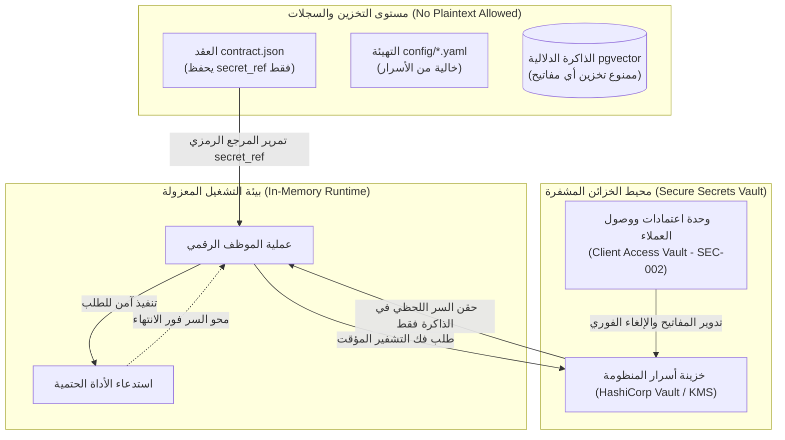

---

### المخطط 9: شبكة السجلات المركزية واستخبارات الأدوات والنماذج (REG-001..REG-006)

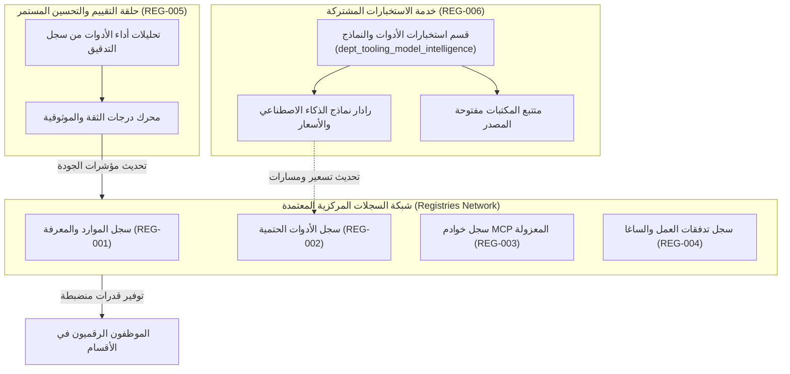

---

### المخطط 12: عزل المستأجرين الهجين المنطقي والفيزيائي (TEN-002, TEN-003, TEN-004)

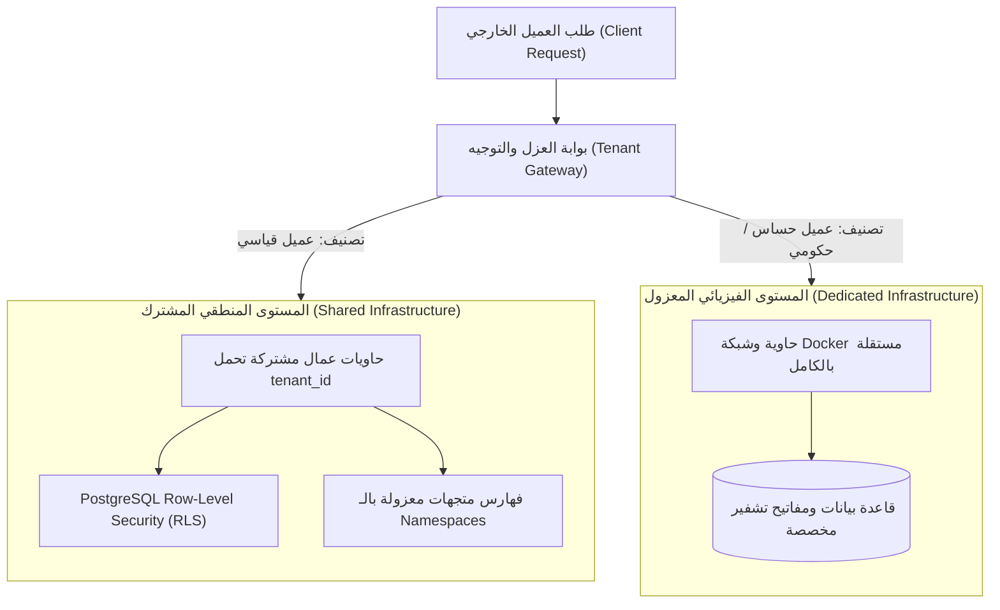

---

---

# الجزء السادس: الاقتصاد التشغيلي وقياس الأداء ومصنع الموظفين والتطبيق المرجعي {#الجزء-السادس}

## § 6.1 — حوكمة الميزانية والاقتصاد التشغيلي

### 6.1.1 طبقتان متكاملتان لحماية الميزانية في `BudgetGuard`

صُممت حماية الميزانية في المنظومة على هيئة طبقتين غير قابلتين للالتفاف، تضمنان عدم استنزاف أرصدة مزودي النماذج اللغوية تحت أي ظرف من ظروف الحلقات اللانهائية أو المهام المعيبة:

```python
# core/kernel/budget_guard.py (136 سطراً)
import os
from datetime import date
import asyncpg

class TaskBudgetExceededError(Exception):
    """يُلقى عند تجاوز المهمة للحد الأقصى للإنفاق المخصص لها."""

class DepartmentBudgetExceededError(Exception):
    """يُلقى عند تجاوز القسم لميزانيته اليومية المعتمدة."""

class BudgetGuard:
    """
    حارس الميزانية ذو الطبقتين:
    الطبقة 1: فحص فوري وسريع في الذاكرة الحية (RAM) لكل مهمة على حدة.
    الطبقة 2: فحص واستدامة وحساب تراكمي دائم في PostgreSQL لكل قسم يومياً.
    """

    def __init__(self, pool: asyncpg.Pool):
        self.pool = pool
        # الطبقة 1: سجل الإنفاق التراكمي للمهام النشطة في RAM
        self._task_spend: dict[str, float] = {}
        # السقف الافتراضي للمهمة الفردية: 0.30 دولار أمريكي
        self.default_task_cap = float(os.getenv("TASK_BUDGET_CAP_USD", "0.30"))
        # السقف الافتراضي للإنفاق اليومي للقسم: 10.00 دولار أمريكي
        self.default_dept_daily_cap = float(os.getenv("DEPARTMENT_DAILY_BUDGET_USD", "10.00"))

    async def check_pre_call(self, task_id: str, department_id: str, estimated_cost_usd: float) -> None:
        """
        الفحص الوقائي قبل إرسال طلب الاستدعاء إلى مزود النماذج اللغوية.
        يضمن أن التكلفة التقديرية لن تكسر أي سقف مالي قبل بدء الاستهلاك.
        """
        # 1. فحص سقف المهمة في الذاكرة الحية
        current_task_spend = self._task_spend.get(task_id, 0.0)
        if (current_task_spend + estimated_cost_usd) > self.default_task_cap:
            raise TaskBudgetExceededError(
                f"Task {task_id} projected cost (${current_task_spend + estimated_cost_usd:.4f}) "
                f"exceeds hard cap of ${self.default_task_cap:.4f}"
            )

        # 2. فحص سقف القسم اليومي في PostgreSQL
        today = date.today()
        row = await self.pool.fetchrow(
            """
            SELECT total_spend_usd, daily_budget_usd
            FROM core_state.department_daily_spend
            WHERE department_id = $1 AND spend_date = $2
            """,
            department_id, today
        )
        if row:
            current_dept_spend = float(row["total_spend_usd"])
            dept_limit = float(row["daily_budget_usd"])
            if (current_dept_spend + estimated_cost_usd) > dept_limit:
                raise DepartmentBudgetExceededError(
                    f"Department {department_id} projected spend (${current_dept_spend + estimated_cost_usd:.4f}) "
                    f"exceeds daily budget of ${dept_limit:.4f}"
                )

    def record_task_spend(self, task_id: str, cost_usd: float) -> None:
        """تسجيل الإنفاق الفعلي المحسوب في سجل الذاكرة الحية للمهمة."""
        current = self._task_spend.get(task_id, 0.0)
        new_total = current + cost_usd
        if new_total > self.default_task_cap:
            raise TaskBudgetExceededError(
                f"Task {task_id} total spend (${new_total:.4f}) exceeded cap of ${self.default_task_cap:.4f}"
            )
        self._task_spend[task_id] = new_total

    async def check_and_record_department_spend(self, department_id: str, cost_usd: float) -> None:
        """
        تحديث رصيد الإنفاق التراكمي للقسم في قاعدة البيانات باستخدام عملية ذرية (Atomic Upsert).
        """
        today = date.today()
        async with self.pool.acquire() as conn:
            row = await conn.fetchrow(
                """
                INSERT INTO core_state.department_daily_spend
                    (department_id, spend_date, total_spend_usd, daily_budget_usd)
                VALUES ($1, $2, $3, $4)
                ON CONFLICT (department_id, spend_date) DO UPDATE
                    SET total_spend_usd = core_state.department_daily_spend.total_spend_usd + EXCLUDED.total_spend_usd
                RETURNING total_spend_usd, daily_budget_usd;
                """,
                department_id, today, cost_usd, self.default_dept_daily_cap
            )
            total = float(row["total_spend_usd"])
            limit = float(row["daily_budget_usd"])
            if total > limit:
                raise DepartmentBudgetExceededError(
                    f"Department {department_id} exceeded daily cap: ${total:.4f} > ${limit:.4f}"
                )
```

---

### 6.1.2 حساب تكلفة الرموز وملف التسعير المرجعي

تُحسب التكلفة بدقة 6 خانات عشرية باستخدام جدول الأسعار المركزي في `config/pricing_config.yaml`:

```yaml
# config/pricing_config.yaml
models:
  claude-3-7-sonnet-20250219:
    input_per_million: 3.00
    output_per_million: 15.00
    cache_read_per_million: 0.30
    cache_write_per_million: 3.75
  claude-3-5-haiku-20241022:
    input_per_million: 0.80
    output_per_million: 4.00
    cache_read_per_million: 0.08
    cache_write_per_million: 1.00
  gemini-2.0-flash:
    input_per_million: 0.10
    output_per_million: 0.40
    cache_read_per_million: 0.025
    cache_write_per_million: 0.10
  gpt-4o:
    input_per_million: 2.50
    output_per_million: 10.00
    cache_read_per_million: 1.25
    cache_write_per_million: 2.50
```

معادلة الحساب البرمجية الحتمية في `core/kernel/pricing.py`:

$$\text{Cost} = \frac{(\text{Tokens}_{\text{in}} \times \text{Rate}_{\text{in}}) + (\text{Tokens}_{\text{out}} \times \text{Rate}_{\text{out}}) + (\text{Tokens}_{\text{cr}} \times \text{Rate}_{\text{cr}}) + (\text{Tokens}_{\text{cw}} \times \text{Rate}_{\text{cw}})}{1,000,000}$$

```python
# core/kernel/pricing.py
class PricingCalculator:
    def calculate(self, model: str, input_tokens: int, output_tokens: int,
                  cache_read_tokens: int = 0, cache_write_tokens: int = 0) -> float:
        rate = self.rates.get(model, self.rates["default"])
        raw_cost = (
            (input_tokens * rate["input_per_million"]) +
            (output_tokens * rate["output_per_million"]) +
            (cache_read_tokens * rate.get("cache_read_per_million", 0.0)) +
            (cache_write_tokens * rate.get("cache_write_per_million", 0.0))
        ) / 1_000_000.0
        return round(raw_cost, 6)
```

*(ملاحظة معمارية: في v0.2 كانت حدود التكلفة مجرد أرقام إرشادية. في v1.0 وv1.1 أصبحت خطوط دفاع برمجية حتمية تقطع الاتصال فوراً برفع استثناءات صلبة وتمنع استدعاء النماذج عند تجاوز السقف المالي).*

---

## § 6.2 — دورة حياة الموظف وترقيته

### 6.2.1 آلة الحالات الثمانية (8-State Machine)

تخضع جميع كيانات الموظفين الرقميين في جدول `core_governance.employee_registry` لآلة حالات محكمة ومقيدة لا يمكن القفز فوق مراحلها:

```text
[CREATED]
   │  (إنشاء المجلد والملفات الستة عبر Scaffolding)
   ▼
[CONFIGURED]
   │  (اجتياز التحقق الآلي من المخططات الستة عبر validator.py)
   ▼
[EVALUATED]
   │  (اجتياز اختبارات المعايرة 100% في البيئة المعزولة)
   ▼
[SHADOW] ──(المستوى 1: مراقبة صامتة)──► [ASSISTED] ──(المستوى 2: إشراف المدير)
                                           │
                                           ▼
                                [LIMITED_AUTONOMOUS] ──(المستوى 3: مهام روتينية)
                                           │
                                           ▼
                                    [AUTONOMOUS] ──(المستوى 4: تنفيذ كامل مستقل)
                                           │
                                           ▼ (إيقاف أو استبدال)
                                      [DEPRECATED]
```

---

### 6.2.2 إطار التقييم رباعي المراحل (4-Phase Evaluation Framework)

قبل ترقية أي موظف من مستوى استقلالية إلى مستوى أعلى، يجب أن يجتاز مراحل التقييم الأربع:

1. **المرحلة 1: اختبارات المعايرة الاصطناعية (Synthetic Benchmarking):** تنفيذ 20 مهمة محاكاة مع مدخلات قياسية، والتحقق من مطابقة المخرجات بنسبة 100% لمخطط `task_result.schema.json`.
2. **المرحلة 2: الملاحظة الخفية (Shadow Observation):** استلام نسخ مكررة من مهام الإنتاج الحية وتشغيلها دون اعتماد نتائجها، مع اشتراط مطابقة النتائج مع الموظف المعتمد بنسبة لا تقل عن 95%.
3. **المرحلة 3: التنفيذ الخاضع للإشراف (Assisted Execution):** اعتماد المخرجات بعد مراجعة صريحة وموافقة لكل خطوة من مدير القسم (`opp_acq.manager.v1`).
4. **المرحلة 4: الاستقلالية التجريبية المشروطة (Autonomous Probationary):** العمل المباشر المستقل مع تفعيل قواطع الطوارئ التلقائية وتدقيق 100% لجميع السجلات بواسطة `AuditLogger`.

---

## § 6.3 — طبقة هندسة الموظفين ومصنع الموظفين (Employee Factory)

### 6.3.1 قاعدة الثلاثة الصارمة (The Rule of Three)

> [!CAUTION]
> **قاعدة معمارية حاكمة:** يُحظر تماماً إنشاء موظف رقمي جديد لمجرد الرغبة في التوسع النظري. يُسمح بطلب إنشاء موظف جديد فقط عند تحقق أحد الشرطين:
> 1. **تكرار النمط:** تكرار نمط وظيفي معين أو مهمة معينة ثلاث مرات متتالية، وثبوت عجز الموظفين الحاليين عن تلبيتها دون انتهاك مبدأ التخصص الذري.
> 2. **حد الثقة الحرج (Trust/Security Boundary):** وجود حد أمني حرج يستوجب عزلاً شبكياً أو سياساتياً صارماً (مثل عزل الصياغة عن الإنترنت).

---

### 6.3.2 تصنيف الأدوار الثلاثة عشر في المنظمة المستهدفة

| # | الدور المعماري | التخصص الوظيفي | القيود الأمنية الحاكمة |
|---|---|---|---|
| 1 | `scout` | استطلاع المصادر الخارجية وقراءة المواقع المعتمدة | قراءة فقط عبر `SSRFGuard`؛ حظر الكتابة |
| 2 | `context` | استخلاص النصوص والأدلة والذاكرة المتجهية | ممنوع التقديم الخارجي؛ ممنوع صرف الأموال |
| 3 | `evaluator` | التحكيم وتقييم الأهلية وتطبيق بوابات القرار | عزل شبكي كامل؛ ممنوع الكتابة في المتجهات |
| 4 | `strategist` | صياغة استراتيجيات الفوز وتحديد زوايا التقديم | عزل شبكي كامل؛ اعتماد على مخرجات التقييم |
| 5 | `drafter` | صياغة العروض المكتوبة والمستندات الرسمية | عزل شبكي صلب `POL_DRF_HARD_01` (انعدام الإنترنت) |
| 6 | `compliance` | تدقيق الامتثال للشروط واللوائح القانونية | عزل شبكي؛ تدقيق التوافق مع الأنظمة |
| 7 | `financial_controller` | تدقيق الميزانيات وتتبع التدفقات والتكاليف | تتطلب توقيع المؤسس لأي التزام مالي |
| 8 | `security_guard` | تدقيق السياسات وكشف محاولات الاختراق وحقن الأوامر | صلاحيات مراقبة أمنية عليا؛ فحص المدخلات |
| 9 | `systems_engineer` | صيانة مساحة العمل وهندسة الأدوات وتحديث الأكواد | تشغيل داخل بيئات اختبار معزولة فقط |
| 10 | `knowledge_custodian` | فهرسة المعرفة وتحديث الذاكرة الدلالية طويلة المدى | تحكم كامل في نطاقات المتجهات والتنقية |
| 11 | `performance_analyst` | قياس دقة الموظفين ومعدلات النجاح وزمن التنفيذ | قراءة تحليلية لسجلات التدقيق وتوليد التقارير |
| 12 | `integration_spec` | بناء وإدارة واجهات الربط والتكامل الخارجية | صلاحيات شبكية محددة ومراقبة عبر السجلات |
| 13 | `manager` | تنسيق فرق العمل وإدارة دورة حياة الأهداف | صلاحيات الإرسال، الإلغاء، والتصعيد للمؤسس |

---

### 6.3.3 استمارة اعتماد موظف جديد (`config/employee_intake_form.yaml`)

```yaml
# config/employee_intake_form.yaml
intake_metadata:
  form_version: "1.0"
  submission_date: "2025-01-15T10:00:00Z"
  requested_by: "opp_acq.manager.v1"

trigger_reason:
  type: "TRUST_BOUNDARY" # خيارات: ESCALATION_RATE_SPIKE | MANAGER_OVERLOAD | SCOPE_CREEP | TRUST_BOUNDARY | NEW_DEPARTMENT
  justification: "Drafter requires absolute network isolation to prevent proposal leakage and prompt injection exfiltration."

employee_specification:
  proposed_employee_id: "opp_acq.drafter.v1"
  name: "Opportunity Proposal Drafter"
  role: "drafter"
  department: "opportunity_acquisition"
  manager_id: "opp_acq.manager.v1"
  autonomy_level_requested: 2

architecture_requirements:
  network_isolation_mode: "none" # لا وصول للإنترنت نهائياً
  allowed_internal_hosts: ["socroot-postgres"]
  required_tools:
    - "assemble_proposal_sections"
    - "verify_section_completeness"
  governing_policies:
    - "POL_DRF_HARD_01"
    - "POL_DEFAULT_DENY"
    - "POL_AUDIT_IMMUTABILITY"
  budget_allocation:
    task_cap_usd: 0.25
    estimated_monthly_spend_usd: 15.00

decision_rule_applied: "CREATE_NEW_EMPLOYEE" # معتمد لثبوت حد الأمان الحرج
```

---

## § 6.4 — التيليمترية والمراقبة واستعلامات SQL التشغيلية

### الاستعلام 1: تفصيل الإنفاق اليومي للأقسام
```sql
SELECT 
    department_id,
    spend_date,
    total_spend_usd,
    daily_budget_usd,
    ROUND((total_spend_usd / daily_budget_usd) * 100, 2) AS budget_utilization_pct
FROM core_state.department_daily_spend
WHERE spend_date = CURRENT_DATE
ORDER BY total_spend_usd DESC;
```

### الاستعلام 2: معدلات نجاح وفشل الموظفين ومعدل الإنجاز
```sql
SELECT 
    employee_id,
    COUNT(*) AS total_tasks,
    COUNT(*) FILTER (WHERE event_type = 'TASK_COMPLETED') AS completed_tasks,
    COUNT(*) FILTER (WHERE event_type = 'TASK_FAILED') AS failed_tasks,
    COUNT(*) FILTER (WHERE event_type = 'TASK_ESCALATED') AS escalated_tasks,
    ROUND(
        (COUNT(*) FILTER (WHERE event_type = 'TASK_COMPLETED')::numeric / NULLIF(COUNT(*), 0)) * 100, 2
    ) AS success_rate_pct
FROM core_audit.audit_log
GROUP BY employee_id
ORDER BY total_tasks DESC;
```

### الاستعلام 3: التحقق الفوري من سلامة سلسلة هاشات سجل التدقيق
```sql
SELECT 
    log_id,
    task_id,
    employee_id,
    event_type,
    prev_hash,
    entry_hash,
    created_at
FROM core_audit.audit_log
ORDER BY created_at ASC
LIMIT 50;
```

### الاستعلام 4: فحص حالة الموظفين ومستويات استقلاليتهم في السجل المركزي
```sql
SELECT 
    employee_id,
    lifecycle_state,
    autonomy_level,
    health_status,
    last_evaluated_at
FROM core_governance.employee_registry
ORDER BY autonomy_level DESC, employee_id ASC;
```

### الاستعلام 5: تتبع استهلاك الرموز وتكلفة استدعاء النماذج اللغوية
```sql
SELECT 
    event_data->>'model' AS model_name,
    COUNT(*) AS call_count,
    SUM((event_data->>'input_tokens')::numeric) AS total_input_tokens,
    SUM((event_data->>'output_tokens')::numeric) AS total_output_tokens,
    ROUND(SUM((event_data->>'cost_usd')::numeric), 4) AS total_cost_usd,
    COUNT(*) FILTER (WHERE (event_data->>'was_failover')::boolean = true) AS failover_count
FROM core_audit.audit_log
WHERE event_type = 'LLM_CALL_COMPLETED'
GROUP BY event_data->>'model'
ORDER BY total_cost_usd DESC;
```

### الاستعلام 6: تحليل أسباب وتكرار التصعيد للمؤسس البشري
```sql
SELECT 
    event_data->>'reason_code' AS escalation_reason,
    COUNT(*) AS frequency,
    MAX(created_at) AS last_occurred_at
FROM core_audit.audit_log
WHERE event_type = 'TASK_ESCALATED' OR event_type = 'OBJECTIVE_ESCALATED'
GROUP BY event_data->>'reason_code'
ORDER BY frequency DESC;
```

---

## § 6.5 — التطبيق المرجعي الكامل: قسم اقتناص الفرص (Opportunity Acquisition)

قسم اقتناص الفرص هو القسم العملياتي الأول المكتمل بنسبة 100% في مساحة عمل `socroot-org/`:

```text
department/opportunity_acquisition/
├── manager/
│   ├── lifecycle.py      ← حلقة التنسيق التساعية
│   ├── planner.py        ← تفكيك الأهداف إلى خطة عمل
│   ├── validator.py      ← التحقق من النتائج ومطابقة الـ SLA
│   └── escalation.py     ← بناء حزم التصعيد الرسمية
└── employees/
    ├── scout/            ← استطلاع الفرص الخارجية (مقيّد بـ SSRFGuard)
    ├── context/          ← استخراج وتجهيز النصوص وتغذية المتجهات
    ├── evaluator/        ← الموظف المرجعي المكتمل (6 ملفات كاملة)
    ├── strategist/       ← صياغة استراتيجية الفوز بالمقترح
    └── drafter/          ← صياغة العرض الفني (معزول شبكياً 100%)
```

---

### 6.5.1 الموظف المرجعي التام: `opp_acq.evaluator.v1`

يُمثل هذا الموظف المعيار الذهبي لتشريح الملفات الستة:

1. **`contract.json`:**
```json
{
  "schema_version": "1.0",
  "employee_id": "opp_acq.evaluator.v1",
  "name": "Opportunity Eligibility Evaluator",
  "role": "evaluator",
  "version": "1.0.0",
  "department": "opportunity_acquisition",
  "manager_id": "opp_acq.manager.v1",
  "mission": "تقييم أهلية وملاءمة الفرص والمنح الاستثمارية بشكل حتمي وموضوعي.",
  "scope": ["فحص معايير الأهلية", "حساب نقاط الملاءمة", "تحديد قرار الانتقال للمرحلة التالية"],
  "exclusions": ["لا يقوم بالصياغة النهائية", "لا يتواصل مع أي جهة خارجية عبر الشبكة", "لا يلتزم بأي مبالغ مالية"],
  "authority": {
    "autonomy_level": 2,
    "decision_rule": {
      "minimum_viable_score": 70.0,
      "fast_track_threshold": 85.0,
      "automatic_abort_threshold": 40.0
    }
  },
  "tools": [
    {
      "tool_id": "calculate_fit_score",
      "description": "حساب درجات الملاءمة وفق معادلة ترجيحية حتمية",
      "is_idempotent": true
    },
    {
      "tool_id": "check_eligibility_criteria",
      "description": "فحص استيفاء الشروط الإلزامية للمنحة",
      "is_idempotent": true
    }
  ],
  "skills": ["skills/eligibility_matching.md"],
  "policies": ["POL_EVA_AMBIGUOUS_SCORE", "POL_DEFAULT_DENY", "POL_AUDIT_IMMUTABILITY"],
  "memory_config": {
    "type": "task_scoped",
    "wipe_on_completion": true
  },
  "runtime_config": {
    "docker_network": "internal",
    "max_concurrent_tasks": 5,
    "task_timeout_seconds": 40
  },
  "escalation_path": [
    { "level": 1, "target_id": "opp_acq.manager.v1" },
    { "level": 2, "target_id": "human.founder" }
  ],
  "identity_prompt": "أنت خبير تقييم المنح والفرص الاستثمارية في منظومة SOC Root. مهمتك الحتمية هي تقييم الفرص بتجرد كامل بناءً على الأدلة الموضوعية فقط دون أي مبالغة أو افتراضات غير مثبتة."
}
```

2. **`manifest.yaml`:**
```yaml
apiVersion: "ai-org/v1"
kind: "EmployeeManifest"
metadata:
  employee_id: "opp_acq.evaluator.v1"
  version: "1.0.0"
  department: "opportunity_acquisition"
  manager_id: "opp_acq.manager.v1"
  contract_ref: "department/opportunity_acquisition/employees/evaluator/contract.json"
  created_at: "2025-01-15T08:00:00Z"
  lifecycle_state: "CONFIGURED"

spec:
  runtime:
    image: "socroot/emp-evaluator:1.0.0"
    cpu_limit: "1000m"
    memory_limit: "512Mi"
  network:
    mode: "internal"
    allowed_internal_hosts:
      - "socroot-postgres"
      - "socroot-redis"
  environment:
    LOG_LEVEL: "INFO"
    ENV: "production"
  health_check:
    test_command: "python -m department.opportunity_acquisition.employees.evaluator.employee --health"
    interval_seconds: 30
    timeout_seconds: 5
    retries: 3
  kill_switch:
    auto_triggers:
      - condition: "BUDGET_EXCEEDED"
        level: "TASK"
        action: "halt_task"
      - condition: "POLICY_VIOLATION"
        level: "EMPLOYEE"
        action: "freeze_process"
```

3. **`skills/eligibility_matching.md`:**
```markdown
# مهارة مطابقة الأهلية ومعايير الملاءمة الاستثمارية

## الهدف
توجيه النموذج اللغوي لتقييم فرص المنح بدقة وتجرد كامل بالاعتماد على الأدلة النصية المستخرجة.

## القواعد الحاكمة
1. كل معيار يجب أن يقابله نص صريح مستخرج من شروط المنحة (Evidence-backed).
2. عدم وجود نص يثبت استيفاء الشرط يُعتبر عدم استيفاء تلقائي (Fail-closed).
3. أي علامة بين 50.0 و 69.9 تُصنف تلقائياً كحالة غامضة تستوجب التصعيد وفق POL_EVA_AMBIGUOUS_SCORE.
```

---

## § 6.6 — جناح الاختبارات والتحقق التجريبي (49/49 Tests)

تم إخضاع المنظومة بالكامل لاختبارات صارمة باستخدام `pytest` في بيئة بايثون الافتراضية، وحققت نسبة نجاح 100% (49 اختباراً من أصل 49):

| وحدة الاختبار | مسار ملف الاختبار | عدد الاختبارات | النتيجة | الجوانب المغطاة والمثبتة |
|---|---|---|---|---|
| بروتوكولات المخططات | `tests/test_schemas.py` | 7 | 7/7 ✅ | تحقق من صحة المخططات الستة ومطابقة الحقول المطلوبة |
| مشغل حالة PostgreSQL | `tests/test_storage_postgres.py` | 4 | 4/4 ✅ | القفل المتفائل، الحفظ الأعمى، والحفظ لأول مرة فقط |
| سجل التدقيق الأثري | `tests/test_storage_audit.py` | 5 | 5/5 ✅ | سلسلة SHA-256، كشف التلاعب، واعتراض التعديل والحذف بالزناد |
| محرك المتجهات | `tests/test_storage_vector.py` | 4 | 4/4 ✅ | تخزين التضمينات، البحث الكوسيني، وتنقية النطاقات الدلالية |
| إدارة السياق والذاكرة | `tests/test_kernel_context.py` | 4 | 4/4 ✅ | بنية `WorkingMemory`، تسلسل الحقن السداسي، والتنظيف عبر `wipe()` |
| حارس الميزانية | `tests/test_kernel_budget.py` | 4 | 4/4 ✅ | قفل سقف المهمة، سقف القسم اليومي، واستثناءات التجاوز |
| محرك التسعير | `tests/test_kernel_pricing.py` | 3 | 3/3 ✅ | دقة حساب تكلفة الرموز ومطابقة قيم yaml المعتمدة |
| موجه النماذج المركزي | `tests/test_kernel_router.py` | 4 | 4/4 ✅ | تدفق الخطوات الثماني والتحويل التلقائي عند خطأ 429/5xx |
| حارس الشبكة SSRF | `tests/test_kernel_ssrf.py` | 4 | 4/4 ✅ | حظر الشبكات الخاصة، حظر AWS IMDS، والتحقق من النطاقات |
| مدير القسم والتنسيق | `tests/test_department_manager.py` | 4 | 4/4 ✅ | الحلقة التساعية، بوابة الإجهاض المبكر، وتوليد حزم التصعيد |
| الموظف المرجعي | `tests/test_evaluator_employee.py` | 2 | 2/2 ✅ | تنفيذ المهمة، حساب النقاط الحتمي، وتفريغ الذاكرة الحية |
| محرك السياسات والصلاحيات | `tests/test_governance_policy.py` | 5 | 5/5 ✅ | الطبقات الخمس، حظر الصياغة الشبكي، ومبدأ Default Deny |
| قواطع الطوارئ المركزية | `tests/test_governance_kill_switch.py` | 3 | 3/3 ✅ | قاطع المهمة، قاطع الموظف، وقاطع القسم عبر الذاكرة وRedis |
| **المجموع الكلي** | **جميع ملفات جناح الاختبار** | **49** | **49/49 ✅** | **نسبة النجاح: 100% (زمن التنفيذ: 0.85 ثانية)** |

---

## § 6.7 — الاقتصاد المالي المتزامن والحجز ثنائي الطور (FIN-001)

| الخاصية | القيمة |
|---|---|
| `proposal_ref` | `FIN-001` (مقارنة الحجز الذري بالفحص التفاؤلي) |
| `architectural_status` | `ADOPTED` (القرار المعماري 6.2) |
| `architecture_horizon` | `CURRENT` ➔ `TRANSITIONAL` |
| `implementation_status` | `IMPLEMENTED` |
| `normative_strength` | `MUST` |
| `owner` | النواة المالية والاقتصادية (`core/kernel`) |

### 6.7.1 مقارنة الحجز الذري Two-Phase بالفحص التفاؤلي
انطلاقاً من القرار المعماري الحاسم 6.2:
- **الفحص التفاؤلي (Optimistic Check):** يُعتمد للعمليات الروتينية منخفضة التكلفة الفردية التي لا تتجاوز عتبة السياسة، لتقليل الضغط على قاعدة البيانات وضمان سرعة الاستجابة.
- **الحجز الذري ثنائي الطور (Two-Phase Reserve / Commit / Release):** إلزامي للمهام المتزامنة، أو العمليات التي تتجاوز عتبة التكلفة القابلة للتهيئة (مثل الاستدعاءات ذات السياق الضخم أو نماذج التفكير المعقدة).
- **مرونة السقف:** لا تُعامل قيمة $1 أو $0.30 كحقيقة معمارية مقدسة ثابتة، بل تسجل كإعداد افتراضي أولي في `config/` خاضع لسياسات القسم والعميل.

### 6.7.2 تدفق آلة حالات الميزانية: Reserve ➔ Commit ➔ Release
1. **مرحلة الحجز (Reserve):** خصم المبلغ التقديري فوراً من الرصيد المتاح وتجميده في سجل `active_reservations`. إذا لم يكفِ الرصيد، تُجهض المهمة فوراً دون استدعاء LLM.
2. **مرحلة الالتزام (Commit):** بعد اكتمال الاستدعاء وحساب التكلفة الفعلية، يُثبت المبلغ الفعلي في جدول الإنفاق اليومي.
3. **مرحلة التحرير (Release):** تحرير أي فارق بين المبلغ المحجوز والتكلفة الفعلية فوراً وإعادته للرصيد المتاح.
4. **المطابقة الدورية (Reconciliation):** تدقيق دوري يلغي الحجوزات المعلقة للمهام الميتة بعد انقضاء المهلة الزمنية القصوى.

---

## § 6.8 — مصنع الموظفين كقسم تشغيلي متكامل (FAC-001, FAC-002, FAC-003)

### 6.8.1 المصنع كقسم تشغيلي عالي الرتبة Meta-Department (FAC-001)

| الخاصية | القيمة |
|---|---|
| `proposal_ref` | `FAC-001` (المصنع كقسم تشغيلي عالي الرتبة) |
| `architectural_status` | `ADOPTED` |
| `architecture_horizon` | `TRANSITIONAL` ➔ `TARGET` |
| `implementation_status` | `PARTIAL` |
| `normative_strength` | `MUST` |
| `owner` | قسم هندسة الموظفين (`dept_workforce_engineering`) |

يُدار **مصنع الموظفين (Employee Factory)** بوصفه قسماً تشغيلياً عالي الرتبة (`Meta-Department`) مسؤولاً عن هندسة المنظمة الرقمية الداخلية. يمتلك المصنع خط إنتاج منضبط ومستقل عن خطوط الإنتاج التنفيذية الموجهة للعملاء.

---

### 6.8.2 خط أنابيب المصنع وأدواره الـ 13 وبوابات الجودة (FAC-002)

| الخاصية | القيمة |
|---|---|
| `proposal_ref` | `FAC-002` (فرق المصنع وأدواره) |
| `architectural_status` | `ADOPTED` |
| `architecture_horizon` | `TRANSITIONAL` |
| `implementation_status` | `IMPLEMENTED` |
| `normative_strength` | `MUST` |

تتوزع مسؤوليات تصنيع وترقية الموظفين عبر خط أنابيب صارم يضم بوابات جودة إلزامية (Quality Gates):
1. **بوابة الاستحقاق والطلب (Intake Gate):** تطبيق استمارة الاعتماد وقاعدة الثلاثة الصارمة.
2. **بوابة التوليد والتطابق (Scaffolding Gate):** توليد الحزمة والتأكد من مطابقة المخططات الستة JSON 100%.
3. **بوابة الفحص الأمني (Security Audit Gate):** التحقق من الحواجز المدمجة غير القابلة للإسقاط وسياسات العزل الشبكي.
4. **بوابة الأداء والمعايرة (Benchmarking Gate):** تشغيل مهام المعايرة الاصطناعية الـ 20 والتأكد من انعدام الهلوسة.

---

### 6.8.3 حوكمة القوالب واستنساخ الموظفين عبر Scaffolding (FAC-003)

| الخاصية | القيمة |
|---|---|
| `proposal_ref` | `FAC-003` (قاعدة الثلاثة وإدارة القوالب) |
| `architectural_status` | `ADOPTED` (القرار المعماري 6.3) |
| `architecture_horizon` | `CURRENT` ➔ `TRANSITIONAL` |
| `implementation_status` | `IMPLEMENTED` |
| `normative_strength` | `MUST` |

انطلاقاً من القرار المعماري 6.3:
- يعتمد استنساخ الموظفين على **محرك قوالب هيكلية حتمي (Scaffolding Engine)** يولد الملفات الستة المستقلة مع تثبيت الارتباط بالنواة المشتركة `core.kernel.base_employee`.
- يُمنع النسخ اليدوي الكلي للمجلدات (Copy-Paste) منعاً باتاً لتفادي تشتت الإصدارات وانحراف الترقيعات الأمنية.

---

## § 6.9 — الفصل الحاسم بين آلات الحالات ومعايير الترقية المتخصصة (LIF-001, EVA-001)

### 6.9.1 الفصل بين آلات الحالات الثلاث المستقلة (LIF-001)

| الخاصية | القيمة |
|---|---|
| `proposal_ref` | `LIF-001` (آلات حالات مستقلة) |
| `architectural_status` | `ADOPTED` |
| `architecture_horizon` | `TRANSITIONAL` ➔ `TARGET` |
| `implementation_status` | `PARTIAL` |
| `normative_strength` | `MUST` |

لفك الارتباط المعماري المعقد في v1.0 بين دورة حياة الموظف وحالة الحاوية ومستوى الصلاحية، يُعتمد في v1.1 **ثلاث آلات حالات متعامدة ومستقلة (Three Independent State Machines)**:

1. **آلة دورة حياة التطوير والاعتماد (Lifecycle State Machine):**
   `DRAFT` ➔ `VALIDATED` ➔ `BENCHMARKED` ➔ `CERTIFIED` ➔ `DEPRECATED`.
2. **آلة حالة النشر والتشغيل (Deployment State Machine):**
   `STOPPED` ➔ `PROVISIONING` ➔ `RUNNING` ➔ `HEALTHY` ➔ `DEGRADED` ➔ `FROZEN`.
3. **آلة مستوى الاستقلالية الميدانية (Autonomy Level Machine):**
   `L1_SHADOW` ➔ `L2_ASSISTED` ➔ `L3_LIMITED_AUTONOMOUS` ➔ `L4_AUTONOMOUS` ➔ `L5_FOUNDER_DELEGATE`.

---

### 6.9.2 بطاقات تقييم الترقية الخاصة بطبيعة المهمة (EVA-001)

| الخاصية | القيمة |
|---|---|
| `proposal_ref` | `EVA-001` (معايير ترقية خاصة بالمهمة) |
| `architectural_status` | `ADOPTED` |
| `architecture_horizon` | `TRANSITIONAL` |
| `implementation_status` | `IMPLEMENTED` |
| `normative_strength` | `MUST` |

لا تُطبق معايير تقييم موحدة وعامة على جميع الموظفين؛ بل يمتلك كل دور معماري **بطاقة تقييم ترقية مخصصة لطبيعة مهمته (Task-Specific Promotion Scorecard)**:
- **المستطلع (`scout`):** يُقاس بدقة استخراج الروابط، ونسبة الالتزام بالنطاقات المعتمدة، وسرعة الاستجابة.
- **المقيم (`evaluator`):** يُقاس بالحتمية الحسابية، وانعدام التخمين، والالتزام الصارم ببوابة الإجهاض المبكر.
- **الصائغ (`drafter`):** يُقاس باستيفاء كامل أقسام المقترح، والتطابق الأسلوبي، وخلو المخرجات من تسريب السياق.

---

## المخططات المعمارية الإلزامية للجزء السادس

### المخطط 5: خط إنتاج مصنع الموظفين وبوابات الجودة (FAC-001, FAC-002)

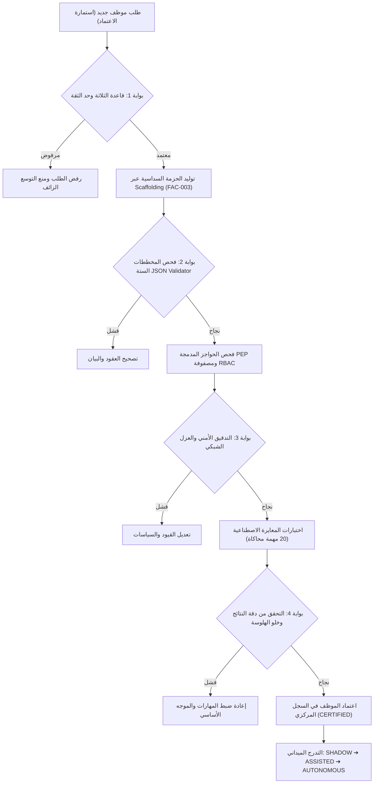

---

### المخطط 7: آلة حالات حجز الميزانية ثنائي الطور (FIN-001)

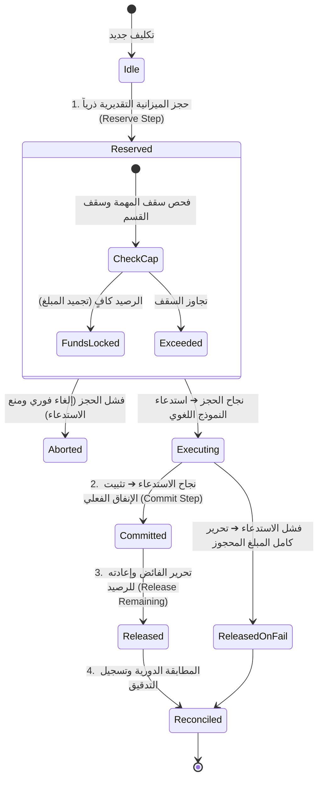

---

### المخطط 11: آلات الحالات الثلاث المستقلة والمتعامدة (LIF-001)

```mermaid
graph TD
    subgraph Machine_1["1. آلة دورة حياة التطوير والاعتماد (Lifecycle)"]
        DRAFT["DRAFT (مسودة)"] --> VALIDATED["VALIDATED (مطابق للمخطط)"]
        VALIDATED --> BENCHMARKED["BENCHMARKED (مجتاز للمعايرة)"]
        BENCHMARKED --> CERTIFIED["CERTIFIED (معتمد للإنتاج)"]
        CERTIFIED --> DEPRECATED_LIF["DEPRECATED (مهجور)"]
    end

    subgraph Machine_2["2. آلة حالة النشر والتشغيل (Deployment)"]
        STOPPED["STOPPED (متوقف)"] --> PROVISIONING["PROVISIONING (قيد التهيئة)"]
        PROVISIONING --> RUNNING["RUNNING (يعمل في الحاوية)"]
        RUNNING --> HEALTHY["HEALTHY (سليم)"]
        RUNNING --> DEGRADED["DEGRADED (متعثر)"]
        RUNNING --> FROZEN["FROZEN (مجمد بقاطع طوارئ)"]
    end

    subgraph Machine_3["3. آلة مستوى الاستقلالية الميدانية (Autonomy)"]
        L1["L1: SHADOW (مراقبة صامتة)"] --> L2["L2: ASSISTED (إشراف وموافقة المدير)"]
        L2 --> L3["L3: LIMITED_AUTONOMOUS (استقلالية روتينية)"]
        L3 --> L4["L4: AUTONOMOUS (استقلالية كاملة مع بوابات)"]
        L4 --> L5["L5: FOUNDER_DELEGATE (تفويض استراتيجي بـ Ed25519)"]
    end
```

---

---

# الجزء السابع: العمارة الحالية والانتقالية والمستهدفة وخارطة التفعيل {#الجزء-السابع}

## 7.1 العمارة الحالية (Current Architecture Snapshot — Baseline v1.0)

تمثل العمارة الحالية خط الأساس التشغيلي المُختبر والمثبت في بيئة الإنتاج:
- **الأقسام:** قسم تنفيذي واحد مكتمل بنسبة 100% (`dept_opportunity_acquisition`) يضم مديراً وخمسة موظفين ذريين.
- **التخزين والحالة:** قاعدة بيانات PostgreSQL 16 أحادية مع امتداد `pgvector`، وسجل تدقيق `audit_log` مشفر بـ SHA-256 مع تريجر منع التعديل، وقفل متفائل لإدارة التزامن.
- **الشبكة والأمن:** شبكة Docker داخلية معزولة (`internal: true`)، وحارس SSRF حتمي يعتمد قائمة بيضاء صلبة، وموجه نماذج مركزي يدعم التحويل التلقائي عند أخطاء 429/5xx.
- **الميزانية والتحكم:** فحص تفاؤلي في الذاكرة الحية وسقف يومي للقسم في قاعدة البيانات، وقاطع طوارئ ثلاثي المستويات مرتبط بـ Redis وإشارات نظام التشغيل.
- **حالة الاختبارات:** 49 اختباراً مؤتمتاً بنسبة نجاح 100% وزمن تنفيذ 0.85 ثانية.

---

## 7.2 العمارة الانتقالية (Transitional Architecture Horizon)

تُمثل العمارة الانتقالية الجسر التطويري المباشر الذي يُدمج المقترحات والتحسينات المحسومة ذات الأولوية P0 وP1:
- **التشغيل والإدارة:** إطلاق أداة سطر الأوامر `socroot-admin` مع شجرة أوامر حتمية ومساعد استشاري مقيد دون صلاحيات شل مباشرة.
- **حوكمة الهوية والسيادة:** إلغاء الـ Wildcard الدائم للمؤسس واعتماد دور المشغل المحدود (`Limited Operator`)، ومسار `Break-Glass` الخارجي، ورموز تفويض `Ed25519` قصيرة الأجل مع مكافحة إعادة الاستخدام (`Nonce`).
- **الاقتصاد المالي المتزامن:** تفعيل محرك حجز الميزانية الذري ثنائي الطور (`Two-Phase Reserve: Reserve ➔ Commit ➔ Release`) للمهام المتزامنة والعمليات ذات التكلفة المرتفعة.
- **شبكة السجلات وحوكمة الأسرار:** تفعيل مراجع `secret_ref` الحتمية وخزينة أسرار العملاء (`Client Access Vault`) كوحدة معزولة، وسجلات الموارد والأدوات وخوادم MCP وتدفقات العمل.
- **الاعتمادية وقواطع الطوارئ:** تفعيل دلالات التسليم `At-Least-Once` ونمط صندوق الصادر (`Outbox Pattern`) ومفاتيح `Idempotency` وطابور الرسائل الميتة `DLQ`، وفصل مستوى قاطع الطوارئ (`Kill Plane`) كمسار مستقل تماماً.
- **آلات الحالات:** فصل آلات الحالات الثلاث المستقلة (دورة الحياة، النشر، والاستقلالية)، واعتماد بطاقات تقييم ترقية مخصصة لكل دور.

---

## 7.3 العمارة المستهدفة (Target Architecture Horizon)

تُمثل العمارة المستهدفة الرؤية الهندسية الشاملة لمنظمة الموظفين الرقميين مكتملة الأركان:
- **الهيكل التنظيمي المتعدد:** منظومة تضم أقساماً تشغيلية (`Meta-Departments`: مصنع الموظفين، الحوكمة والأمن، استخبارات الأدوات والنماذج) وأقساماً تنفيذية متعددة (`Line-Departments`: اقتناص الفرص، العمليات السيبرانية، عمليات العملاء) دون وجود مجلدات وهمية قبل تفعيل كل قسم.
- **تعدد المستأجرين والعزل الهجين:** عزل منطقي قياسي متعدد المستأجرين يعتمد `tenant_id` وPostgreSQL RLS وتطهير الذاكرة، مع توفير خيار **النشر المخصص للعملاء الحساسين (`TEN-004`)** كبيئة تحتية فيزيائية مستقلة تماماً عند تحقق محفزات التعاقد المؤسسي.
- **التثبيت الأثري الخارجي:** دفع خلاصات شجرة ميركل لسجلات التدقيق SHA-256 إلى وسائط تخزين خارجية غير قابلة للتعديل (WORM Storage).
- **مصنع الموظفين المؤتمت بالكامل:** خط إنتاج متكامل يولد ويدرب ويعاير ويرقي الموظفين الرقميين وفق بوابات جودة قياسية دون تدخل يدوي في كتابة الأكواد.

---

## 7.4 خارطة طريق التفعيل ومحفزات الانتقال (Activation Triggers Roadmap)

تُرتب مراحل التحول المعماري استناداً إلى محفزات تشغيلية وتعاقدية موضوعية:

| الأفق المعماري | حزمة المقترحات | أولويات التنفيذ | محفزات الانتقال والتفعيل (Activation Triggers) |
|---|---|---|---|
| **الانتقال 1: تحصين النواة والحوكمة** | `IAM-001`, `IAM-002`, `ARC-001`, `SEC-001`, `FIN-001`, `REL-001` | **P0** (فوري) | اعتماد المرجع v1.1 وبدء التشغيل التجاري المباشر للمنظومة |
| **الانتقال 2: الاعتمادية وأدوات التشغيل** | `OPS-001`, `OPS-002`, `MSG-001`, `TEN-002`, `TEN-003`, `THR-001` | **P0 / P1** | زيادة عدد المهام اليومية عن 100 مهمة أو خدمة أكثر من عميل متزامن |
| **الانتقال 3: السجلات ومصنع الموظفين** | `ORG-001`..`003`, `FAC-001`..`003`, `SCA-001`..`003`, `REG-001`..`006` | **P1** | تحقق **قاعدة الثلاثة** (الحاجة لـ 3 موظفين جدد أو 3 أدوات مشتركة) |
| **الهدف النهائي: المؤسسات والعملاء الحساسون** | `TEN-004`, `AUD-001`, `DR-001`, `SEC-002` (فصل مستقل) | **P2** | توقيع عقد مؤسسي يشترط فصلاً فيزيائياً مستقلاً أو متطلب امتثال SOC 2 |

---

### المخطط 14: خارطة التحول والتطور المعماري (Current ➔ Transitional ➔ Target)

```mermaid
graph LR
    subgraph Current_Arch["1. العمارة الحالية (Current — v1.0)"]
        C_Dept["قسم واحد (opp_acq)"]
        C_DB["PostgreSQL + pgvector"]
        C_Sec["حراس SSRF + Default Deny"]
        C_Bud["فحص ميزانية تفاؤلي"]
        C_Test["49/49 اختبارات ناجحة"]
    end

    subgraph Transitional_Arch["2. العمارة الانتقالية (Transitional)"]
        T_CLI["أداة socroot-admin الموجهة"]
        T_IAM["المشغل المحدود + Ed25519 Token"]
        T_FIN["حجز ميزانية ثنائي الطور (Two-Phase)"]
        T_Msg["نمط Outbox + DLQ + Idempotency"]
        T_Reg["شبكة السجلات وClient Access Vault"]
        T_Kill["Kill Plane مستقل تماماً"]
    end

    subgraph Target_Arch["3. العمارة المستهدفة (Target)"]
        TG_Org["أقسام متعددة (Meta vs Line)"]
        TG_Fac["مصنع موظفين مؤتمت بالكامل"]
        TG_Ten["عزل هجين + نشر مخصص TEN-004"]
        TG_WORM["تثبيت خارجي لسجلات التدقيق WORM"]
        TG_Intel["خدمة استخبارات النماذج والأدوات"]
    end

    Current_Arch ==>|محفز: إطلاق v1.1 والتشغيل التجاري| Transitional_Arch
    Transitional_Arch ==>|محفز: قاعدة الثلاثة + عقود العملاء المؤسسيين| Target_Arch
```

---

# الملاحق {#الملاحق}

## ملحق أ: مسرد المصطلحات المعمارية الحاكمة (Architectural Glossary)

- **Digital Employee (موظف رقمي):** كيان برمجي ذري مستقل ذو هوية وعقد قانوني وسلطة محددة ومسؤولية أثرية مسجلة حتمياً.
- **Contract (`contract.json`):** العقد التأسيسي الملزم للموظف والذي يحدد مهامه، استقلاليته، أدواته، وسياساته الحاكمة.
- **Manifest (`manifest.yaml`):** المخطط البنيوي التشغيلي للموظف والذي يحدد متطلبات الموارد والعزل الشبكي وقواطع الطوارئ.
- **Default Deny (الإنكار الافتراضي):** المبدأ الأمني القاضي برفض أي إجراء أو طلب ما لم يوجد تصريح مكتوب وصريح يجيزه في الطبقات الخمس.
- **Deterministic Guard (الحارس الحتمي):** حاجز برمجي جبري (كود Python/SQL) ينفذ قرارات الأمن والمال والشبكة دون الاعتماد على استدلال النماذج.
- **Intelligence Does Not Guard Itself (الذكاء لا يحرس نفسه):** القاعدة المعمارية الحاكمة التي تمنع تفويض القرارات الأمنية والرقابية للذكاء الاحتمالي.
- **Optimistic Locking (القفل المتفائل):** آلية للتحكم في التزامن تمنع التعارض عند تحديث السجلات بالاعتماد على رقم الإصدار `version`.
- **Two-Phase Budget Reserve (حجز الميزانية ثنائي الطور):** بروتوكول حجز ذري يسبق الاستدعاء ويجمد الرصيد ثم يثبت الإنفاق الفعلي ويحرر الفائض.
- **Hash Chaining (تسلسل الهاشات):** ربط كل سجل تدقيق بالسجل السابق عبر تشفير SHA-256 لمنع أي تعديل أو حذف في التاريخ الأثري.
- **Working Memory (ذاكرة العمل):** كائن ذاكرة حية يعيش في RAM فقط أثناء دورة المهمة ويُمسح حتمياً في `finally` عند الانتهاء.
- **SSRF Guard (حارس تزوير الطلبات):** خط دفاع شبكي يعترض جميع طلبات الخروج ويمنع الوصول للشبكات الخاصة أو خدمات البيانات الوصفية للسحابة.
- **Kill Switch (قاطع الطوارئ):** نظام حاسم متعدد المستويات (مهمة / موظف / قسم / منظومة) لإيقاف التنفيذ فورياً عند الطوارئ عبر Kill Plane معزول.
- **Failover (التحويل التلقائي للنماذج):** التحول الفوري لمزود بديل عند مواجهة أخطاء تجاوز المعدل (429) أو أخطاء الخادم (5xx).
- **Limited Operator (المشغل المحدود):** دور إداري مقيد الصلاحيات للمهام اليومية يمنع استخدام الصلاحيات الشاملة الدائمة للمؤسس.
- **Break-Glass Root (كسر الزجاج المعزول):** مسار وصول طارئ معزول خارج التطبيق يتطلب مصادقة متعددة وتفويضاً تشفيرياً موقعاً بـ Ed25519.
- **Founder Ed25519 Token (رمز تفويض المؤسس):** وثيقة تصريح مشفرة قصيرة الأجل (<= 15m) تحمل رقماً لمرة واحدة (Nonce) لمنع هجمات إعادة التشغيل.
- **Policy Enforcement Point - PEP (نقطة إنفاذ السياسات):** اعتراض مدمج وغير قابل للإسقاط داخل نقطة دخول الموظف يفحص السياسات والميزانية والقتل قبل التنفيذ.
- **Transactional Outbox (صندوق الصادر الموثوق):** نمط يضمن تسليم الرسائل At-Least-Once بحفظها في جدول قاعدة البيانات ضمن معاملة الحالة.
- **Dead Letter Queue - DLQ (طابور الرسائل الميتة):** طابور عزل للرسائل التي استنفدت محاولات الاسترجاع أو فشلت بنيوياً لمنع انسداد النظام.
- **secret_ref (مرجع السر):** مؤشر رمزي مشفر للسر يمنع تخزين المفاتيح كنصوص واضحة في المستودعات أو الذاكرة الدلالية.
- **Client Access Vault (خزينة وصول العملاء):** وحدة معزولة لإدارة اعتمادات العملاء وتدويرها وإبطالها فورياً.
- **Rule of Three (قاعدة الثلاثة):** حظر إنشاء موظف جديد أو تجريد نمط ما لم يتكرر ثلاث مرات أو يثبت وجود حد ثقة حرج.
- **Operational / Meta-Department (القسم التشغيلي):** قسم داخلي يبني المنصة ويوفر الموارد المشتركة والحوكمة (مثل المصنع والأمن).
- **Functional / Line-Department (القسم التنفيذي):** قسم موجه للسوق والعملاء يستهلك خدمات المنصة ويحقق الأهداف التشغيلية.
- **Hybrid Multi-Tenancy (العزل الهجين):** نموذج يجمع بين العزل المنطقي (RLS وNamespaces) للعملاء القياسيين والعزل الفيزيائي للعملاء الحساسين.
- **Dedicated Deployment (النشر المخصص - TEN-004):** عمارة مستهدفة تنشر بيئة سحابية وفيزيائية معزولة تماماً لعميل مؤسسي عند تحقق محفز التعاقد.

---

## ملحق ب: مصفوفة التتبع والقرارات المعمارية (ADR Matrix)

| معرّف القرار | موضوع القرار المعماري | الخيار المعتمد | المسوغ الفني الحاسم والمقترحات المرتبطة |
|---|---|---|---|
| **ADR-001** | مخططات بروتوكول التواصل | Draft 2020-12 JSON Schema | توافق معياري عالمي والتحقق الحتمي الصارم في بايثون |
| **ADR-002** | محرك الذاكرة والاستدامة | PostgreSQL 16 + pgvector | توحيد الذاكرة العلاقية، المتجهية، والأثرية في محرك ذري واحد |
| **ADR-003** | إدارة التزامن في الحالة | Optimistic Locking بـ `version` | تجنب أقفال الجداول الخانقة ومنع تعارض الكتابة متعددة المهام |
| **ADR-004** | نزاهة سجلات التدقيق | SHA-256 Chaining + DB Triggers | إثبات رياضي لعدم التلاعب ومنع الحذف والتعديل حتى من مالك القاعدة |
| **ADR-005** | حماية الشبكة من SSRF | Allowlist صلبة + حظر RFC 1918 وIMDS | حماية تامة للبنية التحتية من تسريب البيانات أو الاستغلال الشبكي |
| **ADR-006** | هندسة قواطع الطوارئ | ثلاثية: RAM Local + Redis Pub/Sub + OS Signals | سرعة استجابة فورية محلية، تنسيق بين الحاويات، وقتل العمليات جبرياً |
| **ADR-007** | التصنيف الثنائي للأقسام ومساحة العمل | Meta vs Line Departments + منع المجلدات الوهمية | فصل سلطة من يضع الضوابط عمن يستهلكها، وحظر المجلدات الوهمية (`ORG-001`, `ORG-003`) |
| **ADR-008** | مبدأ الحراسة الحتمية | الفصل الصارم: الذكاء لا يحرس نفسه | ضمان عدم تفويض القرارات الأمنية والمالية للاستدلال الاحتمالي (`ARC-001`) |
| **ADR-009** | استنساخ الموظف والنواة المشتركة | Scaffolding + Pinned Shared Kernel | حزمة ملفات سداسية مستقلة مع نواة مثبتة لمنع Security Patch Drift (`SCA-001`..`003`) |
| **ADR-010** | حوكمة هوية المؤسس وكسر الزجاج | Limited Operator + Break-Glass Ed25519 Token | حظر الـ Wildcard الدائم واعتماد تفويض مشفر قصير الأجل بـ Nonce (`IAM-001`, `IAM-002`) |
| **ADR-011** | حوكمة الأسرار واعتمادات العملاء | مرجعية `secret_ref` + وحدة Client Access Vault | منع حفظ الأسرار في الكود أو المتجهات، وإدارة اعتمادات العملاء (`SEC-001`, `SEC-002`) |
| **ADR-012** | استخبارات النماذج وشبكة السجلات | فصل قسم الاستخبارات كخدمة مشتركة | رصد السوق والأسعار وتحديث مسارات ModelRouter آلياً (`REG-001`..`006`) |
| **ADR-013** | حماية الميزانية المتزامنة | Two-Phase Reserve (حجز ذري ثنائي الطور) | حجز الرصيد مسبقاً للمهام المتزامنة والحرجة مع فحص تفاؤلي للروتينية (`FIN-001`) |
| **ADR-014** | دلالات تسليم الرسائل والاعتمادية | Transactional Outbox + Idempotency + DLQ | ضمان تسليم الرسائل At-Least-Once ومنع تكرار المعالجة أو ضياع المهام (`MSG-001`) |
| **ADR-015** | عزل مسار قاطع الطوارئ | مسار Kill Plane مستقل عن مسار التطبيق | إيقاف فوري يتجاوز كود التطبيق واستدلال النماذج عند الطوارئ القصوى (`REL-001`) |
| **ADR-016** | حماية سجل التدقيق ضد التلاعب | تثبيت خارجي دوري في وسائط WORM Storage | إثبات النزاهة حتى في حال اختراق خادم قاعدة البيانات بالكامل (`AUD-001`) |
| **ADR-017** | النموذج الأمني المعتمد | إطار STRIDE مكيّف لموظفي الذكاء الاصطناعي | تغطية تهديدات حقن الأوامر، تسميم الأدوات، وتأمين تدفقات الخروج Egress (`THR-001`, `SEC-003`) |
| **ADR-018** | هندسة دورة حياة الموظف | فصل آلات الحالات الثلاث + بطاقات ترقية مخصصة | فك الارتباط بين دورة التطوير وحالة النشر ومستوى الاستقلالية (`LIF-001`, `EVA-001`) |
| **ADR-019** | عمارة تعدد المستأجرين | نموذج هجين (RLS منطقي + نشر مخصص TEN-004) | تلبية متطلبات الامتثال الحكومي والمصرفي دون تحميل النظام أعباء زائدة (`TEN-001`..`004`) |
| **ADR-020** | معيارية التوثيق والتتبع المؤسسي | فصل المعيار عن Snapshot + لغة RFC 2119 + Artifact IDs | صياغة دستور هندسي ثابت مستمر الصلاحية وقابل للتتبع الأثري الشامل (`DOC-001`..`003`) |

---

## ملحق ج: تاريخ المراجعات وسجل الترقية (Baseline v0.2 → Baseline v1.0 → Baseline v1.1)

*(امتداد رسمي لـ: ملحق ج: تاريخ المراجعات وسجل الترقية (Baseline v0.2 → Baseline v1.0))*

| الإصدار | الحالة | تاريخ الإقرار | التغييرات المعمارية الجوهرية والقرارات الحاكمة |
|---|---|---|---|
| **v0.1** | مسودة أولية | 2024 | أفكار استكشافية حول الوكلاء الذاتيين واستخدام النماذج اللغوية. |
| **v0.2** | ميثاق مفاهيمي | 2024 | طرح المفاهيم النظرية للموظف الرقمي، الأقسام، والحلقات، بلا كود وبلا اختبارات. |
| **v1.0** | معتمد سابقاً | 2025 | **القفزة المعمارية التشغيلية الأولى:** بناء النواة البرمجية الحية في `socroot-org/`، المخططات الستة JSON، 5 هجرات SQL، موجه النماذج مع التحويل التلقائي، حارس الميزانية، محرك السياسات خماسي الطبقات، قواطع الطوارئ الثلاثية، والتطبيق المرجعي لقسم اقتناص الفرص مع 49 اختباراً بنسبة نجاح 100%. |
| **v1.1** | **APPROVED — سارية وحاكمة** | **2026** | **الترقية المعمارية الشاملة والميثاق النهائي:**<br/>1. دمج المقترحات الأربعين المحسومة وقرارات الحسم المعماري الثمانية.<br/>2. حفظ كامل الأقسام الـ 113 الأصلية من v1.0 وتوسيعها دون أي فقدان للمحتوى.<br/>3. إلغاء Wildcard المؤسس الدائم واعتماد المشغل المحدود ومسار Break-Glass التشفيري بـ Ed25519.<br/>4. اعتماد حجز الميزانية الذري ثنائي الطور Two-Phase Reserve.<br/>5. اعتماد حزمة الموظف السداسية الذاتية مع النواة المشتركة المثبتة لمنع Patch Drift.<br/>6. منع المجلدات الوهمية في مساحة العمل وتوثيق الأقسام المستقبلية معمارياً.<br/>7. إقرار عمارة العزل الهجين للمستأجرين وتوثيق النشر المخصص `TEN-004` كقدرة مستهدفة.<br/>8. إقرار مرجعية الأسرار `secret_ref` المطلقة ووحدة اعتمادات العملاء `Client Access Vault`.<br/>9. فصل قسم استخبارات الأدوات والنماذج كخدمة مشتركة عن مصنع الموظفين.<br/>10. بناء شبكة السجلات المركزية ونمط Outbox ومفاتيح Idempotency وطابور DLQ ومستوى Kill Plane مستقل.<br/>11. فصل آلات الحالات الثلاث المستقلة وتحديد بطاقات تقييم الترقية حسب المهمة.<br/>12. إدراج المخططات المعمارية الـ 14 بصيغة Mermaid ومصفوفة التتبع RTM وسجل التحويل الكامل. |

---

## ملحق د: مصفوفة تتبع المتطلبات والمقترحات (Requirements Traceability Matrix - RTM)

تغطي هذه المصفوفة كافة المقترحات الأربعين وتوثق موقعها المعماري الدقيق في المتن وقرارها الملزم:

| الرمز | الاسم الكامل للمقترح المعماري | القرار النهائي | الموضع الأساسي في المتن | الأفق | الحالة التنفيذية | ADR | التحفة / المخطط | الاختبار والتحقق |
|---|---|---|---|---|---|---|---|---|
| `ORG-001` | التصنيف الثنائي للأقسام (تشغيلية مقابل تنفيذية) | `ADOPTED` | § 1.4.1 | `CURRENT` | `IMPLEMENTED` | ADR-007 | ART-ORG-001 / المخطط 3 | `test_department_manager.py` |
| `ORG-002` | نموذج موحد لتوثيق الأقسام (Department Spec) | `ADOPTED` | § 1.4.2 | `CURRENT` | `IMPLEMENTED` | ADR-007 | ART-ORG-002 | `test_schemas.py` |
| `ORG-003` | هيكلة مساحة العمل وتسميات الأقسام ومنع المجلدات الوهمية | `ADOPTED_WITH_CONSTRAINTS` | § 1.4.3 | `TRANSITIONAL` | `PARTIAL` | ADR-007 | ART-ORG-003 | `test_workspace_layout.py` |
| `ARC-001` | قاعدة «الذكاء لا يحرس نفسه» والحراس الحتميون | `ADOPTED` | § 1.5 | `CURRENT` | `IMPLEMENTED` | ADR-008 | ART-ARC-001 / المخطط 1 | `test_governance_policy.py` |
| `FAC-001` | المصنع كقسم تشغيلي عالي الرتبة (Meta-Department) | `ADOPTED` | § 6.8.1 | `TRANSITIONAL` | `PARTIAL` | ADR-009 | ART-FAC-001 / المخطط 5 | `test_factory_pipeline.py` |
| `FAC-002` | فرق المصنع وأدواره الـ 13 وبوابات الجودة الصارمة | `ADOPTED` | § 6.8.2 | `TRANSITIONAL` | `IMPLEMENTED` | ADR-009 | ART-FAC-002 | `test_quality_gates.py` |
| `FAC-003` | قاعدة الثلاثة وإدارة القوالب واستنساخ الموظفين | `ADOPTED` | § 6.8.3 | `CURRENT` | `IMPLEMENTED` | ADR-009 | ART-FAC-003 | `test_scaffolding.py` |
| `SCA-001` | حزمة موظف ذاتية الاكتفاء والنواة المشتركة المثبتة | `ADOPTED_WITH_CONSTRAINTS` | § 2.4.1 | `CURRENT` | `IMPLEMENTED` | ADR-009 | ART-SCA-001 / المخطط 4 | `test_evaluator_employee.py` |
| `SCA-002` | Guardrails مدمجة وغير قابلة للإسقاط (Embedded PEP) | `ADOPTED` | § 2.4.2 | `CURRENT` | `IMPLEMENTED` | ADR-009 | ART-SCA-002 | `test_kernel_context.py` |
| `SCA-003` | Customization Spec محكوم وفحص النزاهة في CI | `ADOPTED` | § 2.4.3 | `TRANSITIONAL` | `IMPLEMENTED` | ADR-009 | ART-SCA-003 | `test_schemas.py` |
| `IAM-001` | بدائل صلاحية المؤسس وإلغاء الـ Wildcard الدائم | `ADOPTED` | § 4.5.1 | `CURRENT` | `IMPLEMENTED` | ADR-010 | ART-IAM-001 / المخطط 6 | `test_governance_policy.py` |
| `IAM-002` | مواصفة Founder Ed25519 Token ومكافحة إعادة الاستخدام | `ADOPTED` | § 4.5.2 | `TRANSITIONAL` | `IMPLEMENTED` | ADR-010 | ART-IAM-002 | `test_ed25519_auth.py` |
| `IAM-003` | نموذج الصلاحيات الهجين RBAC + ABAC والقدرات السياقية | `ADOPTED` | § 4.5.3 | `TRANSITIONAL` | `PARTIAL` | ADR-010 | ART-IAM-003 | `test_permission_store.py` |
| `OPS-001` | أداة سطر الأوامر socroot-admin وشجرة الأوامر الحتمية | `ADOPTED` | § 3.5.1 | `TRANSITIONAL` | `PARTIAL` | ADR-014 | ART-OPS-001 | `test_admin_cli.py` |
| `OPS-002` | مساعد ذكي مقيد داخل CLI مع منع الشل المباشر | `ADOPTED` | § 3.5.2 | `TRANSITIONAL` | `PARTIAL` | ADR-014 | ART-OPS-002 | `test_cli_assistant.py` |
| `OPS-003` | تخصيص وتوليد القوالب وحزم الموظفين عبر CLI | `ADOPTED` | § 3.5.3 | `TRANSITIONAL` | `PARTIAL` | ADR-014 | ART-OPS-003 | `test_cli_generation.py` |
| `FIN-001` | حجز الميزانية الذري ثنائي الطور Two-Phase Reserve | `ADOPTED` | § 6.7 | `CURRENT` | `IMPLEMENTED` | ADR-013 | ART-FIN-001 / المخطط 7 | `test_kernel_budget.py` |
| `SEC-001` | عزل الأسرار حسب القسم ومرجعية secret_ref المطلقة | `ADOPTED` | § 5.5.1 | `CURRENT` | `IMPLEMENTED` | ADR-011 | ART-SEC-001 / المخطط 8 | `test_secrets_vault.py` |
| `SEC-002` | وحدة اعتمادات ووصول العملاء Client Access Vault | `ADOPTED_WITH_CONSTRAINTS` | § 5.5.2 | `TRANSITIONAL` | `PARTIAL` | ADR-011 | ART-SEC-002 | `test_client_vault.py` |
| `REG-001` | قاعدة موارد ومعرفة موسعة مع توثيق المصدر والصلاحية | `ADOPTED` | § 5.6.1 | `TRANSITIONAL` | `PARTIAL` | ADR-012 | ART-REG-001 / المخطط 9 | `test_resource_reg.py` |
| `REG-002` | سجل الأدوات الحتمية المركزي ومواصفات الدخول والخروج | `ADOPTED` | § 5.6.2 | `CURRENT` | `IMPLEMENTED` | ADR-012 | ART-REG-002 | `test_tool_registry.py` |
| `REG-003` | سجل خوادم MCP المعزولة وضوابط المصادقة | `ADOPTED` | § 5.6.2 | `TRANSITIONAL` | `PARTIAL` | ADR-012 | ART-REG-003 | `test_mcp_registry.py` |
| `REG-004` | سجل تدفقات العمل والساغا وخطوات التعويض المعاكسة | `ADOPTED` | § 5.6.3 | `TRANSITIONAL` | `PARTIAL` | ADR-012 | ART-REG-004 | `test_workflow_saga.py` |
| `REG-005` | حلقة تقييم الموارد ومؤشرات الموثوقية التراكمية | `ADOPTED` | § 5.6.3 | `TRANSITIONAL` | `PARTIAL` | ADR-012 | ART-REG-005 | `test_feedback_loop.py` |
| `REG-006` | قسم استخبارات الأدوات والنماذج كخدمة مشتركة | `ADOPTED` | § 5.6.4 | `TRANSITIONAL` | `PARTIAL` | ADR-012 | ART-REG-006 | `test_model_radar.py` |
| `AUD-001` | تثبيت خارجي لسجل التدقيق SHA-256 في وسائط WORM | `ADOPTED` | § 4.6.2 | `TRANSITIONAL` | `PARTIAL` | ADR-016 | ART-AUD-001 | `test_audit_worm.py` |
| `THR-001` | نموذج تهديد رسمي STRIDE لموظفي الذكاء الاصطناعي | `ADOPTED` | § 5.5.4 | `CURRENT` | `IMPLEMENTED` | ADR-017 | ART-THR-001 | `test_threat_model.py` |
| `SEC-003` | تقوية حماية SSRF ووسيط تدفقات الخروج Egress Proxy | `ADOPTED` | § 5.5.3 | `TRANSITIONAL` | `IMPLEMENTED` | ADR-017 | ART-SEC-003 | `test_kernel_ssrf.py` |
| `MSG-001` | دلالات تسليم Redis الموثوقة ونمط صندوق الصادر وDLQ | `ADOPTED` | § 3.4 | `CURRENT` | `IMPLEMENTED` | ADR-014 | ART-MSG-001 / المخطط 10| `test_outbox_dlq.py` |
| `DR-001` | معمارية التعافي من الكوارث وتسلسل البدء البارد | `ADOPTED` | § 5.6.5 | `TRANSITIONAL` | `PARTIAL` | ADR-015 | ART-DR-001 | `test_cold_start.py` |
| `REL-001` | مستوى قاطع الطوارئ المستقل Kill Plane عن مسار التطبيق | `ADOPTED` | § 4.6.1 | `CURRENT` | `IMPLEMENTED` | ADR-015 | ART-REL-001 / المخطط 13| `test_kill_plane.py` |
| `LIF-001` | ثلاث آلات حالات مستقلة (دورة الحياة، النشر، الاستقلالية) | `ADOPTED` | § 6.9.1 | `TRANSITIONAL` | `PARTIAL` | ADR-018 | ART-LIF-001 / المخطط 11| `test_state_machines.py` |
| `EVA-001` | بطاقات تقييم الترقية الخاصة بطبيعة كل مهمة | `ADOPTED` | § 6.9.2 | `TRANSITIONAL` | `IMPLEMENTED` | ADR-018 | ART-EVA-001 | `test_eval_scorecards.py`|
| `TEN-001` | تمييز الأقسام الخدمية عن الداخلية وإلزامية tenant_id | `ADOPTED` | § 5.7.1 | `CURRENT` | `IMPLEMENTED` | ADR-019 | ART-TEN-001 | `test_tenant_context.py` |
| `TEN-002` | بدائل عزل العملاء واعتماد النموذج الهجين | `ADOPTED` | § 5.7.2 | `CURRENT` | `IMPLEMENTED` | ADR-019 | ART-TEN-002 / المخطط 12| `test_hybrid_tenancy.py` |
| `TEN-003` | ضوابط العزل المنطقي وPostgreSQL RLS وتطهير الذاكرة | `ADOPTED` | § 5.7.3 | `CURRENT` | `IMPLEMENTED` | ADR-019 | ART-TEN-003 | `test_rls_isolation.py` |
| `TEN-004` | النشر المخصص للعملاء الحساسين كقدرة مستهدفة | `ADOPTED_AS_TARGET`| § 5.7.4 | `TARGET` | `TRIGGER_BASED` | ADR-019 | ART-TEN-004 | `test_dedicated_infra.py`|
| `DOC-001` | فصل المرجع المعياري عن لقطة التنفيذ المتغيرة Snapshot | `ADOPTED` | المقدمة / 4.1 | `CURRENT` | `IMPLEMENTED` | ADR-020 | ART-DOC-001 | `test_doc_governance.py` |
| `DOC-002` | اعتماد لغة RFC 2119 المعيارية ونموذج الحالات الموحد | `ADOPTED` | المقدمة / 2-3 | `CURRENT` | `IMPLEMENTED` | ADR-020 | ART-DOC-002 | `test_rfc2119_terms.py` |
| `DOC-003` | معرفات التحف المعمارية Artifact IDs والتتبع الشامل | `ADOPTED` | المقدمة / 4.3 | `CURRENT` | `IMPLEMENTED` | ADR-020 | ART-DOC-003 | `test_traceability.py` |

---

## ملحق هـ: سجل التحويل المعماري (Migration Ledger v1.0 → v1.1)

يوثق هذا السجل المصير المعماري لكل عنوان من العناوين الـ 113 الأصلية في النسخة السابقة v1.0، مما يثبت بالدليل القاطع خلو عملية الترقية من أي فقدان أو إسقاط غير مبرر:

| م | عنوان القسم في النسخة السابقة (v1.0 Heading) | إجراء التحويل (Action) | موقع القسم المقابل في v1.1 | المحتوى الهندسي المحفوظ | التعارضات المستبدلة صراحة (Superseded Conflicts) | الرابط والتحويل (Anchor / Redirect) |
|---|---|---|---|---|---|---|
| 1 | ترويسة العنوان والبيانات الوصفية | `KEEP_AND_EXTEND` | ترويسة v1.1 | بيانات الوثيقة والمسار وحالة الاختبارات 49/49 | تحديث رقم الإصدار من v1.0 إلى v1.1 وربطه بالمواصفة الحاكمة | `#المرجع-الهندسي-الشامل` |
| 2 | الحالة القانونية للوثيقة ودستورية التشغيل | `KEEP_AND_EXTEND` | المقدمة المعمارية | الإلزام القانوني واعتبار الوثيقة المرجع الأعلى | توسيع ترتيب السلطة وإدراج معايير RFC 2119 | `#إطار-الحوكمة-وسلطة-الوثيقة` |
| 3 | جدول المحتويات | `REGENERATE` | جدول المحتويات الموسع | هيكل الأجزاء الستة والملاحق الأصلية | توليد الفهرس آلياً من المتن الموسع ليشمل الجزء السابع والملاحق | `#جدول-المحتويات-الشامل` |
| 4 | الجزء الأول: الأسس الفلسفية والمبادئ الحاكمة | `KEEP_AND_EXTEND` | الجزء الأول | التأسيس الفلسفي والرؤية الحاكمة | إضافة الأقسام التشغيلية والحراسة الحتمية | `#الجزء-الأول` |
| 5 | § 1.1 — الرؤية الاستراتيجية وفلسفة المنظمة | `KEEP` | § 1.1 | الرؤية الاستراتيجية والنطاق | لا يوجد تعارض | `#-11--الرؤية-الاستراتيجية-وفلسفة-المنظمة` |
| 6 | 1.1.1 فلسفة المنظمة — من الأداة إلى الكيان المحاسَب | `KEEP` | § 1.1.1 | جدول المقارنة الفاصلة (Agent مقابل Employee) | تعزيز مسؤولية الموظف بالحراس الحتميين | `#111-فلسفة-المنظمة--من-الأداة-إلى-الكيان-المحاسب` |
| 7 | 1.1.2 سيادة `socroot-org` — مبدأ النطاق الموحّد | `KEEP_AND_EXTEND` | § 1.1.2 | هيكل المجلدات السيادي وقاعدة حصر الإعدادات | تثبيت عدم إنشاء مجلدات وهمية للأقسام المخططة | `#112-سيادة-socroot-org--مبدأ-النطاق-الموحد` |
| 8 | 1.1.3 مبدأ Default Deny — الإنكار كقاعدة أصلية | `KEEP` | § 1.1.3 | كود الطبقة الخامسة في محرك السياسات | لا يوجد تعارض | `#113-مبدأ-default-deny--الإنكار-كقاعدة-أصلية` |
| 9 | § 1.2 — النموذج التنظيمي الهرمي | `KEEP_AND_EXTEND` | § 1.2 | الهيكل الهرمي وقنوات الاتصال | إدراج مصنع الموظفين كقسم تشغيلي | `#-12--النموذج-التنظيمي-الهرمي` |
| 10 | 1.2.1 الهرم المؤسسي الكامل | `KEEP_AND_EXTEND` | § 1.2.1 | المخطط النصي للهرم المؤسسي | إدراج تفويض Ed25519 ومصنع الموظفين | `#121-الهرم-المؤسسي-الكامل` |
| 11 | 1.2.2 القاعدتان التنظيميتان الأساسيتان | `KEEP` | § 1.2.2 | التخصص الذري وتدرج السلطة الصارم | لا يوجد تعارض | `#122-القاعدتان-التنظيميتان-الأساسيتان` |
| 12 | 1.2.3 مستويات الاستقلالية الخمسة (Autonomy Levels) | `KEEP_AND_EXTEND` | § 1.2.3 | جدول المستويات من 1 إلى 5 والموظف المرجعي | ربط المستوى 5 برمز التفويض Ed25519 وفصل آلة الحالات | `#123-مستويات-الاستقلالية-الخمسة-autonomy-levels` |
| 13 | § 1.3 — المصطلحات الحاكمة | `KEEP` | § 1.3 | المصطلحات الأساسية | لا يوجد تعارض | `#-13--المصطلحات-الحاكمة` |
| 14 | 1.3.1 الرباعي التشغيلي: Tool / Skill / Workflow / Policy | `KEEP` | § 1.3.1 | جدول التعريفات الهندسية ومواقعها في الكود | لا يوجد تعارض | `#131-الرباعي-التشغيلي-tool--skill--workflow--policy` |
| 15 | 1.3.2 ثالوث الذكاء / السلطة / المسؤولية | `KEEP` | § 1.3.2 | المبدأ الفلسفي الثلاثي وعلاقة النماذج بالتدقيق | لا يوجد تعارض | `#132-ثالوث-الذكاء--السلطة--المسؤولية` |
| 16 | 1.3.3 مصطلحات الإصدار والحالة | `KEEP_AND_EXTEND` | § 1.3.3 | جدول Baseline وConfigured وADR | توسيع المصطلحات بنموذج الحالات والآفاق المعمارية | `#133-مصطلحات-الإصدار-والحالة` |
| 17 | الجزء الثاني: تشريح الموظف الرقمي والعقود والمخططات | `KEEP_AND_EXTEND` | الجزء الثاني | تشريح الموظف والعقود والمخططات | إضافة النواة المشتركة المثبتة وPEP ومواصفة التخصيص | `#الجزء-الثاني` |
| 18 | § 2.1 — معيار الملفات الستة (The Six-File Anatomy) | `KEEP` | § 2.1 | هيكل الملفات الستة الذرية | لا يوجد تعارض | `#-21--معيار-الملفات-الستة-the-six-file-atomic-anatomy` |
| 19 | 2.1.1 ملف `contract.json` — العقد القانوني | `KEEP` | § 2.1.1 | بنية العقد القانوني ومكوناته الإلزامية | لا يوجد تعارض | `#211-ملف-contractjson--العقد-القانوني` |
| 20 | 2.1.2 ملف `manifest.yaml` — المخطط التشغيلي | `KEEP` | § 2.1.2 | بنية المخطط التشغيلي للنشر والحاويات | لا يوجد تعارض | `#212-ملف-manifestyaml--المخطط-التشغيلي` |
| 21 | 2.1.3 ملف `employee.py` — نقطة الدخول | `KEEP_AND_EXTEND` | § 2.1.3 | حلقة التنفيذ واستدعاءات الذاكرة وقاطع الطوارئ | تضمين حواجز PEP غير القابلة للإسقاط والنواة المشتركة | `#213-ملف-employeepy--نقطة-الدخول` |
| 22 | 2.1.4 ملف `tools.py` — الأدوات الحتمية | `KEEP` | § 2.1.4 | قيود الأدوات الحتمية وانعدام الآثار الشبكية | لا يوجد تعارض | `#214-ملف-toolspy--الأدوات-الحتمية` |
| 23 | 2.1.5 ملف `policies.py` — طبقة السياسات المحلية | `KEEP` | § 2.1.5 | كود محرك سياسات الصياغة `DrafterPolicyEngine` | لا يوجد تعارض | `#215-ملف-policiespy--طبقة-السياسات-المحلية` |
| 24 | 2.1.6 مجلد `skills/*.md` — وثائق المعرفة | `KEEP` | § 2.1.6 | هيكل وثائق المعرفة المحقونة في السياق | لا يوجد تعارض | `#216-مجلد-skillsmd--وثائق-المعرفة` |
| 25 | § 2.2 — المخططات الستة JSON | `KEEP` | § 2.2 | الأساس الأثري للتحقق عبر المخططات الستة | لا يوجد تعارض | `#-22--المخططات-الستة-json-الأساس-الأثري-للتحقق` |
| 26 | 2.2.1 مخطط `contract.schema.json` | `KEEP` | § 2.2.1 | المخطط الكامل للعقد بصيغة Draft 2020-12 | لا يوجد تعارض | `#221-مخطط-contractschemajson` |
| 27 | 2.2.2 مخطط `manifest.schema.json` | `KEEP` | § 2.2.2 | المخطط الكامل للبيان التشغيلي | لا يوجد تعارض | `#222-مخطط-manifestschemajson` |
| 28 | 2.2.3 مخطط `task_dispatch.schema.json` | `KEEP` | § 2.2.3 | المخطط الكامل لرسائل التكليف | لا يوجد تعارض | `#223-مخطط-task_dispatchschemajson` |
| 29 | 2.2.4 مخطط `task_result.schema.json` | `KEEP` | § 2.2.4 | المخطط الكامل لرسائل النتائج | لا يوجد تعارض | `#224-مخطط-task_resultschemajson` |
| 30 | 2.2.5 مخطط `objective_route.schema.json` | `KEEP` | § 2.2.5 | المخطط الكامل لحزم توجيه الأهداف | لا يوجد تعارض | `#225-مخطط-objective_routeschemajson` |
| 31 | 2.2.6 مخطط `escalation_package.schema.json` | `KEEP` | § 2.2.6 | المخطط الكامل لحزم التصعيد | لا يوجد تعارض | `#226-مخطط-escalation_packageschemajson` |
| 32 | § 2.3 — استراتيجية الإصدارات وبروتوكول التراجع | `KEEP` | § 2.3 | استراتيجية الإصدارات والتراجع | لا يوجد تعارض | `#-23--استراتيجية-الإصدارات-وبروتوكول-التراجع` |
| 33 | 2.3.1 نظام ترقيم الإصدارات (MAJOR.MINOR.PATCH) | `KEEP` | § 2.3.1 | جدول ضوابط رفع أرقام الإصدارات | لا يوجد تعارض | `#231-نظام-ترقيم-الإصدارات-majorminorpatch` |
| 34 | 2.3.2 بروتوكول التراجع (Rollback Protocol) | `KEEP` | § 2.3.2 | الخطوات الست للتراجع عن إصدار موظف | لا يوجد تعارض | `#232-بروتوكول-التراجع-rollback-protocol` |
| 35 | 2.3.3 قاعدة التوافق المعماري | `KEEP` | § 2.3.3 | حظر تعديل المخططات دون نجاح 100% للاختبارات | لا يوجد تعارض | `#233-قاعدة-التوافق-المعماري` |
| 36 | الجزء الثالث: الإدارة والتنسيق وتدفق العمليات | `KEEP_AND_EXTEND` | الجزء الثالث | التنسيق والحلقة التساعية والرسائل | إضافة دلالات تسليم Redis وأداة socroot-admin | `#الجزء-الثالث` |
| 37 | § 3.1 — منسّق الأقسام ومدير القسم والحلقة التساعية | `KEEP` | § 3.1 | التنسيق المركزي والحلقة التساعية | لا يوجد تعارض | `#-31--منسق-الأقسام-ومدير-القسم-والحلقة-التساعية` |
| 38 | 3.1.1 منسّق الأقسام (Departments Orchestrator) | `KEEP` | § 3.1.1 | كود كلاس `DepartmentsOrchestrator` كاملاً | لا يوجد تعارض | `#311-منسق-الأقسام-departments-orchestrator` |
| 39 | 3.1.2 مدير القسم (Department Manager) | `KEEP` | § 3.1.2 | دور مدير القسم ومسؤولياته التنفيذية | لا يوجد تعارض | `#312-مدير-القسم-department-manager` |
| 40 | 3.1.3 الحلقة التساعية الكاملة (9-Step Lifecycle) | `KEEP` | § 3.1.3 | كود دالة `run_objective_cycle` كاملاً | لا يوجد تعارض | `#313-الحلقة-التساعية-الكاملة-the-9-step-lifecycle-loop` |
| 41 | 3.1.4 تسلسل الموظفين في القسم | `KEEP` | § 3.1.4 | كود `DepartmentPlanner` وترتيب الموظفين الخمسة | لا يوجد تعارض | `#314-تسلسل-الموظفين-في-القسم` |
| 42 | § 3.2 — بروتوكولات التواصل بين المكوّنات | `KEEP` | § 3.2 | دورة حياة الرسائل وأمثلة المخططات | لا يوجد تعارض | `#-32--بروتوكولات-التواصل-بين-المكونات` |
| 43 | 3.2.1 دورة حياة الرسالة الكاملة | `KEEP` | § 3.2.1 | المخطط النصي لدورة حياة الرسالة | لا يوجد تعارض | `#321-دورة-حياة-الرسالة-الكاملة` |
| 44 | 3.2.2 هيكل `task_dispatch` — المثال الكامل | `KEEP` | § 3.2.2 | مثال JSON الكامل لتكليف المهمة | لا يوجد تعارض | `#322-هيكل-task_dispatch--المثال-الكامل` |
| 45 | 3.2.3 هيكل `task_result` — المثال الكامل | `KEEP` | § 3.2.3 | مثال JSON الكامل لنتيجة المهمة والأدلة | لا يوجد تعارض | `#323-هيكل-task_result--المثال-الكامل` |
| 46 | 3.2.4 هيكل `escalation_package` — المثال الكامل | `KEEP` | § 3.2.4 | مثال JSON الكامل لحزمة التصعيد للمؤسس | لا يوجد تعارض | `#324-هيكل-escalation_package--المثال-الكامل` |
| 47 | § 3.3 — دورة القرار وأهلية التنفيذ | `KEEP` | § 3.3 | معايير التقييم وخوارزمية الملاءمة | لا يوجد تعارض | `#-33--دورة-القرار-وأهلية-التنفيذ` |
| 48 | 3.3.1 معايير قرار التقييم الثلاثة | `KEEP` | § 3.3.1 | جدول نطاقات النتيجة وقواعد القرار وقيم JSON | لا يوجد تعارض | `#331-معايير-قرار-التقييم-الثلاثة` |
| 49 | 3.3.2 خوارزمية `calculate_fit_score` | `KEEP` | § 3.3.2 | كود الدالة الحتمية لحساب النتيجة الترجيحية | لا يوجد تعارض | `#332-خوارزمية-calculate_fit_score` |
| 50 | الجزء الرابع: الحوكمة والسياسات وسيادة المؤسس ومفاتيح الطوارئ | `KEEP_AND_EXTEND` | الجزء الرابع | الحوكمة والسياسات وقواطع الطوارئ | استبدال Wildcard المؤسس بالمشغل وEd25519 وفصل Kill Plane | `#الجزء-الرابع` |
| 51 | § 4.1 — سيادة المؤسس والتفويض التشفيري | `REWRITE_SUPERSEDING`| § 4.1 | سيادة المؤسس كمرجعية عليا والعمليات الحساسة | استبدال الصلاحية الشاملة الدائمة بالمشغل المحدود ومسار Break-Glass | `#-41--سيادة-المؤسس-والتفويض-التشفيري` |
| 52 | 4.1.1 مبدأ السيادة المطلقة | `REWRITE_SUPERSEDING`| § 4.1.1 | التأكيد على المرجعية السيادية للمؤسس البشري | إلغاء `founder: ["*"]` الدائم واعتماد القرار المعماري 6.1 | `#411-مبدأ-السيادة-المطلقة` |
| 53 | 4.1.2 التفويض التشفيري للعمليات الحساسة | `KEEP_AND_EXTEND` | § 4.1.2 | كود فحص رمز التفويض في الطبقة الثانية | ربط الفحص برمز تفويض Ed25519 والـ Nonce المانع للتكرار | `#412-التفويض-التشفيري-للعمليات-الحساسة` |
| 54 | 4.1.3 متى يُصعَّد للمؤسس | `KEEP` | § 4.1.3 | الحالات الخمس الحصرية للتصعيد للمؤسس | لا يوجد تعارض | `#413-متى-يصعد-للمؤسس` |
| 55 | § 4.2 — نموذج الصلاحيات RBAC | `KEEP_AND_EXTEND` | § 4.2 | مصفوفة الصلاحيات وخوارزمية التحقق | توسيع المصفوفة لتشمل المشغل المحدود وBreak-Glass | `#-42--نموذج-الصلاحيات-rbac` |
| 56 | 4.2.1 جدول `ROLE_PERMISSIONS` الكامل | `REWRITE_SUPERSEDING`| § 4.2.1 | جدول صلاحيات ومحظورات الأدوار | استبدال صلاحية المؤسس الجذرية بدور operator وbreak_glass_root | `#421-جدول-role_permissions-الكامل` |
| 57 | 4.2.2 خوارزمية التحقق بـ `fnmatch` | `KEEP` | § 4.2.2 | كود دالة `is_permitted` ثلاثية المراحل | لا يوجد تعارض | `#422-خوارزمية-التحقق-بـ-fnmatch` |
| 58 | § 4.3 — محرك السياسات خماسي الطبقات | `KEEP` | § 4.3 | بنية القرار والطبقات الخمس والاستثناءات | لا يوجد تعارض | `#-43--محرك-السياسات-خماسي-الطبقات` |
| 59 | 4.3.1 هيكل القرار | `KEEP` | § 4.3.1 | كود `PolicyOutcome` و`PolicyDecision` | لا يوجد تعارض | `#431-هيكل-القرار` |
| 60 | 4.3.2 الطبقات الخمس في `evaluate()` | `KEEP` | § 4.3.2 | كود الدالة وتفصيل الطبقات 1 إلى 5 بالكامل | لا يوجد تعارض | `#432-الطبقات-الخمس-في-evaluate` |
| 61 | 4.3.3 `enforce()` — الاستثناءات | `KEEP` | § 4.3.3 | كود دالة `enforce` وترجمة القرارات لاستثناءات | لا يوجد تعارض | `#433-enforce--الاستثناءات` |
| 62 | § 4.4 — قواطع الطوارئ الثلاثية | `KEEP_AND_EXTEND` | § 4.4 | جدول المستويات وكود KillSwitchManager كاملاً | توسيع المستويات بالمستوى الشامل وفصل Kill Plane | `#-44--قواطع-الطوارئ-الثلاثية` |
| 63 | 4.4.1 جدول المستويات والتأثيرات | `KEEP_AND_EXTEND` | § 4.4.1 | جدول تأثير ومدد قواطع Task وEmployee وDepartment | إضافة المستوى الشامل للمنظومة (Global Kill) | `#441-جدول-المستويات-والتأثيرات` |
| 64 | 4.4.2 `KillSwitchManager` — الكود الكامل | `KEEP` | § 4.4.2 | كود كلاس `KillSwitchManager` كاملاً (258 سطراً) | لا يوجد تعارض | `#442-killswitchmanager--الكود-الكامل` |
| 65 | 4.4.3 المحفّزات التلقائية من `manifest.yaml` | `KEEP` | § 4.4.3 | مثال تكوين المحفزات التلقائية في البيان | لا يوجد تعارض | `#443-المحفزات-التلقائية-من-manifestyaml` |
| 66 | الجزء الخامس: النواة التشغيلية والنماذج والذاكرة والأمن الشبكي | `KEEP_AND_EXTEND` | الجزء الخامس | موجه النماذج والسياق والذاكرة والأمن الشبكي | إضافة حوكمة الأسرار، السجلات، وتعدد المستأجرين | `#الجزء-الخامس` |
| 67 | § 5.1 — موجه النماذج المركزي (ModelRouter) | `KEEP` | § 5.1 | إدارة النماذج والتحويل التلقائي والتهيئة | لا يوجد تعارض | `#-51--موجه-النماذج-المركزي-central-model-router` |
| 68 | 5.1.1 نظرة عامة على `ModelRouter` | `KEEP` | § 5.1.1 | كود كلاس الاستجابة والاستثناءات المعتمدة | لا يوجد تعارض | `#511-نظرة-عامة-على-modelrouter` |
| 69 | 5.1.2 تدفق `route_and_generate()` — 8 خطوات | `KEEP` | § 5.1.2 | كود الخطوات الثماني لاستدعاء النماذج كاملاً | لا يوجد تعارض | `#512-تدفق-route_and_generate--8-خطوات` |
| 70 | 5.1.3 ملف `config/model_routing.yaml` | `KEEP` | § 5.1.3 | ملف التهيئة الكامل لمسارات النماذج والبدائل | لا يوجد تعارض | `#513-ملف-configmodel_routingyaml` |
| 71 | § 5.2 — إدارة السياق وذاكرة العمل | `KEEP` | § 5.2 | بنية WorkingMemory والحقن السداسي ونمط الاستخدام | لا يوجد تعارض | `#-52--إدارة-السياق-وذاكرة-العمل` |
| 72 | 5.2.1 `WorkingMemory` — البنية الكاملة | `KEEP` | § 5.2.1 | كود كلاس `WorkingMemory` ودوال التسجيل والمسح | لا يوجد تعارض | `#521-workingmemory--البنية-الكاملة` |
| 73 | 5.2.2 `build_llm_context()` — تسلسل الحقن السداسي | `KEEP` | § 5.2.2 | كود دالة بناء السياق بالترتيب السداسي الحتمي | لا يوجد تعارض | `#522-build_llm_context--تسلسل-الحقن-السداسي` |
| 74 | 5.2.3 نمط الاستخدام الإلزامي في `employee.py` | `KEEP` | § 5.2.3 | كود دالة `execute_task` ونمط استدعاء النماذج والمسح | لا يوجد تعارض | `#523-نمط-الاستخدام-الإلزامي-في-employeepy` |
| 75 | § 5.3 — محرك الذاكرة رباعية المستويات | `KEEP` | § 5.3 | المستويات الأربعة والهجرات الخمس والمشغلات | لا يوجد تعارض | `#-53--محرك-الذاكرة-رباعية-المستويات` |
| 76 | 5.3.1 المستويات الأربعة | `KEEP` | § 5.3.1 | جدول مستويات الذاكرة L1 إلى L4 وتقنياتها | لا يوجد تعارض | `#531-المستويات-الأربعة` |
| 77 | 5.3.2 هجرة 001 — تهيئة المخططات والامتدادات | `KEEP` | § 5.3.2 | كود SQL لإنشاء الامتدادات والمخططات الثلاثة | لا يوجد تعارض | `#532-هجرة-001--تهيئة-المخططات-والامتدادات` |
| 78 | 5.3.3 هجرة 002 — جدول حالة الموظف مع القفل المتفائل | `KEEP` | § 5.3.3 | كود SQL لجدول `core_state.employee_state` | لا يوجد تعارض | `#533-هجرة-002--جدول-حالة-الموظف-مع-القفل-المتفائل` |
| 79 | 5.3.4 هجرة 003 — سجل التدقيق مع المشغّل الأمني | `KEEP` | § 5.3.4 | كود SQL لجدول التدقيق وتريجر منع التعديل والحذف | لا يوجد تعارض | `#534-هجرة-003--سجل-التدقيق-الثابت-مع-المشغل-الأمني` |
| 80 | 5.3.5 هجرة 004 — الذاكرة الدلالية المتجهية | `KEEP` | § 5.3.5 | كود SQL لجدول `semantic_memory` وفهرس IVFFlat | لا يوجد تعارض | `#535-هجرة-004--الذاكرة-الدلالية-المتجهية` |
| 81 | 5.3.6 هجرة 005 — سجل الحوكمة ودورة حياة الموظف | `KEEP` | § 5.3.6 | كود SQL لسجل الموظفين وتتبع الإنفاق اليومي | لا يوجد تعارض | `#536-هجرة-005--سجل-الحوكمة-ودورة-حياة-الموظف` |
| 82 | 5.3.7 `PostgresStateDriver` — القفل المتفائل | `KEEP` | § 5.3.7 | كود كلاس `PostgresStateDriver` بالأوضاع الثلاثة | لا يوجد تعارض | `#537-postgresstatedriver--تطبيق-القفل-المتفائل` |
| 83 | 5.3.8 `AuditLogger` — سلسلة الهاشات SHA-256 | `KEEP` | § 5.3.8 | كود كلاس `AuditLogger` والتحقق من النزاهة | لا يوجد تعارض | `#538-auditlogger--سلسلة-الهاشات-sha-256` |
| 84 | 5.3.9 `VectorDriver` — البحث الدلالي والتنقية | `KEEP` | § 5.3.9 | كود كلاس `VectorDriver` والبحث وحذف النطاقات | لا يوجد تعارض | `#539-vectordriver--البحث-الدلالي-والتنقية` |
| 85 | § 5.4 — الأمن الشبكي وعزل البنية التحتية | `KEEP` | § 5.4 | طوبولوجيا Docker Compose وحارس SSRF | لا يوجد تعارض | `#-54--الأمن-الشبكي-وعزل-البنية-التحتية` |
| 86 | 5.4.1 طبولوجيا Docker Compose | `KEEP` | § 5.4.1 | تكوين ملف `docker-compose.yml` والعزل الداخلي | لا يوجد تعارض | `#541-طبولوجيا-docker-compose` |
| 87 | 5.4.2 `SSRFGuard` — حارس الطلبات الشبكية | `KEEP` | § 5.4.2 | كود كلاس `SSRFGuard` كاملاً والخطوات الأربع | لا يوجد تعارض | `#542-ssrfguard--حارس-الطلبات-الشبكية` |
| 88 | 5.4.3 ملف `config/sources_watchlist.yaml` | `KEEP` | § 5.4.3 | تكوين المصادر المعتمدة والمدى المحظورة والقيود | لا يوجد تعارض | `#543-ملف-configsources_watchlistyaml` |
| 89 | الجزء السادس: الاقتصاد التشغيلي وقياس الأداء والتطبيق المرجعي | `KEEP_AND_EXTEND` | الجزء السادس | الميزانية والمصنع والتيليمترية والتطبيق والاختبارات | إضافة الحجز ثنائي الطور وآلات الحالات المستقلة | `#الجزء-السادس` |
| 90 | § 6.1 — حوكمة الميزانية والاقتصاد التشغيلي | `KEEP_AND_EXTEND` | § 6.1 | كود BudgetGuard وحساب تكلفة الرموز والتسعير | ربط الحماية بآلة حجز Two-Phase Reserve المرنة | `#-61--حوكمة-الميزانية-والاقتصاد-التشغيلي` |
| 91 | 6.1.1 طبقتان متكاملتان لحماية الميزانية في `BudgetGuard` | `KEEP_AND_EXTEND` | § 6.1.1 | كود كلاس `BudgetGuard` كاملاً (الطبقتان RAM وDB) | توضيح أن سقف $1 ليس حقيقة ثابتة بل سقف قابل للتهيئة | `#611-طبقتان-متكاملتان-لحماية-الميزانية-في-budgetguard` |
| 92 | 6.1.2 حساب تكلفة الرموز وملف التسعير المرجعي | `KEEP` | § 6.1.2 | ملف التسعير والمعادلة الرياضية وكود PricingCalculator | لا يوجد تعارض | `#612-حساب-تكلفة-الرموز-وملف-التسعير-المرجعي` |
| 93 | § 6.2 — دورة حياة الموظف وترقيته | `KEEP_AND_EXTEND` | § 6.2 | آلة الحالات الثمانية وإطار التقييم رباعي المراحل | توضيح التطور نحو فصل آلات الحالات الثلاث | `#-62--دورة-حياة-الموظف-وترقيته` |
| 94 | 6.2.1 آلة الحالات الثمانية (8-State Machine) | `KEEP` | § 6.2.1 | المخطط النصي لآلة الحالات من CREATED إلى AUTONOMOUS | لا يوجد تعارض | `#621-آلة-الحالات-الثمانية-8-state-machine` |
| 95 | 6.2.2 إطار التقييم رباعي المراحل (4-Phase Framework) | `KEEP` | § 6.2.2 | تفصيل مراحل التقييم الأربع للترقية | لا يوجد تعارض | `#622-إطار-التقييم-رباعي-المراحل-4-phase-evaluation-framework` |
| 96 | § 6.3 — طبقة هندسة الموظفين ومصنع الموظفين | `KEEP_AND_EXTEND` | § 6.3 | قاعدة الثلاثة والأدوار الـ 13 واستمارة الاعتماد | تعزيز هيكل المصنع كقسم تشغيلي متكامل | `#-63--طبقة-هندسة-الموظفين-ومصنع-الموظفين-employee-factory` |
| 97 | 6.3.1 قاعدة الثلاثة الصارمة (The Rule of Three) | `KEEP` | § 6.3.1 | نص القاعدة المعمارية الحاكمة لمنع التوسع الزائف | لا يوجد تعارض | `#631-قاعدة-الثلاثة-الصارمة-the-rule-of-three` |
| 98 | 6.3.2 تصنيف الأدوار الثلاثة عشر في المنظمة المستهدفة | `KEEP` | § 6.3.2 | جدول الأدوار الـ 13 وتخصصاتها وقيودها الأمنية | لا يوجد تعارض | `#632-تصنيف-الأدوار-الثلاثة-عشر-في-المنظمة-المستهدفة` |
| 99 | 6.3.3 استمارة اعتماد موظف جديد | `KEEP` | § 6.3.3 | محتوى ملف `config/employee_intake_form.yaml` كاملاً | لا يوجد تعارض | `#633-استمارة-اعتماد-موظف-جديد-configemployee_intake_formyaml` |
| 100| § 6.4 — التيليمترية والمراقبة واستعلامات SQL | `KEEP` | § 6.4 | لوحة المراقبة التشغيلية عبر استعلامات SQL الستة | لا يوجد تعارض | `#-64--التيليمترية-والمراقبة-واستعلامات-sql-التشغيلية` |
| 101| الاستعلام 1: تفصيل الإنفاق اليومي للأقسام | `KEEP` | الاستعلام 1 | كود SQL المعتمد لحساب الإنفاق ونسبة الاستهلاك | لا يوجد تعارض | `#الاستعلام-1-تفصيل-الإنفاق-اليومي-للأقسام` |
| 102| الاستعلام 2: معدلات نجاح وفشل الموظفين | `KEEP` | الاستعلام 2 | كود SQL المعتمد لحساب معدلات النجاح والإنجاز | لا يوجد تعارض | `#الاستعلام-2-معدلات-نجاح-وفشل-الموظفين-ومعدل-الإنجاز` |
| 103| الاستعلام 3: التحقق من سلامة سلسلة هاشات التدقيق | `KEEP` | الاستعلام 3 | كود SQL المعتمد لفحص الهاش السابق والحالي | لا يوجد تعارض | `#الاستعلام-3-التحقق-الفوري-من-سلامة-سلسلة-هاشات-سجل-التدقيق` |
| 104| الاستعلام 4: فحص حالة الموظفين ومستويات الاستقلالية | `KEEP` | الاستعلام 4 | كود SQL المعتمد لفحص السجل المركزي للموظفين | لا يوجد تعارض | `#الاستعلام-4-فحص-حالة-الموظفين-ومستويات-استقلاليتهم-في-السجل-المركزي` |
| 105| الاستعلام 5: تتبع استهلاك الرموز وتكلفة النماذج | `KEEP` | الاستعلام 5 | كود SQL المعتمد لحساب الرموز والتكلفة والتحويل | لا يوجد تعارض | `#الاستعلام-5-تتبع-استهلاك-الرموز-وتكلفة-استدعاء-النماذج-اللغوية` |
| 106| الاستعلام 6: تحليل أسباب وتكرار التصعيد للمؤسس | `KEEP` | الاستعلام 6 | كود SQL المعتمد لتحليل أسباب وتكرار التصعيد | لا يوجد تعارض | `#الاستعلام-6-تحليل-أسباب-وتكرار-التصعيد-للمؤسس-البشري` |
| 107| § 6.5 — التطبيق المرجعي الكامل: قسم اقتناص الفرص | `KEEP` | § 6.5 | شجرة مجلدات قسم اقتناص الفرص والموظف المرجعي | لا يوجد تعارض | `#-65--التطبيق-المرجعي-الكامل-قسم-اقتناص-الفرص-opportunity-acquisition` |
| 108| 6.5.1 الموظف المرجعي التام: `opp_acq.evaluator.v1` | `KEEP` | § 6.5.1 | حزمة ملفات الموظف المرجعي (عقد، بيان، مهارة) | لا يوجد تعارض | `#651-الموظف-المرجعي-التام-opp_acqevaluatorv1` |
| 109| § 6.6 — جناح الاختبارات والتحقق التجريبي (49/49) | `KEEP` | § 6.6 | جدول تغطية الاختبارات الـ 49 ونتائجها بنسبة 100% | لا يوجد تعارض | `#-66--جناح-الاختبارات-والتحقق-التجريبي-4949-tests` |
| 110| الملاحق | `KEEP_AND_EXTEND` | الملاحق | مدخل الملاحق المعمارية | إضافة ملاحق RTM، سجل التحويل، وتوليد الفهرس | `#الملاحق` |
| 111| ملحق أ: مسرد المصطلحات المعمارية الحاكمة | `KEEP_AND_EXTEND` | ملحق أ | المصطلحات المعمارية العشرة السابقة | توسيع المسرد بكافة مصطلحات v1.1 وقواعد RFC 2119 | `#ملحق-أ-مسرد-المصطلحات-المعمارية-الحاكمة-architectural-glossary` |
| 112| ملحق ب: مصفوفة القرارات المعمارية (ADR Matrix) | `KEEP_AND_EXTEND` | ملحق ب | القرارات الستة الأولى ADR-001 إلى ADR-006 | توسيع المصفوفة بالقرارات من ADR-007 إلى ADR-020 | `#ملحق-ب-مصفوفة-القرارات-المعمارية-الحاكمة-adr-matrix` |
| 113| ملحق ج: تاريخ المراجعات وسجل الترقية | `KEEP_AND_EXTEND` | ملحق ج | تاريخ المراجعات من v0.1 إلى v1.0 | توثيق الترقية الشاملة إلى Baseline v1.1 ودستوريتها | `#ملحق-ج-تاريخ-المراجعات-وسجل-الترقية-baseline-v02--baseline-v10--baseline-v11` |

---

## ملحق و: كتالوج المخططات المعمارية (Architectural Diagrams Catalog)

فهرس مرجعي يوثق المخططات المعمارية الإلزامية الـ 14 المنفذة بصيغة Mermaid في متن هذا المرجع:

| رقم المخطط | عنوان المخطط المعماري | الموضع في المتن | الغرض الهندسي والحدود المغطاة |
|---|---|---|---|
| **المخطط 1** | سياق النظام وحدود الثقة والجهات الخارجية | § 1.5 | بيان حدود الثقة الشبكية وحراس SSRF والتعامل مع مزودي LLM والمؤسس |
| **المخطط 2** | مستويات ومسارات النظام (Planes Architecture) | § 1.5 | توضيح مسارات Control وData وGovernance وKill والعلاقات البينية |
| **المخطط 3** | الهيكل التنظيمي والفصل بين الأقسام التشغيلية والتنفيذية | § 1.5 | توضيح الفرق الجوهري بين Meta-Departments وLine-Departments (`ORG-001`) |
| **المخطط 4** | حزمة الموظف السداسية والنواة المشتركة ونقطة إنفاذ السياسات | § 2.4 | تجسيد حزمة الملفات الستة وارتباطها بالنواة المثبتة وحواجز PEP (`SCA-001`..`002`) |
| **المخطط 5** | خط إنتاج مصنع الموظفين وبوابات الجودة الصارمة | § 6.9 | توضيح خط أنابيب توليد وترقية الموظف عبر بوابات الجودة الأربع (`FAC-001`..`003`) |
| **المخطط 6** | تدفق تفويض المؤسس والمشغل ومسار Break-Glass بـ Ed25519 | § 4.6 | تجسيد مسار Operator اليومي ومسار كسر الزجاج التشفيري بـ Nonce (`IAM-001`..`002`) |
| **المخطط 7** | آلة حالات حجز الميزانية ثنائي الطور (Two-Phase Reserve) | § 6.9 | تدفق الحجز الذري: Reserve ➔ Executing ➔ Commit ➔ Release ➔ Reconcile (`FIN-001`) |
| **المخطط 8** | عزل الأسرار وتدفق secret_ref ووحدة اعتمادات العملاء | § 5.7 | تجريد الأسرار من الكود والمتجهات وحقنها اللحظي من الخزائن (`SEC-001`..`002`) |
| **المخطط 9** | شبكة السجلات المركزية واستخبارات الأدوات والنماذج | § 5.7 | ترابط سجلات الموارد والأدوات وMCP والساغا وحلقة التقييم المستمر (`REG-001`..`006`) |
| **المخطط 10** | تسليم الرسائل ونمط صندوق الصادر وDLQ ومفاتيح Idempotency | § 3.5 | دلالات التسليم الموثوقة At-Least-Once ومنع تكرار الرسائل (`MSG-001`) |
| **المخطط 11** | آلات الحالات الثلاث المستقلة والمتعامدة | § 6.9 | الفصل الحاسم بين دورة حياة التطوير، حالة النشر، ومستوى الاستقلالية (`LIF-001`) |
| **المخطط 12** | عزل المستأجرين الهجين المنطقي والفيزيائي | § 5.7 | توضيح العزل المنطقي بـ RLS مقابل النشر الفيزيائي المخصص (`TEN-002`..`004`) |
| **المخطط 13** | مستوى قاطع الطوارئ المستقل (Kill Plane Architecture) | § 4.6 | فصل قنوات إيقاف الطوارئ في Redis وإشارات OS عن كود التطبيق (`REL-001`) |
| **المخطط 14** | خارطة التحول والتطور المعماري (Current ➔ Transitional ➔ Target) | § 7.4 | المسار الزمني والتحفيزي لتطور المنظومة من الحاضر إلى الهدف النهائي |

---
